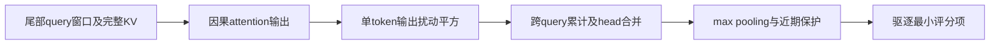
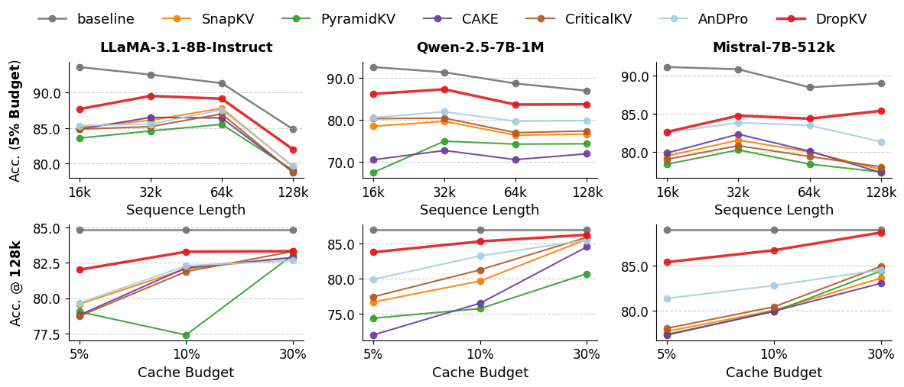

# DropKV：精确单项输出扰动评分组件

## 论文信息

| 字段 | 内容 |
| --- | --- |
| 论文链接 | [arXiv 2610.22130](https://arxiv.org/abs/2610.22130)；[v1 全文](https://arxiv.org/html/2610.22130v1) |
| 原文标题 | DropKV: Decoupling Residual-Output Perturbation for Near-Optimal KV-Cache Eviction |
| 公司/机构 | 一作 Aozhong Zhang：University at Albany, SUNY；其他作者含 IBM、Northwestern University |
| 首次公开日期 | 2026-10-15；`2026-10-15T16:05:17Z`，不是 10-16 公告日期 |
| 原文开源代码 | 是：[AozhongZhang/DropKV](https://github.com/AozhongZhang/DropKV)，Apache-2.0；也已接入 NVIDIA kvpress。本地按公式独立实现 |
| Adapter | `drop-kv`（目录键）；`adapter: null`，不是 reproduction CLI adapter |
| 本地复现代码目录 | `src/auto_research/foundation_models/drop_kv.py`；`scripts/run_oct17_foundation_components.py` |
| 实现状态 | `component_only`，L1 机制诊断；未接入 evolve |
| 完整实验 | 成本过高，不复现（审查 DONE）；`not_reproduced_high_cost` |

## 原始论文总结

### 背景与主要改动

只按 attention 权重淘汰 KV 会忽略 value 内容。DropKV 将组合驱逐近似为逐 token 输出扰动，跨观察窗口累加、池化，并保护近期 token。§3 与 Algorithm 1 定义评分；§4 的近似保证有条件，不能解释成任意输入上的全局最优。



<!-- paper-figure:start -->
### 原论文关键图

[](https://arxiv.org/html/2610.22130v1/Figures/ruler_results.png)

> **原论文 Figure 2（关键图）**：RULER 准确率随序列长度与 KV cache 预算的变化；这是原论文评测曲线，不是架构图或本地测量。图片来自[原论文](https://arxiv.org/abs/2610.22130)，版权归原作者所有；点击图片可查看来源。
<!-- paper-figure:end -->

### 核心公式

对 $p=\operatorname{softmax}(Kq/\sqrt d)$、$a=\sum_jp_jv_j$，移除单项后的变化为

$$
\Delta_j=\frac{p_j}{1-p_j}(a-v_j),\qquad s_j=\sum_{t\in\mathcal Q}\left\|\Delta_j^{(t)}\right\|_2^2.
$$

Algorithm 1 对评分做 MaxPool1D，并将末尾观察窗口评分置为正无穷，再取最小的驱逐项。GQA 的本地合同是同一物理 KV head 对应查询 head 的评分取均值。概率舍入成 1 时精确单项移除已奇异，本地拒绝，不用 epsilon 偷换公式。

### 论文离线与线上效果

RULER/LongBench 在相同 cache 预算比较；§5.4 的 A100-80GB 128K scoring 最高加速 19.8 倍是融合 Triton 对朴素参考的算子结果，不是完整生成加速。线上 A/B：未报告。本地不复现这些能力或吞吐数字。

## 本地复现

### 数据协议与运行

无数据集/模型下载。输入为固定种子 42/43/44 的合成 Q/K/V，revision `synthetic-formula-and-bit-patterns@oct17-foundation-components-v1`，不是能力 benchmark。每 seed：1 batch、4 query heads、2 KV heads、19 历史槽、3 query、8 维，驱逐 7 项；不接触训练/验证/测试答案。

```bash
PYTHONPATH=src python scripts/run_oct17_foundation_components.py \
  --papers drop-kv --device cpu --seeds 42,43,44 \
  --output runs/oct17-foundation/drop-kv-cpu.json
```

显式 `--device cuda` 使用同一参考算法，CUDA 不可用会失败，不静默回退。输出目录不可覆盖；导出的源码可用 `--code-commit` 绑定受控提交及逐文件 SHA-256。

### 结果与独立对照

CPU 定向测试通过，并已在真实 NVIDIA A100 上执行 seeds42/43/44。GPU seed42 与“实际删除每一项后重新 softmax”的独立参考最大误差 `5.55e-16`；Q/K/V 梯度有限且非零，近期窗口未被驱逐。attention-only 负对照与归一化扰动分数差 `0.26233`，用于证明不是原权重改名，不是能力提升。[CUDA 诊断记录](metrics/component-cuda-seeds42-44.json) 与[真实GPU回执](../../gpu-validations/drop-kv-a100-20261017.json) 保存设备、种子及源码身份。

### 代码映射与边界

`drop_kv_scores` 实现因果尾对齐、GQA、精确扰动、池化和保护；`DropKVResult` 返回物理 KV head 的评分/驱逐索引及查询 attention/output。测试在 `tests/foundation_models/test_oct17_foundation_components.py`，包含实际删除重算、pooling、梯度及奇异输入拒绝。

这是会物化中间张量的 Torch 数学参考，不是高效 Triton，也没有接入真实模型 cache、chunked generation 或服务。完整 7B/8B 多模型、4K–128K、多预算、多基准评估超出本轮单 A100/A30 的低成本范围，**成本过高，不复现（审查 DONE）**。`diagnostic_only: true`、`promotion_eligible: false`；不能由三个种子升级为模型能力证据。
