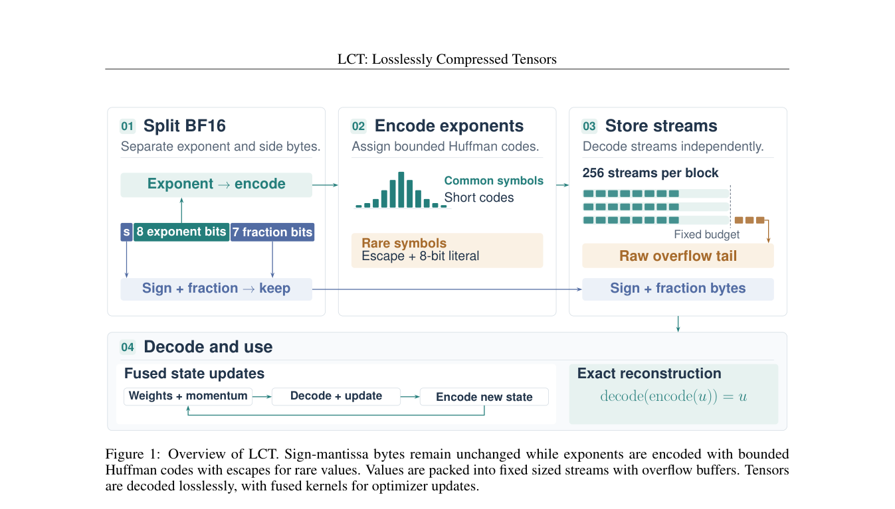

# LCT: Bounded Huffman exponent coding with a raw overflow tail

<!-- source-sha256: 234759a872291395c063a0caa8d0ae2a2361a507b914978e194255a8eebfff5d -->

[简体中文](README.md)

## Paper information

| Field | Details |
| --- | --- |
| Paper links | [arXiv 2610.22179](https://arxiv.org/abs/2610.22179); [v1 full text](https://arxiv.org/html/2610.22179v1) |
| Original title | LCT: Losslessly Compressed Tensors with GPU friendly execution for Training |
| Company / institution | First author Max Zhu: University of Cambridge; collaboration includes University of Oxford |
| First public release | 2026-10-15; `2026-10-15T16:34:35Z` |
| Author code | [Maxzhu123/Losslessly_Compressed_Tensors](https://github.com/Maxzhu123/Losslessly_Compressed_Tensors), MIT. Independent local implementation; the upstream Python 3.14 environment was not installed. |
| Adapter | Catalog key `lct`; `adapter: null` |
| Local implementation | `src/auto_research/foundation_models/lct.py`; `scripts/run_oct17_foundation_components.py` |
| Implementation status | `component_only`, L1 mechanism diagnostic, no Evolve |
| Full experiment | Reviewed and not reproduced because of cost; `not_reproduced_high_cost` |

## Paper summary

### Background and main changes

Floating-point exponents are often more compressible than sign and mantissa, but training repeatedly encodes them. LCT separates the two fields, precomputes short codes under a fixed model, adapts to magnitude via a runtime centering transform, and preserves raw exponents that overflow the round-robin stream budget. See Section 4 and Appendices B/C. Generic zlib is not a substitute.

~~~mermaid
flowchart LR
  A[Caller fixes exponent probability model] --> B[Package-Merge codebook with escape]
  C[Raw BF16 bits] --> D[Unchanged sign-fraction byte]
  C --> E[Centered exponent permutation]
  B --> F[Bounded prefix coding in round-robin streams]
  E --> F
  F --> G[Budgeted bytes and raw overflow tail]
  D --> H[Bitwise reconstruction]
  G --> H
~~~

<!-- paper-figure:start -->
### Original paper figure

> **Paper Figure 1:** Overall method and components. From the [original paper](https://arxiv.org/abs/2610.22179); copyright remains with the authors. Click the image to open its source.
<!-- paper-figure:end -->

### Core equation

BF16 splits into exponent $e$ and an unchanged sign–fraction byte. The fixed model $q$ evaluates all probability-tail cutoffs:

$$
C(D)=\sum_{t\in D}q_t\ell_t+q_{esc}(\ell_{esc}+8).
$$

Each candidate uses length-limited Package-Merge, with at most eight prefix bits. Escape is followed by the raw 8-bit symbol. Without escape, a 256-symbol code must use eight bits. After a stream exhausts its budget, remaining exponents go to the raw tail rather than being dropped. The center-zero special exponent and general center permutation preserve signed zero, subnormals, Inf, and NaN payloads bit for bit.

### Offline and online results reported in the paper

The paper compares tensor codecs and includes NanoGPT/FineWeb and Qwen3-4B. Training memory includes actual live allocation. NanoGPT memory falls about 24.6% while time rises about 7.2% in the author's complete implementation, not locally. No online A/B is reported.

## Local reproduction

### Data protocol and execution

No model or corpus downloads. Revision `synthetic-formula-and-bit-patterns@oct17-foundation-components-v1`, seeds 42/43/44. The first 256 of 512 public synthetic BF16 patterns cover all exponents, with varying sign/fraction bits. The fixed codebook is not fitted to test input. Sixteen streams with 32-bit budgets deliberately overflow; larger budgets and other centers check reconstruction.

~~~bash
PYTHONPATH=src python scripts/run_oct17_foundation_components.py \
  --papers lct --device cpu --seeds 42,43,44 \
  --output runs/oct17-foundation/lct-cpu.json
~~~

### Results and independent comparison

Targeted CPU tests and three real A100 seeds passed exponent/special-pattern round trips across centers and budgets. GPU seed 42 generates a 480-byte raw overflow tail. Against 1,024 dense bytes, the format uses 1,184 bytes for payload/stream metadata, 771 for the separate codebook, and 24 for the declared int32 serialized header: **1,979 bytes, an expansion**. This deliberately mismatched, tiny-budget control is not a compression success.

Tiny BF16 linear forward and both actual autograd gradients match dense. See [CUDA diagnostics](metrics/component-cuda-seeds42-44.json) and the [GPU receipt](../../gpu-validations/lct-a100-20261017.json) for device, seeds, and source. CPU codebook and Python header runtime object overhead are not GPU payload. Serialized bytes do not measure peak Python memory.

### Code mapping and limits

`build_codebook` uses fixed probabilities, all cutoffs, Package-Merge, and canonical codes. `compress_bf16` / `decompress_bf16` actually split, pack, decode, and restore bits. `lct_linear` restores the backward input from compressed state. Tests compare small-alphabet optimal lengths to exhaustive search and cover noncontiguous shapes, all exponents, overflow, and dense gradients.

Torch bit operations support CUDA, but codebook preprocessing is on CPU and stream decoding loops in Python with synchronous checks. **No fused Triton, asynchronous arena, or fused-optimizer throughput claim.** Diagnostics are bounded to 1–65,536 elements and the codec is not a general differentiable tensor operation.

The paper's 3,400-step NanoGPT run at about nine seconds per RTX3090 step implies roughly 8.5 hours per arm, plus 4B full-parameter tuning. **The full pipeline was reviewed and not reproduced because of cost.** No probe. `diagnostic_only: true`, `promotion_eligible: false`.
