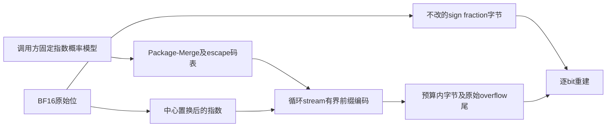
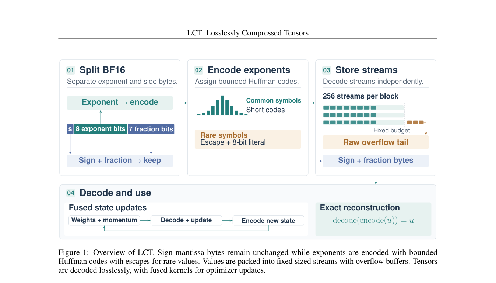

# LCT：有界 Huffman 指数编码与原始溢出尾

## 论文信息

| 字段 | 内容 |
| --- | --- |
| 论文链接 | [arXiv 2610.22179](https://arxiv.org/abs/2610.22179)；[v1 全文](https://arxiv.org/html/2610.22179v1) |
| 原文标题 | LCT: Losslessly Compressed Tensors with GPU friendly execution for Training |
| 公司/机构 | 一作 Max Zhu：University of Cambridge；协作含 University of Oxford |
| 首次公开日期 | 2026-10-15；`2026-10-15T16:34:35Z` |
| 原文开源代码 | 是：[Maxzhu123/Losslessly_Compressed_Tensors](https://github.com/Maxzhu123/Losslessly_Compressed_Tensors)，MIT；本地独立实现，不安装上游 Python3.14 环境 |
| Adapter | `lct`（目录键）；`adapter: null` |
| 本地复现代码目录 | `src/auto_research/foundation_models/lct.py`；`scripts/run_oct17_foundation_components.py` |
| 实现状态 | `component_only`、L1 机制诊断；不接入 evolve |
| 完整实验 | 成本过高，不复现（审查 DONE）；`not_reproduced_high_cost` |

## 原始论文总结

### 背景与主要改动

浮点指数往往比 sign/mantissa 更可压缩，但训练需要反复编码。LCT 将两部分分开，以固定模型预计算短码，运行时中心变换适应量级，循环 stream 在固定预算之外保留原始指数尾。主源 §4、Appendix B/C；不是用通用 zlib 压缩替代算法。



<!-- paper-figure:start -->
### 原论文关键图

[](https://arxiv.org/pdf/2610.22179#page=2)

> **原论文 Figure 1（关键图）**：展示原论文方法的总体设计和关键组成。图片来自[原论文](https://arxiv.org/abs/2610.22179)，版权归原作者所有；点击图片可查看来源。
<!-- paper-figure:end -->

### 核心公式

BF16 分为指数 $e$ 与不变的 sign–fraction byte。固定模型 $q$ 的码表对全部概率尾 cutoff 比较：

$$
C(D)=\sum_{t\in D}q_t\ell_t+q_{esc}(\ell_{esc}+8).
$$

每个候选采用 length-limited Package-Merge，prefix 最大 8 bits；escape 后跟原始 8-bit symbol。无 escape 时 256 符号码必为 8 bits。stream 预算超限后剩余项全部进入原始指数尾，而非丢弃低概率项。保留 center=0 的特殊指数与一般中心置换，可逐 bit 还原有符号零、subnormal、Inf 和 NaN payload。

### 论文离线与线上效果

原文包括 tensor codec 对照、NanoGPT/FineWeb 和 Qwen3-4B；训练内存统计包含实际 live allocation。其 NanoGPT 约 24.6% 的内存下降伴随约 7.2% 时间增长，属于完整作者实现，非本地结果。线上 A/B：未报告。

## 本地复现

### 数据协议与运行

不下载模型或语料。revision `synthetic-formula-and-bit-patterns@oct17-foundation-components-v1`，seeds42/43/44。使用公开定义的合成 BF16 位模式：512个元素中的前256个覆盖所有指数，另改变 sign/fraction；固定码表模型不是根据测试输入拟合。16 streams×32-bit预算故意产生 overflow；另以充足预算及其他中心检查还原。

```bash
PYTHONPATH=src python scripts/run_oct17_foundation_components.py \
  --papers lct --device cpu --seeds 42,43,44 \
  --output runs/oct17-foundation/lct-cpu.json
```

### 结果与独立对照

CPU定向测试通过，并已在真实 NVIDIA A100 上执行三个种子，验证所有指数/特殊位模式round-trip及不同中心/预算。GPU seed42产生480 bytes原始overflow尾；1024-byte dense输入，对照格式payload/stream metadata1184 bytes、独立码表771 bytes、声明的int32序列化header24 bytes，总1979 bytes，**反而膨胀**。这是刻意的分布失配/极小预算负例，不美化为压缩成功。

小型BF16 linear 的真实autograd前向和两路梯度与dense一致。[CUDA诊断记录](metrics/component-cuda-seeds42-44.json) 与[真实GPU回执](../../gpu-validations/lct-a100-20261017.json) 保存设备、种子与源码身份。CPU码表和Python header有额外运行时对象开销，不计作GPU payload；序列化计数不是Python内存峰值。

### 代码映射与边界

`build_codebook` 实现预计算概率模型、全部cutoff比较、Package-Merge和canonical码；`compress_bf16`/`decompress_bf16` 实际拆位、打包、解码与拼回，`lct_linear` 实际从压缩state恢复反向输入。测试将小字母表码长最优值与穷举比较，并覆盖非连续shape、全部指数、overflow和dense梯度。

本地张量位操作支持CUDA，但码表在CPU预计算，stream解码用Python循环，另有同步检查。**不是融合Triton、无异步arena、不支持fused optimizer吞吐声明**。只支持1..65536元素的有界诊断；不把压缩函数误当通用可微tensor。

原文3400步NanoGPT按RTX3090约9秒/步估算单臂约8.5小时，另有4B全参微调。完整链路**成本过高，不复现（审查 DONE）**，不启动探跑；`diagnostic_only: true`、`promotion_eligible: false`。
