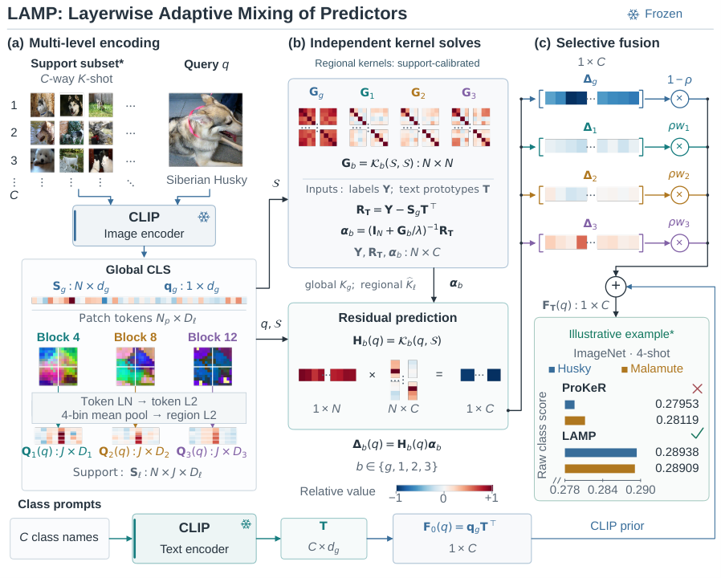

# LAMP: Kernel-residual fusion of native features from multiple layers

<!-- source-sha256: d1e744c8473f5a0b2c99dad659fb9d9ca3c51011ba9ee5fb97503eeb1f2a4ae5 -->

[简体中文](README.md)

## Paper information

| Field | Details |
| --- | --- |
| Paper links | [arXiv 2610.22182](https://arxiv.org/abs/2610.22182); [pinned v1 full text](https://arxiv.org/html/2610.22182v1) |
| Original title | LAMP: Layerwise Adaptive Mixing of Predictors for Training-Free Few-Shot Vision-Language Adaptation |
| Company / institution | First author Zhipeng Ye: Taizhou Institute of Science and Technology, Nanjing University of Science and Technology; collaboration with Xi'an Jiaotong-Liverpool University and University of Arizona |
| First public release | 2026-10-15 16:35:40 UTC. Backfilled from October 16 announcement, not first released October 19. |
| Author code | Abstract and full text list no code link. No verified repository or license found. |
| Local adapter / stable key | `lamp`; `adapter: null`, no reproduction CLI or Evolve operator |
| Local implementation | `src/auto_research/foundation_models/lamp.py`; `scripts/run_oct19_foundation_components.py` |
| Implementation status | `component_only`, L1 diagnostic; `diagnostic_only: true`, `promotion_eligible: false` |
| Full experiment | Reviewed and not reproduced because of cost; `not_reproduced_high_cost` |

## Paper summary

### Background and main changes

Intermediate layers of a frozen vision encoder contain information at different granularities, dimensions, and similarity structures. LAMP does not project them to a common width. It fits support-label residuals relative to a CLIP prior in each branch, then mixes class scores. Regional kernels calibrate only on the support bank. When LAMP-F adapts text prototypes, it also updates residual predictions so the support residuals do not go stale.

~~~mermaid
flowchart TD
  S[Labeled support set] --> F[Frozen global and three regional feature layers]
  F --> K[Support-only regional kernel calibration]
  S --> R[Shared label residual]
  K --> A[Independent solves for four branches]
  R --> A
  A --> V[Choose score mixture on validation]
  V --> P[Adapt prototypes with fixed kernels and mixture]
  P --> C[Exact cached-response update]
  C --> T[Final report on independent test]
~~~

<!-- paper-figure:start -->
### Original paper figure

> **Paper Figure 1:** Global and three native regional layers fit support-label residuals independently, then mix class scores. Examples are paper CLIP results, not local random-feature diagnostics. From the [original paper](https://arxiv.org/abs/2610.22182); copyright remains with the authors. Click the image to open its source.
<!-- paper-figure:end -->

### Core equations

Support residual is $R=Y-S_gT^\top$, and the global kernel is $k_\beta(a,b)=\exp[-\beta(1-a^\top b)]$. For ViT, apply parameter-free LN and L2 normalization per token, then mean pool $2\times2$ regions and L2-normalize them. For ResNet, use GeM ($p=3$) on nonnegative features.

Average all 4×4 regional similarities and normalize by self-similarity. Calibrate with support means $m(x)=N^{-1}\sum_iK(x,s_i)$ and $b=N^{-2}\sum_{ij}K(s_i,s_j)$:

$$
\widehat K(x,z)=\frac{K(x,z)-m(x)-m(z)+b}
 {\sqrt{\max(1-2m(x)+b,10^{-10})\max(1-2m(z)+b,10^{-10})}}.
$$

Solve $\alpha_b=(I+G_b/\lambda)^{-1}R$ independently. Mix $F_T=Q_gT^\top+\sum_b\pi_bH_b\alpha_b$ with $\pi=(1-\rho,\rho w_1,\rho w_2,\rho w_3)$. Choose $\rho,w$ only on validation.

LAMP-F uses $\Gamma=\operatorname{norm}(W)-T$ and caches

$$
E(Q)=\sum_b\pi_bH_b(I+G_b/\lambda)^{-1}S_g,\qquad
F_P=F_T+[Q_g-E(Q)]\Gamma^\top.
$$

The prototype objective uses each support image's multiview mean without another normalization, cross-entropy on logits multiplied by 100, and an anchor from $W$ to the text prototypes weighted by original support confidence. Encoder, kernels, and mixture are frozen.

### Offline and online results reported in the paper

At 16 shots over 11 datasets, LAMP with RN50 averages 78.73%; LAMP-F with ViT-B/16 and RN50 gives 83.57% and 79.10%. Some matched global-only comparisons are negative, so not every setup improves. No online A/B is reported. Author CLIP scores are not comparable to local random features.

## Local reproduction

### Data protocol and execution

Pinned recipe `synthetic-fpot-and-native-layer-kernel-features@oct19-foundation-mechanisms-v1`, seeds 42/43/44. A frozen three-layer MLP encodes 4×4 synthetic patches, with regional widths 5/7/9 and global width 6. The 12 support views, six validation examples, and five test examples are independently generated and have disjoint IDs. This is neither CLIP nor a public image benchmark.

~~~bash
PYTHONPATH=src python scripts/run_oct19_foundation_components.py \
  --papers lamp --device cpu --seeds 42,43,44 \
  --output runs/oct19-components/lamp-cpu.json
~~~

Support labels are for residuals and prototype training; validation labels only choose the mixture. Test labels are read for the final diagnostic after choices and one prototype update. `FeatureBatch` requires stable unique view IDs; callers must not rename different views of the same image across splits. Bandwidth and regularization are fixed, not the full paper search.

### Results and independent comparison

Three CPU seeds checked all-pair region kernels against scalars, linear solves against an independent inverse, and cached response after prototype update against a fresh solve. Prototype gradients and updates are nonzero while encoder parameters remain unchanged. Single-query and mixed-batch results agree, and regional permutation preserves the set kernel.

Updating only query priors while keeping stale support residuals is a negative control. `base_lamp_synthetic_test_accuracy` reports original LAMP with validation-selected mixing, **not accuracy after LAMP-F prototype adaptation**. Prototype adaptation is only for cached-versus-fresh checks. Synthetic validation and test values are preserved as data-flow diagnostics, not vision capability.

Real A100 seeds 42/43/44 passed at frozen commit `8c963f810e45ce3886e43b1b5da39980e41c95c0`. Maximum regional-kernel error is $2.080\times10^{-13}$, cached-versus-fresh error $7.495\times10^{-16}$. Mean prototype gradient norm 74.1338 (sample SD 6.6900), mean update 0.004243, and frozen encoder changes zero. CUDA chooses $\rho=0,1,0$ respectively, not the three all-zero CPU choices; fixed $\rho=0.5$ also checks every regional branch. Original LAMP synthetic test mean is 0.3333 (SD 0.1155), with five samples per seed, not a public benchmark or improvement result. See [A100 per-seed diagnostics](metrics/component-cuda-seeds42-44.json) and the [GPU receipt](../../gpu-validations/lamp-a100-20261019.json).

### Code mapping and limits

`vit_regions` and `resnet_regions` pool; `LampPredictor` freezes support statistics and solves branches. `select_mixture` does not accept test labels. `evaluate_test` only reports final scores and checks split identity. `CachedResponse` implements exact linear response. Tests cover cross-split identity conflicts, invalid mixtures, and freezing query features that already carry gradients.

The full protocol spans 11 datasets, five shot counts, three seeds, multiple CLIP backbones, and transfer datasets. The cumulative data caching, kernel, and search matrix is costly; it is not a claim that one CLIP cannot load on one GPU. **Reviewed and not reproduced because of cost.** No CLIP/ImageNet download, real recognition gain, or Evolve promotion.
