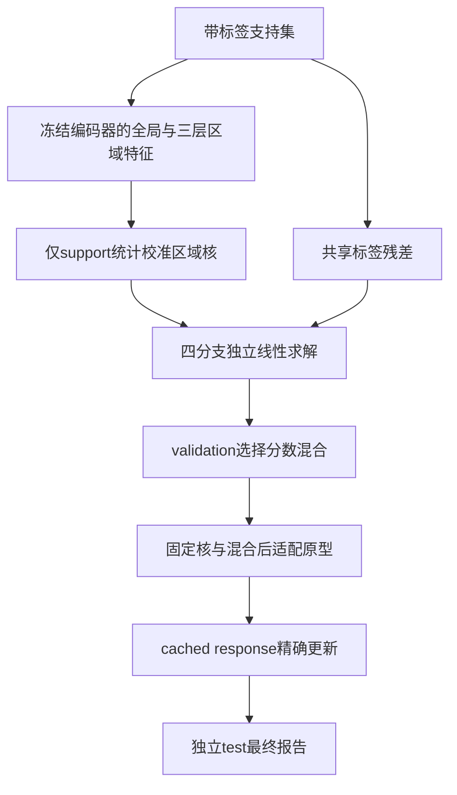
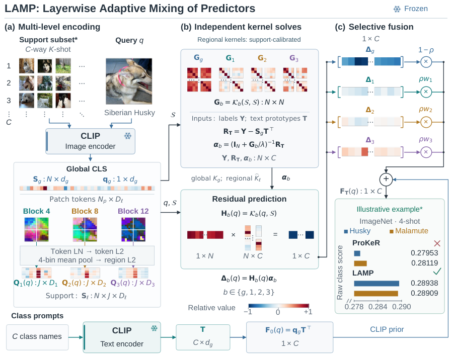

# LAMP：多层原生特征的核残差融合

## 论文信息

| 字段 | 内容 |
| --- | --- |
| 论文链接 | [arXiv 2610.22182](https://arxiv.org/abs/2610.22182)；[固定v1全文](https://arxiv.org/html/2610.22182v1) |
| 原文标题 | LAMP: Layerwise Adaptive Mixing of Predictors for Training-Free Few-Shot Vision-Language Adaptation |
| 公司 / 机构 | 一作Zhipeng Ye：Taizhou Institute of Science and Technology, Nanjing University of Science and Technology（南京理工大学泰州科技学院）；合作西交利物浦大学、University of Arizona |
| 首次公开日期 | 2026-10-15 16:35:40 UTC；10月16日公告的重叠补漏，不是10月19日首发 |
| 原作者代码 | 摘要和全文未列作者代码链接；本轮未找到可核验的作者源代码仓库或许可证 |
| 本地 adapter / 稳定键 | `lamp`（目录键）；`adapter: null`，未注册reproduction CLI/Evolve算子 |
| 本地复现代码目录 | `src/auto_research/foundation_models/lamp.py`；`scripts/run_oct19_foundation_components.py` |
| 实现状态 | `component_only`，L1机制诊断；`diagnostic_only: true`、`promotion_eligible: false` |
| 完整实验 | 成本过高，不复现（审查 DONE）；`not_reproduced_high_cost` |

## 原始论文总结

### 背景与主要改动

冻结视觉编码器的中间层包含不同粒度的信息，但维度和相似性结构不同。LAMP不将它们投影到统一特征维度，而是分别拟合支持标签相对CLIP先验的残差，再在类别分数空间混合。区域核只以support bank校准；LAMP-F适配文本原型时，同步更新残差预测，避免原型改变而支持残差仍陈旧。



<!-- paper-figure:start -->
### 原论文关键图

[](https://arxiv.org/html/2610.22182v1/method_figure.png)

> **原论文 Figure 1（关键图）**：全局及三层原生区域特征分别拟合支持标签残差，再在类别分数空间选择混合；图中示例为原文 CLIP 结果，不是本地随机特征诊断。图片来自[原论文](https://arxiv.org/abs/2610.22182)，版权归原作者所有；点击图片可查看来源。
<!-- paper-figure:end -->

### 核心公式

支持残差为 $R=Y-S_gT^\top$；全局核为 $k_\beta(a,b)=\exp[-\beta(1-a^\top b)]$。ViT区域特征先逐token做无参数LN和L2归一化，再2×2分区均值及区域L2归一化；ResNet对非负特征做GeM($p=3$)。

区域核先平均全部4×4区域对相似性并按自相似性归一化。使用支持集均值 $m(x)=N^{-1}\sum_iK(x,s_i)$、$b=N^{-2}\sum_{ij}K(s_i,s_j)$ 校准：

$$
\widehat K(x,z)=\frac{K(x,z)-m(x)-m(z)+b}
 {\sqrt{\max(1-2m(x)+b,10^{-10})\max(1-2m(z)+b,10^{-10})}}.
$$

每分支独立求解 $\alpha_b=(I+G_b/\lambda)^{-1}R$。混合为 $F_T=Q_gT^\top+\sum_b\pi_bH_b\alpha_b$，其中 $\pi=(1-\rho,\rho w_1,\rho w_2,\rho w_3)$；$\rho,w$只用validation选取。

LAMP-F令 $\Gamma=\operatorname{norm}(W)-T$，缓存

$$
E(Q)=\sum_b\pi_bH_b(I+G_b/\lambda)^{-1}S_g,\qquad
F_P=F_T+[Q_g-E(Q)]\Gamma^\top.
$$

原型目标使用每张支持图像的多视图均值（不再次归一化），优化100倍logit的交叉熵，并按原始support置信度把 $W$ 锚定到文本原型。编码器、核及混合权重冻结。

### 论文离线与线上效果

原文11数据集16-shot平均准确率：RN50上的LAMP为78.73%；LAMP-F在ViT-B/16和RN50分别为83.57%、79.10%。相对于匹配global-only基线的平均增益也有负例，并非每种配置均改善。线上A/B：未报告。上述为作者CLIP实验，不能与本地随机特征分数比较。

## 本地复现

### 数据协议与运行

固定recipe `synthetic-fpot-and-native-layer-kernel-features@oct19-foundation-mechanisms-v1`，seeds42/43/44。冻结三层小MLP编码4×4合成patch；三层区域宽度分别为5/7/9，全局宽度6。支持12视图、验证6样本、测试5样本具有不重叠身份，彼此独立生成；不是CLIP或公开图像benchmark。

```bash
PYTHONPATH=src python scripts/run_oct19_foundation_components.py \
  --papers lamp --device cpu --seeds 42,43,44 \
  --output runs/oct19-components/lamp-cpu.json
```

支持标签只用于残差和原型训练；验证标签只用于混合选择；测试标签在所有选择与一次原型更新完成后才用于最终诊断报告。`FeatureBatch`要求每视图稳定唯一身份，调用者不得把同一原图的不同视图重新命名后跨split使用。本轮bandwidth和regularization固定，不宣称复现论文完整超参搜索。

### 结果与独立对照

CPU三seed已执行：全区域对核与独立标量参考、线性求解与独立矩阵逆参考、原型更新后的cached response与重新求解一致。原型出现非零梯度/更新，冻结编码器参数不变；单查询与混合batch的结果一致，区域顺序置换不改变set kernel。

负对照只更新query先验却沿用旧support残差，确认与正确更新存在差异。`base_lamp_synthetic_test_accuracy`只报告validation所选混合的原始LAMP结果，**不是更新原型后的LAMP-F准确率**；原型更新仅用于上述cached-vs-fresh算子诊断。合成验证/测试分数均按实际值保存，仅为数据流诊断，不视为视觉能力证据。

真实单张NVIDIA A100上seeds42/43/44已通过，执行冻结commit为`8c963f810e45ce3886e43b1b5da39980e41c95c0`。区域核参考最大误差为$2.080\times10^{-13}$，cached-vs-fresh最大误差为$7.495\times10^{-16}$；原型梯度范数均值74.1338（样本标准差6.6900），实际更新范数均值0.004243，冻结编码器参数变化均为0。该CUDA运行的混合选择依seed42/43/44分别为$\rho=0,1,0$，不能套用CPU三seed都选0的记录；另以固定$\rho=0.5$验证所有区域分支。原始LAMP合成test分数均值为0.3333（标准差0.1155），每seed仅5样本，不是公开视觉benchmark或提升证据。见[实际A100逐seed诊断指标](metrics/component-cuda-seeds42-44.json)与[真实GPU验收回执](../../gpu-validations/lamp-a100-20261019.json)。

### 代码映射与边界

`vit_regions`/`resnet_regions`实现池化，`LampPredictor`冻结support统计并求解分支，`select_mixture`不接收test标签，`evaluate_test`只报告最终分数且检查split身份，`CachedResponse`实现精确线性响应。测试覆盖跨split身份冲突、无效混合和有梯度query特征仍被冻结的边界。

完整论文协议跨11数据集、5档shot、3seed及多个CLIP backbone和迁移数据集；对本轮而言属于数据缓存、核矩阵和搜索矩阵的累计成本，而非声称单个CLIP无法在单卡加载。**完整实验成本过高，不复现（审查 DONE）**。没有下载CLIP/ImageNet，不宣称真实识别增益，也不接入Evolve晋级。
