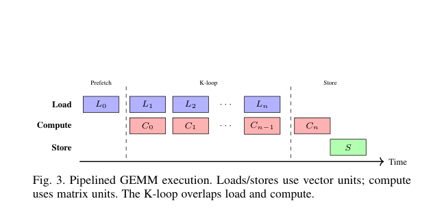

# Meta and AMD: End-to-end co-design for hardware diversity

<!-- source-sha256: dd3fe2e8cc13798840ac0e918c08b67897de5bde728232c8488132d8d386e8ae -->

[简体中文](README.md)

> **Research reference only. Reviewed and not reproduced because of cost and hardware mismatch.** No production-model download, cluster training, executable adapter, or Evolve integration. All results below are from the paper, not local GPU measurements.

## Paper information

| Field | Details |
| --- | --- |
| Paper links | [arXiv 2610.22230](https://arxiv.org/abs/2610.22230); [pinned v1 full text](https://arxiv.org/html/2610.22230v1) |
| Companies | Meta and AMD |
| First-author affiliation | Meta (Haoyu Zhang) |
| First public release | 2026-10-15 17:09:08 UTC (arXiv v1; announced October 16) |
| Author code | The paper says changes were upstreamed to [PyTorch](https://github.com/pytorch/pytorch), [Triton](https://github.com/triton-lang/triton), and [ROCm](https://github.com/ROCm). No separate complete reproduction repository found. Those projects are not in their entirety this paper's source. |
| Local adapter / stable key | `hardware-diversity`, reference only, no executable adapter |
| Local implementation | None. [Catalog metadata](https://github.com/daiwk/auto-research/blob/main/src/auto_research/paper_specs/catalog/foundation-models/hardware-diversity.json) and this page only, not runnable code. |
| Review status | Review complete, full experiment not reproduced; no local training metrics or GPU receipt |

## Paper summary

### Background and main changes

Translating a CUDA program to HIP does not equalize performance across hardware. Using recommendation training as its case, the paper jointly changes the model, parallelism, and memory policy, uses an analytical model to choose GEMM configurations, and uses agents for compilation, debugging, and kernel porting. This is systems research, not one new recommender model.

### Architecture and data flow

~~~mermaid
flowchart TD
  W[Production workload and matrix shapes] --> H[Hardware capacity and topology]
  H --> C[Model, memory, and parallelism co-design]
  H --> O[Origami analytical kernel selection]
  H --> A[Agent-assisted porting and optimization]
  C --> E[End-to-end checks with matched batch and device count]
  O --> E
  A --> E
  E --> U[Upstream changes and production deployment]
~~~

<!-- paper-figure:start -->
### Original paper figure

> **Paper Figure 3:** Overall pipeline, main stages, and data flow. From the [original paper](https://arxiv.org/abs/2610.22230); copyright remains with the authors. Click the image to open its source.
<!-- paper-figure:end -->

### Core equation

Section III-B estimates compute and hierarchical memory cycles for each tile, accounting for pipelining and tail idle time:

$$
L_{\rm tile}=L_{\rm prefetch}+\lceil K/K_T\rceil\max(L_{\rm compute},L_{\rm mem})+L_{\rm store},
\quad L_{\rm total}=\left\lceil T_{\rm out}/N_{\rm CU}\right\rceil L_{\rm tile}.
$$

This is an analytical selection model, not a reason to reuse AMD hardware constants on A100 and expect the same performance.

### Offline and online results reported in the paper

Section VI-A compares ten production training workloads on 8–128 GPUs. It reports training throughput and system co-design gains but **no online A/B user outcomes**. Production training deployment does not establish online recommendation improvement, and is not comparable to a local single-card diagnostic.

## Local reproduction

Only metadata, paper, and cost review were completed. The original setup depends on MI350X/B200 clusters and private workloads, which one A100 **or** A30 cannot reproduce equivalently. No downloads, performance probes, full training, local scores, metric JSON, or fabricated receipts.

## Reproduction limits

**Reviewed and not reproduced because of cost.** Not an automatic retry TODO or implemented algorithm. The reference does not block other work or the watermark. A future explicit request for a public operator would need a new scope, hardware, and validation contract, not a claim of full production-system reproduction.

See the [12-component batch acceptance notes](../../research-audits/oct17-components/README.md).
