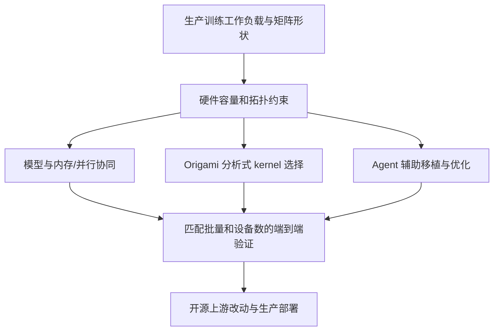
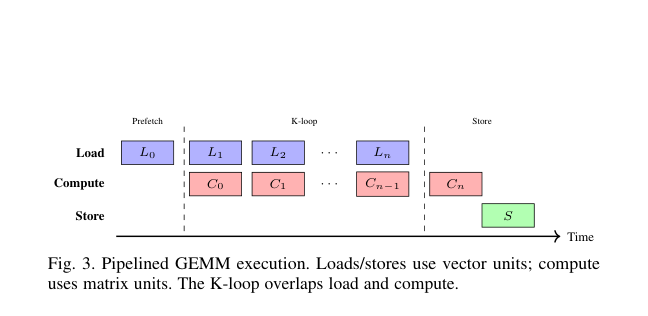

# Meta/AMD：面向硬件多样性的端到端协同设计

> **研究资料；成本过高且硬件不匹配，不复现（审查 DONE）。** 不下载生产模型、不尝试集群训练，不注册可执行 adapter，不接入 Evolve；下文结果均来自论文，不是本地 GPU 测量。

## 论文信息

| 字段 | 内容 |
| --- | --- |
| 论文链接 | [arXiv 2610.22230](https://arxiv.org/abs/2610.22230)；[固定 v1 全文](https://arxiv.org/html/2610.22230v1) |
| 公司 / 机构 | Meta / AMD |
| 一作所属机构 | Meta（Haoyu Zhang） |
| 首次公开日期 | 2026-10-15 17:09:08 UTC（arXiv v1；10-16 公告） |
| 原作者代码 | 论文称改动已上游至 [PyTorch](https://github.com/pytorch/pytorch)、[Triton](https://github.com/triton-lang/triton) 与 [ROCm](https://github.com/ROCm)；未找到独立整套复现仓库，不把相关项目全部称为本文源码 |
| 本地 adapter / 稳定键 | `hardware-diversity`（仅资料键；无可执行 adapter） |
| 本地复现代码 | **无算法实现**；仅有 [catalog 元数据](https://github.com/daiwk/auto-research/blob/main/src/auto_research/paper_specs/catalog/foundation-models/hardware-diversity.json)与本文，不是运行代码 |
| 验收状态 | 审查 DONE / 完整实验不复现；无本地训练指标或 GPU 通过回执 |

## 原始论文总结

### 背景与主要改动

CUDA 程序能够转换为 HIP，不代表跨硬件性能相同。本文以推荐训练为案例，联合修改模型/并行与内存策略，用分析模型选择 GEMM 配置，并用 Agent 辅助编译、调试和内核移植；它是系统研究报告，而非单一新推荐模型。

### 架构与数据流

<!-- paper-figure:start -->
### 原论文关键图

> **原论文 Figure 3（关键图）**：展示原论文的整体流程、关键阶段及其数据流向。图片来自[原论文](https://arxiv.org/abs/2610.22230)，版权归原作者所有；点击图片可查看来源。
<!-- paper-figure:end -->

### 核心公式

原文 §III-B 对每个 tile 配置估计计算与分层内存周期，并考虑流水线及尾部空转：

$$
L_{\rm tile}=L_{\rm prefetch}+\lceil K/K_T\rceil\max(L_{\rm compute},L_{\rm mem})+L_{\rm store},
\quad L_{\rm total}=\left\lceil T_{\rm out}/N_{\rm CU}\right\rceil L_{\rm tile}.
$$

这是分析选型模型，不代表可把 AMD 的硬件常数直接套到 A100 并取得同样性能。

### 论文离线与线上效果

§VI-A 比较十种生产训练工作负载，规模为 8–128 GPU。它报告训练吞吐及系统协同收益，**没有提供线上 A/B 用户效果**；不能由生产训练部署推导线上推荐指标提升，也不能与本地单卡诊断混为同一口径。

## 本地复现

本轮仅完成元数据、正文与成本审查。原配置依赖 MI350X/B200 集群和私有工作负载，现有一张 A100 **或** A30 无法等价复现；不启动下载、性能探跑或完整训练。没有本地实验分数，也不制造 metrics JSON 或成功回执。

## 复现边界

状态为 **成本过高，不复现（审查 DONE）**，不是待自动重试 TODO，也不是算法已实现。资料收录不阻塞其他组件或审查水位；若以后明确要求实现某个公开算子，应重新界定该算子、硬件和验证合同，不冒充完整生产系统复现。

本批范围见[十二组件验收说明](../../research-audits/oct17-components/README.md)。
