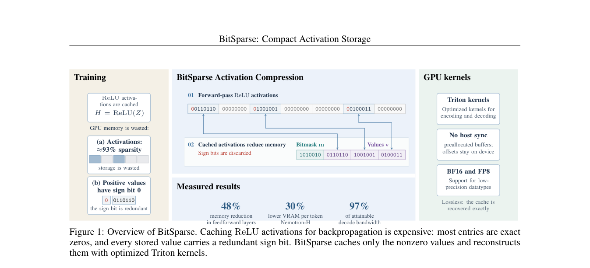

# BitSparse: Lossless tiled activation storage with real backpropagation

<!-- source-sha256: 59b4355c7c270c0ff96b4caf83cc1c24acd08fc35ca98e4ce4b213729921ad47 -->

[简体中文](README.md)

## Paper information

| Field | Details |
| --- | --- |
| Paper links | [arXiv 2610.22256](https://arxiv.org/abs/2610.22256); [v1 full text](https://arxiv.org/html/2610.22256v1) |
| Original title | BitSparse: Compact Activation Storage for ReLU Feed-Forward Networks |
| Company / institution | First author Max Zhu: University of Cambridge; collaboration includes University of Oxford |
| First public release | 2026-10-15; `2026-10-15T17:24:51Z` |
| Author code | [Maxzhu123/Bitmask_Sparsity](https://github.com/Maxzhu123/Bitmask_Sparsity) is public to read. The license is unverified; copying is not assumed permissible. No upstream code is vendored. |
| Adapter | Catalog key `bit-sparse`; `adapter: null` |
| Local implementation | `src/auto_research/foundation_models/bit_sparse.py`; `scripts/run_oct17_foundation_components.py` |
| Implementation status | `component_only`, L1 mechanism diagnostic, no Evolve |
| Full experiment | Reviewed and not reproduced because of cost; `not_reproduced_high_cost` |

## Paper summary

### Background and main changes

ReLU-family activations already have many exact zeros. BitSparse stores bitmasks, positive values, and tile prefixes and reconstructs them losslessly in backward, rather than trading lossy quantization or extra forward passes for space. Section 3 defines the format; Eqs. 1–2 and Appendix C specify ReLU/ReLU² linear backward.

~~~mermaid
flowchart LR
  A[Input Z] --> B[Positive activations H]
  B --> C[Tile bitmask and compact positive values]
  B --> D[Linear forward after ReLU or squaring]
  C --> E[Reconstruct H exactly for backward]
  E --> F[Input and weight gradients]
~~~

<!-- paper-figure:start -->
### Original paper figure

> **Paper Figure 1:** Overall method and main components. From the [original paper](https://arxiv.org/abs/2610.22256); copyright remains with the authors. Click the image to open its source.
<!-- paper-figure:end -->

### Core equations

Each tile stores $m_t=\mathbf1[H_t>0]$, the positive-value sequence $v_t$, and prefix $p_t=\sum_{q<t}\|H_q\|_0$. The mask packs one bit per position, not a one-byte Boolean per element. For $H=\operatorname{ReLU}(Z),Y=H^2W^T$:

$$
\nabla_WL=G^TH^2,\qquad\nabla_ZL=2(GW)\odot H.
$$

Unsquared ReLU uses the positive mask in backward. Zeros reconstruct as positive zero; the local codec rejects negative zero, negative values, and nonfinite activations. The autograd forward normalizes zero signs.

### Offline and online results reported in the paper

The paper compares dense storage, activation checkpointing, CSR, nvCOMP, and lossy CompAct with NanoGPT and Nemotron-H. Section 6 time and memory come from the authors' Triton implementation, not the local reference. The two training approaches have similar final validation loss after 3,350 steps. No online A/B is reported.

## Local reproduction

### Data protocol and execution

No model or data download. Three-seed synthetic revision `synthetic-formula-and-bit-patterns@oct17-foundation-components-v1`. A 33×37 BF16 activation tests tile format with padding; 9×13 double inputs and 7×13 weights test against independent dense forward/backward. Tile size 8 is a deliberately small format check, not the paper's default tile 64 performance setup.

~~~bash
PYTHONPATH=src python scripts/run_oct17_foundation_components.py \
  --papers bit-sparse --device cpu --seeds 42,43,44 \
  --output runs/oct17-foundation/bit-sparse-cpu.json
~~~

### Results and independent comparison

Targeted CPU tests and three real A100 seeds passed. GPU seed 42 BF16 matches bit for bit; maximum forward/backward errors are zero. Activation sparsity is about `0.8288`. Dense takes 2,442 bytes and the mask/prefix/value format 718 bytes. This is storage for one synthetic input, not total training memory. See [CUDA diagnostics](metrics/component-cuda-seeds42-44.json) and the [GPU receipt](../../gpu-validations/bit-sparse-a100-20261017.json) for device, seeds, and source identity.

### Code mapping and limits

`pack_activation` and `unpack_activation` implement tile ordering, byte masks, 32-bit prefixes, and edge padding. `sparse_activation_linear` caches only compressed activations and weights in custom autograd, actually reconstructing on backward. Tests include double gradcheck. Numeric reference support covers BF16 and float32/64, not FP8 or sign-bit packing.

This is not the high-performance GPU kernel: compacted shapes and checks synchronize, with no shared asynchronous arena, fused GEMM, or allocator. From the paper's RTX3090 7.4–7.7 seconds × 3,350 steps, one arm is about seven hours. **Reviewed and not reproduced because of cost.** That estimate is not an A100 measurement. A100/A30 BF16 checks do not establish native FP8 support. `diagnostic_only: true`, `promotion_eligible: false`.
