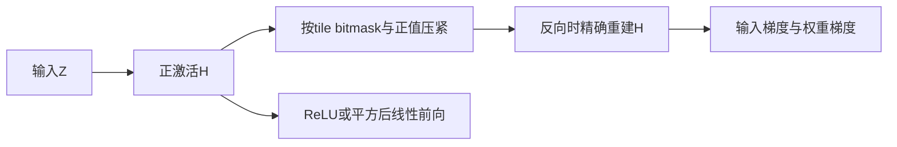
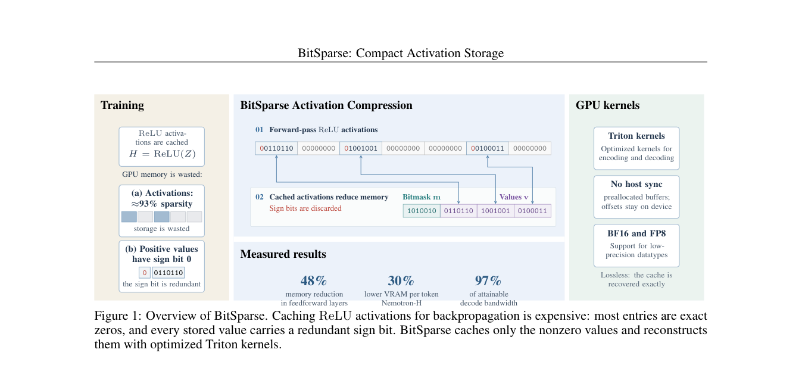

# BitSparse：按 tile 无损保存激活与真实反向传播

## 论文信息

| 字段 | 内容 |
| --- | --- |
| 论文链接 | [arXiv 2610.22256](https://arxiv.org/abs/2610.22256)；[v1 全文](https://arxiv.org/html/2610.22256v1) |
| 原文标题 | BitSparse: Compact Activation Storage for ReLU Feed-Forward Networks |
| 公司/机构 | 一作 Max Zhu：University of Cambridge；协作含 University of Oxford |
| 首次公开日期 | 2026-10-15；`2026-10-15T17:24:51Z` |
| 原文开源代码 | [Maxzhu123/Bitmask_Sparsity](https://github.com/Maxzhu123/Bitmask_Sparsity) 公开可读；许可证未确认，不默认可复制。本地不 vendor 上游 |
| Adapter | `bit-sparse`（目录键）；`adapter: null` |
| 本地复现代码目录 | `src/auto_research/foundation_models/bit_sparse.py`；`scripts/run_oct17_foundation_components.py` |
| 实现状态 | `component_only`、L1 机制诊断；不接入 evolve |
| 完整实验 | 成本过高，不复现（审查 DONE）；`not_reproduced_high_cost` |

## 原始论文总结

### 背景与主要改动

ReLU 家族已有大量精确零；BitSparse 保存 bitmask、正值和 tile prefix，在反向时无损重建，避免靠有损量化或额外前向换空间。§3 定义格式，公式 1–2 与 Appendix C 定义 ReLU/ReLU² 线性层反向。



<!-- paper-figure:start -->
### 原论文关键图

[](https://arxiv.org/pdf/2610.22256#page=2)

> **原论文 Figure 1（关键图）**：展示原论文方法的总体设计和关键组成。图片来自[原论文](https://arxiv.org/abs/2610.22256)，版权归原作者所有；点击图片可查看来源。
<!-- paper-figure:end -->

### 核心公式

每 tile 保存 $m_t=\mathbf1[H_t>0]$、正值序列 $v_t$ 和前缀 $p_t=\sum_{q<t}\|H_q\|_0$；mask 按每位置 1 bit 打包，不是 bool 每元素 1 byte。对 $H=\operatorname{ReLU}(Z),Y=H^2W^T$，

$$
\nabla_WL=G^TH^2,\qquad\nabla_ZL=2(GW)\odot H.
$$

ReLU 一次方的反向使用正值 mask。论文零值重建为正零；本地 codec 拒绝负零、负值和非有限激活，autograd 前向显式规范化零符号。

### 论文离线与线上效果

原文比较 dense、activation checkpoint、CSR、nvCOMP 与有损 CompAct，包含 NanoGPT 和 Nemotron-H；§6 的内存/时间来自作者 Triton 实现，不能移植为本地参考收益。完整训练 3350 步，两种方案最终 validation loss 接近。线上 A/B：未报告。

## 本地复现

### 数据协议与运行

无模型或数据下载。三个 seed 的合成输入 revision 为 `synthetic-formula-and-bit-patterns@oct17-foundation-components-v1`。BF16 33×37 激活检验含 padding 的 tile 格式；另以双精度 9×13 输入、7×13 权重做独立 dense 前向/反向参考。tile 8 是有意缩小的格式验收，不是原文默认 tile64 的性能测试。

```bash
PYTHONPATH=src python scripts/run_oct17_foundation_components.py \
  --papers bit-sparse --device cpu --seeds 42,43,44 \
  --output runs/oct17-foundation/bit-sparse-cpu.json
```

### 结果与独立对照

CPU 定向测试通过，并已在真实 NVIDIA A100 上执行三个种子。GPU seed42 BF16 逐 bit 一致，forward/backward 最大误差均为0；激活稀疏率约 `0.8288`，dense2442 bytes，对照格式包含mask/prefix/value共718 bytes。这是该合成输入的格式占用，不是总训练显存下降。[CUDA诊断记录](metrics/component-cuda-seeds42-44.json) 与[真实GPU回执](../../gpu-validations/bit-sparse-a100-20261017.json) 保存设备、种子及执行源码身份。

### 代码映射与边界

`pack_activation`/`unpack_activation` 实现 tile-order、字节 mask、32位 prefix 与边缘 padding；`sparse_activation_linear` 在自定义 autograd 中只缓存压缩激活和权重，实际反向重建，测试另含 double gradcheck。支持 BF16、float32/64 数值格式参考，不支持 FP8 或 sign-bit packing。

这不是论文的 GPU 高性能 kernel：压紧 shape 和检查会同步，未实现 shared asynchronous arena、fused GEMM 或 allocator。按原文 RTX3090 约 7.4–7.7秒/步×3350 步推算单臂约 7小时，**成本过高，不复现（审查 DONE）**；这是原文硬件估算，不是 A100 实测。A100/A30 的 BF16 验收不证明原生 FP8 支持。`diagnostic_only: true`、`promotion_eligible: false`。
