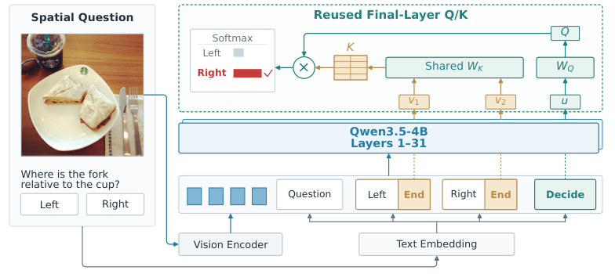

# MJev-Spatial: Reading candidates with native attention

<!-- source-sha256: 1f15f3a42bde2dbe68cfcf97e6e198477415bbe7cc0402669bb3c59425a3bf17 -->

[简体中文](README.md)

## Paper information

| Field | Details |
| --- | --- |
| Paper links | [arXiv 2610.22276](https://arxiv.org/abs/2610.22276); [v1 full text](https://arxiv.org/html/2610.22276v1) |
| Original title | MJev-Spatial: System One Spatial Intelligence via Native Attention Matching |
| Company / institution | The paper and PDF front page do not list first author Luozheng Qin's affiliation. MindLab publishes the checkpoint; other authors' contact addresses do not establish the first author's affiliation. |
| First public release | 2026-10-15; `2026-10-15T17:37:50Z` |
| Author code | [Author repository](https://github.com/Fr0zenCrane/MJev-Spatial), Apache-2.0; the [4B checkpoint](https://huggingface.co/mindlab-research/MJev-Spatial-4B) was not downloaded. |
| Adapter | Catalog key `mjev-spatial`; `adapter: null`, no reproduction CLI or Evolve operator |
| Local implementation | `src/auto_research/foundation_models/mjev_spatial.py`; `scripts/run_oct18_foundation_components.py` |
| Implementation status | `component_only`, L1 mechanism diagnostic; `diagnostic_only: true`, `promotion_eligible: false` |
| Full experiment | Reviewed and not reproduced because of cost; `not_reproduced_high_cost` |

## Paper summary

### Background and main changes

A spatial question may need only a choice, number, or 2D point, yet VLMs still generate and parse text. MJev-Spatial unifies them as candidate classification. The decision marker supplies the query, and candidate-end markers supply keys using the backbone's native final attention projections. Continuous values use bins or three-stage regional refinement, without a separate classification head.

~~~mermaid
flowchart LR
  I[Image, question, and candidates] --> B[Causal backbone contextualization]
  B --> Q[Native Decide query]
  B --> K[Native End keys]
  Q --> S[GQA dot products and candidate softmax]
  K --> S
  S --> N[Decode number or crop original image]
  N --> I
~~~

<!-- paper-figure:start -->
### Original paper figure

> **Paper Figure 3:** Architecture, major modules, and connections. From the [original paper](https://arxiv.org/abs/2610.22276); copyright remains with the authors. Click the image to open its source.
<!-- paper-figure:end -->

### Core equations

After input/head normalization and RoPE, average native matching scores over query heads:

$$
z_i=\frac1H\sum_{h=0}^{H-1}\frac{Q_h^TK_{i,g(h)}}{\sqrt d},\quad g(h)=\lfloor h/(H/G)\rfloor.
$$

Average stage cross-entropy within each original question so multi-stage problems do not get extra weight:

$$
L=\frac1N\sum_q\frac1{S_q}\sum_t-\log p(a^*_{q,t}).
$$

Counting uses $n=32a_1+a_2$ for 0–1023. Point prediction chooses a $3\times3$ region three times, always cropping the original image rather than the previous resized crop.

### Offline and online results reported in the paper

The mean over 12 spatial benchmarks is 65.64 versus 54.80 for original Qwen3.5-4B. The paper reports 5.6× inference speedup over that base. These depend on the author's data, model, and timing protocol, not a local small-operator result. No online A/B is reported.

## Local reproduction

### Data protocol and execution

Seeds 42/43/44; pinned synthetic revision `synthetic-memory-spatial-vision-recurrence-and-ode@oct18-foundation-mechanisms-v1`. A randomly initialized width-16 causal Transformer produces candidate and decision states. Final-layer Q/K, RMSNorm, and head normalization are injected as the same module objects. No Qwen checkpoint is loaded or converted.

~~~bash
PYTHONPATH=src python scripts/run_oct18_foundation_components.py \
  --papers mjev-spatial --device cpu --seeds 42,43,44 \
  --output runs/oct18-components/mjev-spatial-cpu.json
~~~

Output is not overwritten. Unavailable CUDA errors instead of masquerading as a GPU pass.

### Results and independent comparison

CPU checks cover independent per-head dot products, deliberately wrong GQA grouping, stage-loss averaging, 1,024 count round trips, length-bin quantization bounds, and three-level original-image cropping. Parameter identity proves that injection does not copy objects; a real SGD update also changes the source Q projection. Random labels are gradient diagnostics, not spatial accuracy.

Real A100 seeds 42/43/44 passed. Maximum independent GQA error is below $1.12\times10^{-16}$, stage-mean loss error and 1,024 count round-trip errors are zero, Q gradient norm is at least 1.341, and SGD update norm is at least 0.01341. Wrong GQA grouping gives error 0.6682–0.8929. See [per-seed diagnostics](metrics/component-cuda-seeds42-44.json) and the [GPU receipt](../../gpu-validations/mjev-spatial-a100-20261018.json). This is L1 evidence, not a reproduction of 65.64 or the speedup.

### Code mapping and limits

`NativeSpatialReadout` accepts explicit final-layer projections; `stage_normalized_loss` keeps equal question weight. `length_codebook`, count encoding, and `refine_region` / `crop_original` provide controller interfaces. No automatic Qwen3.5 conversion, real vision encoder, joint teacher-forced packing, multi-point search, or full benchmark driver.

The paper fully trains 4B language parameters on 12.3M QA pairs across eight GPUs. **The full experiment was reviewed and not reproduced because of cost** and is not eligible for Evolve promotion.
