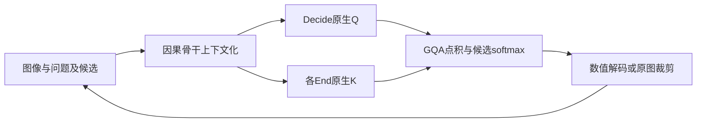
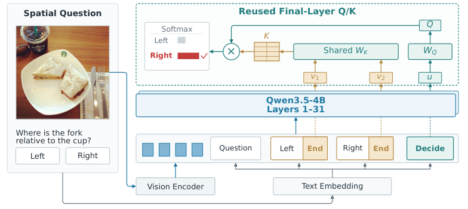

# MJev-Spatial：原生注意力候选读出

## 论文信息

| 字段 | 内容 |
| --- | --- |
| 论文链接 | [arXiv 2610.22276](https://arxiv.org/abs/2610.22276)；[v1 全文](https://arxiv.org/html/2610.22276v1) |
| 原文标题 | MJev-Spatial: System One Spatial Intelligence via Native Attention Matching |
| 公司/机构 | 论文正文与首页 PDF 未列一作 Luozheng Qin 的机构；公开 checkpoint 发布主体为 MindLab，不能据其他作者通讯邮箱推断一作所属 |
| 首次公开日期 | 2026-10-15；`2026-10-15T17:37:50Z` |
| 原文开源代码 | [原作者仓库](https://github.com/Fr0zenCrane/MJev-Spatial)，Apache-2.0；[4B checkpoint](https://huggingface.co/mindlab-research/MJev-Spatial-4B) 本轮不下载 |
| Adapter | `mjev-spatial`（目录键）；`adapter: null`，未注册 reproduction CLI/evolve operator |
| 本地复现代码目录 | `src/auto_research/foundation_models/mjev_spatial.py`；`scripts/run_oct18_foundation_components.py` |
| 实现状态 | `component_only`；L1 机制诊断；`diagnostic_only: true`、`promotion_eligible: false` |
| 完整实验 | 成本过高，不复现（审查 DONE）；`not_reproduced_high_cost` |

## 原始论文总结

### 背景与主要改动

空间问题往往只需选项、数值或二维点，却仍让 VLM 自回归生成并解析答案。MJev-Spatial 将三者统一为候选分类：decision marker 提供 query，candidate-end marker 提供 key，直接复用骨干最终注意力投影。连续量通过分桶或三级区域细化预测，不增加独立分类头。



<!-- paper-figure:start -->
### 原论文关键图

[](https://arxiv.org/html/2610.22276v1/jev_spatial_architecture.png)

> **原论文 Figure 3（关键图）**：展示原论文提出的核心架构、主要模块及其连接关系。图片来自[原论文](https://arxiv.org/abs/2610.22276)，版权归原作者所有；点击图片可查看来源。
<!-- paper-figure:end -->

### 核心公式

保留输入/head normalization 与 RoPE 后，对 query heads 平均原生匹配分数：

$$
z_i=\frac1H\sum_{h=0}^{H-1}\frac{Q_h^TK_{i,g(h)}}{\sqrt d},\quad g(h)=\lfloor h/(H/G)\rfloor.
$$

训练按原始问题平均阶段交叉熵，而非把多阶段问题重复加权：

$$
L=\frac1N\sum_q\frac1{S_q}\sum_t-\log p(a^*_{q,t}).
$$

计数为 $n=32a_1+a_2$，覆盖0–1023。点预测连续三次选择 $3\times3$ 区域，每次从原图裁剪，不从上次缩放图继续裁剪。

### 论文离线与线上效果

12项空间 benchmark 的平均分为65.64，原始 Qwen3.5-4B 为54.80；原文报告相对该基模5.6倍推理加速。这是作者特定数据、模型与计时协议的结果，不是本地小算子结果。线上 A/B：未报告。

## 本地复现

### 数据协议与运行

seeds42/43/44，固定程序化 revision `synthetic-memory-spatial-vision-recurrence-and-ode@oct18-foundation-mechanisms-v1`。随机16维因果 Transformer 产生候选/决策状态，最终层 Q/K、RMSNorm 和 headnorm 以同一模块对象注入读出器；不是加载或转换真实 Qwen checkpoint。

```bash
PYTHONPATH=src python scripts/run_oct18_foundation_components.py \
  --papers mjev-spatial --device cpu --seeds 42,43,44 \
  --output runs/oct18-components/mjev-spatial-cpu.json
```

输出不可覆盖；CUDA 不可用时报错，不伪装为 GPU 通过。

### 结果与独立对照

CPU 已核对逐 head 点积独立公式、故意错误 GQA 分组负对照、阶段损失平均、1024个计数往返、长度分桶量化界和原图三级裁剪。参数 identity 测试验证注入对象未复制，真实 SGD 更新同时反映到来源层 Q 投影。随机分类标签只是梯度诊断，不是空间任务准确率。

真实 NVIDIA A100 上 seeds42/43/44 全部通过：原生GQA独立公式最大误差低于 $1.12\times10^{-16}$，阶段平均损失误差和1024个计数往返错误均为0。Q投影梯度范数至少1.341、SGD更新范数至少0.01341；错误GQA分组负对照产生0.6682–0.8929误差。完整逐 seed 数据见[诊断指标](metrics/component-cuda-seeds42-44.json)和[GPU 回执](../../gpu-validations/mjev-spatial-a100-20261018.json)。这些是 L1 算子证据，不代表复现65.64分或推理加速。

### 代码映射与边界

`NativeSpatialReadout` 支持显式注入最终层投影；`stage_normalized_loss` 保持问题等权；`length_codebook`、计数编码与 `refine_region`/`crop_original` 为控制器接口。未提供自动 Qwen3.5 模块转换、真实视觉编码、联合 teacher-forced 序列打包、多点搜索或完整 benchmark driver。

原文4B语言参数全量训练、12.3M QA、8 GPU并行；完整实验明显超过单卡预算，**成本过高，不复现（审查 DONE）**。当前不接入 evolve 晋级。
