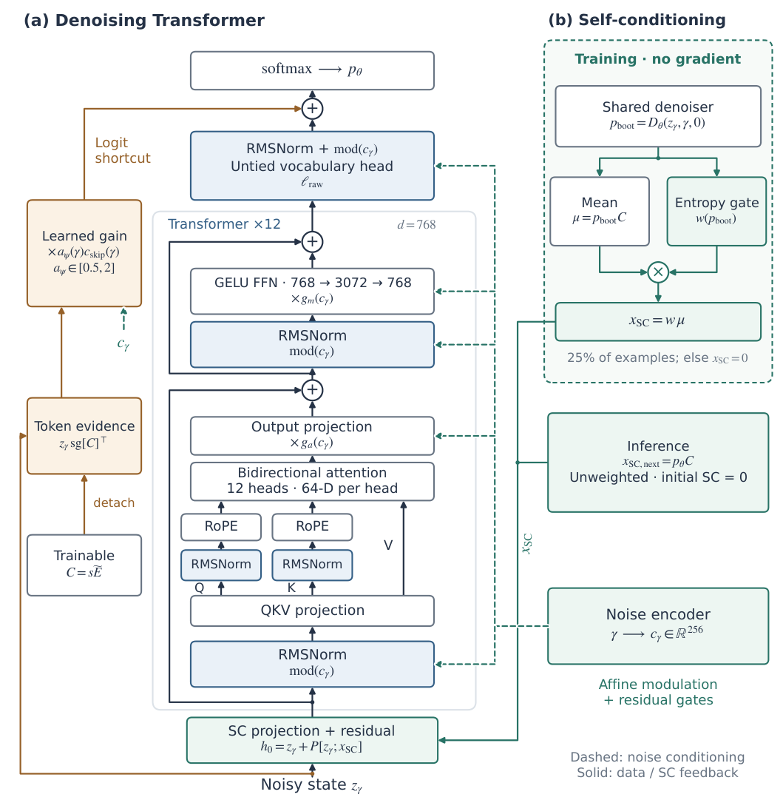

# LangDiT: Gradient routing and self-conditioning for continuous diffusion language models

<!-- source-sha256: fcecab09c649dbbc02ff39441031bd4c5e1f7a06b73ad7ebca1f05263e4eb904 -->

[简体中文](README.md)

## Paper information

| Field | Details |
| --- | --- |
| Paper links | [arXiv 2610.22330](https://arxiv.org/abs/2610.22330); [v1 full text](https://arxiv.org/html/2610.22330v1) |
| Original title | Designing Transformers for Continuous Diffusion Language Models |
| Company / institution | First author Weijian Luo: Dots Studio, Xiaohongshu. Co-first author Yujian Chen: Polyadic Research Group / Peking University. |
| First public release | 2026-10-15; `2026-10-15T17:52:31Z` |
| Author code | No verified author repository or license found. The local implementation follows the paper independently. |
| Adapter | Catalog key `langdit`; `adapter: null`, no reproduction CLI or Evolve |
| Local implementation | `src/auto_research/foundation_models/langdit.py`; `scripts/run_oct17_supplement_foundation.py` |
| Implementation status | `component_only`, L1 mechanism diagnostic; `diagnostic_only: true`, `promotion_eligible: false` |
| Full experiment | Reviewed and not reproduced because of cost; `not_reproduced_high_cost` |

## Paper summary

### Background and main changes

Continuous diffusion language models recover discrete distributions from Gaussian-noised token embeddings. Section 3 changes three places: backbone RMS/QK normalization and noise-conditioned capacity; explicit codebook gradient routing and bounded calibration in a vocabulary likelihood shortcut; and confidence attenuation in training-time bootstrap self-conditioning. LangFlow representation, cross-entropy, and sampler stay unchanged. Plaid only adopts the compatible subset; the gradient rules are not interchangeable.

~~~mermaid
flowchart LR
  C[Spherical codebook and Gaussian perturbation] --> Z[Noisy continuous state]
  Z --> B[Noise-conditioned bidirectional Transformer]
  B --> H[Untied vocabulary head]
  Z --> L[Likelihood shortcut with explicit codebook detach]
  L --> A[Bounded calibration and addition]
  H --> A
  A --> P[Token posterior probabilities]
  P --> T[Entropy-weighted training bootstrap]
  P --> I[Unweighted inference posterior mean]
~~~

<!-- paper-figure:start -->
### Original paper figure

> **Paper Figure 3:** Denoising Transformer, likelihood shortcut, training entropy gate, and unweighted inference self-conditioning. From the [original paper](https://arxiv.org/abs/2610.22330); copyright remains with the authors. Click the image to open its source.
<!-- paper-figure:end -->

### Core equations

The spherical codebook and noised input are

$$
C_v=0.1\sqrt d\frac{E_v}{\|E_v\|_2},\quad
\alpha_\gamma=\sqrt{\operatorname{sigmoid}(-\gamma)},\quad
\sigma_\gamma=\sqrt{\operatorname{sigmoid}(\gamma)},\quad
z_\gamma=\alpha_\gamma C_y+\sigma_\gamma\epsilon.
$$

In LangFlow detach only the explicit codebook on the right of the shortcut, not all of $z$:

$$
\ell_\theta=\ell_{\mathrm{raw},\theta}
+a_\psi(\gamma)\frac{\alpha_\gamma}{\sigma_\gamma^2}z_\gamma\operatorname{sg}[C]^\top,
\qquad
a_\psi=\exp(\operatorname{clip}(f_\psi(c_\gamma),-\log2,\log2)).
$$

Calibration starts at 1 and stays in $[0.5,2]$; the shortcut has a linear warm-up for the first 5,000 steps. Codebook gradients still flow through $z$. During training, 25% of examples get gradient-free bootstrap:

$$
x_{\mathrm{SC}}^{\mathrm{train}}=\operatorname{sg}\left[w(p_{\mathrm{boot}})(p_{\mathrm{boot}}C)\right],
\qquad
w_i=\operatorname{clip}\left(1-\frac{H(p_i)}{\log|\mathcal V|},0,1\right).
$$

Inference uses unweighted $\hat x_0=p_\theta C$, with no extra bootstrap or training entropy gate. The training weight is a feedback heuristic, not a guarantee of a better posterior estimate.

### Offline and online results reported in the paper

The main controlled OWT-1024 comparison between LangFlow and LangDiT uses the same data order, batch, objective, and sampler for 250K updates. At 128 NFE, GenPPL is 64.26 versus 53.66, while unigram entropy drops from 5.416 to 5.391. Longer-training results such as 21.72/11.33 use different checkpoint progress; some Plaid comparisons differ in steps. They are not all matched-budget gains. Lower GenPPL does not establish better overall semantics. No online A/B is reported.

## Local reproduction

### Data protocol and execution

No large public model or data download. Revision `synthetic-packed-options-and-noisy-tokens@oct17-supplement-foundation-v1`, seeds 42/43/44. A real two-layer, width-16, two-head, 19-token denoiser retains spherical codebook, RMS/QK norm, RoPE, noise-conditioned residual gates, untied vocabulary head, zero-initialized input fusion, and calibration. Each seed uses 4×6 tokens and a mask for one-quarter bootstrap, with three real SGD updates to check trainability only.

~~~bash
PYTHONPATH=src python scripts/run_oct17_supplement_foundation.py \
  --papers langdit --device cpu --seeds 42,43,44 \
  --output runs/oct17-supplement/langdit-cpu.json
~~~

### Results and independent comparison

CPU formula/gradient tests and three real A100 seeds passed. The shortcut matches an independent per-batch formula. No explicit codebook gradient exists for independent $z$, but constructing $z(C)$ retains nonzero codebook input gradients. Bootstrap is fully detached. Uniform and one-hot posteriors yield confidence zero and one; inference matches the unweighted mean, not the training-weighted value. Attention and codebook gradients stay finite and nonzero over three updates. Scaling the codebook by maximum absolute value avoids norm overflow or underflow for extreme finite inputs. After the fix A100 covered four extremes and gradients; [diagnostics](metrics/component-cuda-seeds42-44.json) and [GPU receipt](../../gpu-validations/langdit-supplement-a100-20261017.json) bind the final source.

### Code mapping and limits

`LangDiTDenoiser` is a reduced-width real backbone. `likelihood_shortcut`, `training_self_condition`, and `inference_mean` define the explicit detach, training gate, and inference boundary. Tests: `tests/foundation_models/test_oct17_supplement_foundation.py`.

No learned LangFlow noise scheduler, entropy matching, full Euler–EDM generation, Plaid NELBO/sampling, pretraining, or public capability evaluation. The full model is about 334M, seven × 250K updates with 512×1024 tokens per step and substantial 128/1024-NFE generation. **Reviewed and not reproduced because of cost.** A falling local loss is not OWT reproduction or automatic Evolve integration.
