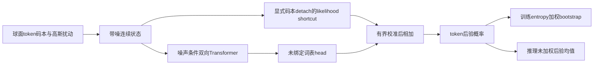
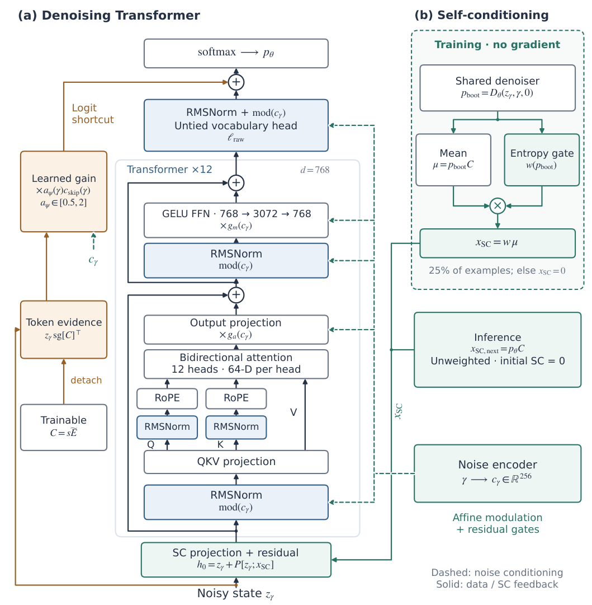

# LangDiT：连续扩散语言模型的梯度与自条件组件

## 论文信息

| 字段 | 内容 |
| --- | --- |
| 论文链接 | [arXiv 2610.22330](https://arxiv.org/abs/2610.22330)；[v1 全文](https://arxiv.org/html/2610.22330v1) |
| 原文标题 | Designing Transformers for Continuous Diffusion Language Models |
| 公司/机构 | 一作 Weijian Luo：Dots Studio, Xiaohongshu；共同一作 Yujian Chen：Polyadic Research Group / Peking University |
| 首次公开日期 | 2026-10-15；`2026-10-15T17:52:31Z` |
| 原文开源代码 | 本轮未找到可确认的原作者方法代码仓库或许可证；本地依据原文独立实现 |
| Adapter | `langdit`（目录键）；`adapter: null`；非 reproduction CLI adapter，未接入 evolve |
| 本地复现代码目录 | `src/auto_research/foundation_models/langdit.py`；`scripts/run_oct17_supplement_foundation.py` |
| 实现状态 | `component_only`；L1 机制诊断；`diagnostic_only: true`、`promotion_eligible: false` |
| 完整实验 | 成本过高，不复现（审查 DONE）；`not_reproduced_high_cost` |

## 原始论文总结

### 背景与主要改动

连续扩散语言模型要从带高斯噪声的 token 嵌入恢复离散分布。原文§3把架构改动分为三个位置：backbone 的 RMS/QK 归一与噪声条件容量；词表 likelihood shortcut 的显式码本梯度路由和有界校准；训练期 bootstrap self-conditioning 的置信度衰减。LangFlow 的表示、交叉熵和采样器保持不变；Plaid 适配只迁移兼容子集，不能把两套梯度规则混为一谈。



<!-- paper-figure:start -->
### 原论文关键图

[](https://arxiv.org/pdf/2610.22330v1#page=6)

> **原论文 Figure 3（关键图）**：完整 denoising Transformer、likelihood shortcut，以及训练 entropy gate 与推理未加权 self-conditioning。图片来自[原论文](https://arxiv.org/abs/2610.22330)，版权归原作者所有；点击图片可查看来源。
<!-- paper-figure:end -->

### 核心公式

球面码本和噪声输入为：

$$
C_v=0.1\sqrt d\frac{E_v}{\|E_v\|_2},\quad
\alpha_\gamma=\sqrt{\operatorname{sigmoid}(-\gamma)},\quad
\sigma_\gamma=\sqrt{\operatorname{sigmoid}(\gamma)},\quad
z_\gamma=\alpha_\gamma C_y+\sigma_\gamma\epsilon.
$$

LangFlow 分支只切断 shortcut 右侧显式码本因子，不能 detach 整个 $z$：

$$
\ell_\theta=\ell_{\mathrm{raw},\theta}
+a_\psi(\gamma)\frac{\alpha_\gamma}{\sigma_\gamma^2}z_\gamma\operatorname{sg}[C]^\top,
\qquad
a_\psi=\exp(\operatorname{clip}(f_\psi(c_\gamma),-\log2,\log2)).
$$

初始校准为1，范围为 $[0.5,2]$；shortcut 保留前5,000步线性 warmup。码本仍通过构造 $z$ 的路径训练。训练对25%样本作无梯度 bootstrap：

$$
x_{\mathrm{SC}}^{\mathrm{train}}=\operatorname{sg}\left[w(p_{\mathrm{boot}})(p_{\mathrm{boot}}C)\right],
\qquad
w_i=\operatorname{clip}\left(1-\frac{H(p_i)}{\log|\mathcal V|},0,1\right).
$$

推理使用未加权 $\hat x_0=p_\theta C$，不额外 bootstrap、不套用训练 entropy gate。该权重是训练反馈启发式，不是更优后验估计的数学保证。

### 论文离线与线上效果

主要可归因对照是在相同数据顺序、batch、目标和采样器下，LangFlow 与 LangDiT 的 OWT-1024 250k-update 比较：128 NFE 的 GenPPL 为64.26与53.66，unigram entropy 同时由5.416降至5.391。更长训练的21.72/11.33等结果来自不同checkpoint进度；部分Plaid对照训练步数不一致，不能统一当同预算提升。GenPPL降低不证明整体语义质量提升。线上 A/B：未报告。

## 本地复现

### 数据协议与运行

无公开大数据/模型下载。revision `synthetic-packed-options-and-noisy-tokens@oct17-supplement-foundation-v1`，seeds42/43/44。实际微型 denoiser 为2层、16维、2 heads、19词，保留球面码本、RMS/QK归一、RoPE、噪声条件残差门、未绑定词表head、零初始化输入融合和校准。每 seed 4×6 tokens，显式mask选中1/4 bootstrap样本，3次真实SGD更新，仅检查机制可训练性。

```bash
PYTHONPATH=src python scripts/run_oct17_supplement_foundation.py \
  --papers langdit --device cpu --seeds 42,43,44 \
  --output runs/oct17-supplement/langdit-cpu.json
```

### 结果与独立对照

CPU 公式/梯度测试与真实 NVIDIA A100 三种子机制运行通过：shortcut 和逐 batch 独立公式相符；在独立 $z$ 上显式码本梯度不存在，构造 $z(C)$ 后码本输入梯度仍非零；bootstrap 完整 detach；均匀与 one-hot 分布分别给零和一置信度；推理均值与未加权后验一致，和训练加权值不同。三步更新后实际 attention 和码本有有限非零梯度。码本先按最大绝对值缩放，避免极大/极小有限输入的范数溢出/下溢；修复后已重新在 A100 覆盖四种极值及梯度检查，[诊断记录](metrics/component-cuda-seeds42-44.json)与[GPU回执](../../gpu-validations/langdit-supplement-a100-20261017.json)绑定最终执行源码。

### 代码映射与边界

`LangDiTDenoiser` 是缩小维度的真实 backbone；`likelihood_shortcut`、`training_self_condition` 和 `inference_mean` 分别固定显式detach、训练gate和推理边界；测试在 `tests/foundation_models/test_oct17_supplement_foundation.py`。

未实现 LangFlow 学习噪声调度器、entropy matching、Euler–EDM完整生成、Plaid NELBO/采样、预训练与公开能力评测。原文完整模型约334M、7组×250k updates、每步512×1024 tokens，以及大量128/1024 NFE生成；**成本过高，不复现（审查 DONE）**。本地没有用降低loss冒充OWT复现或自动evolve接入。
