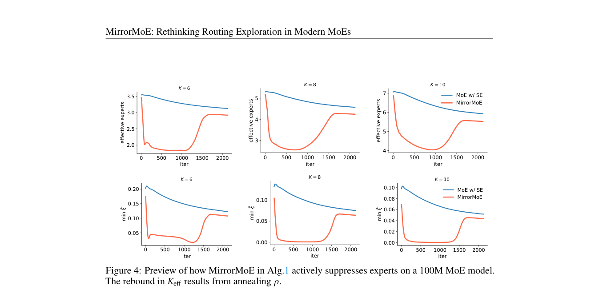

# MirrorMoE: Mirror routing with separate selection and aggregation

<!-- source-sha256: 8767bb16b64e48b72b89265dad098632296df1d855b6c59c862c7acd5ce8c0ed -->

[简体中文](README.md)

## Paper information

| Field | Details |
| --- | --- |
| Paper links | [arXiv 2610.22353](https://arxiv.org/abs/2610.22353); [v1 full text](https://arxiv.org/html/2610.22353v1) |
| Original title | Rethinking Routing Exploration in Modern Mixture-of-Experts |
| Company / institution | First author Bingcong Li: ETH Zurich and University of Hong Kong; collaborators include Max Planck and WU Vienna |
| First public release | 2026-10-15; `2026-10-15T17:58:02Z` |
| Author code | [BingcongLi/MirrorMoE](https://github.com/BingcongLi/MirrorMoE), MIT. The local implementation follows the equations independently and does not import Megatron. |
| Adapter | Catalog key `mirror-moe`; `adapter: null` |
| Local implementation | `src/auto_research/foundation_models/mirror_moe.py`; `scripts/run_oct17_foundation_components.py` |
| Implementation status | `component_only`, L1 mechanism diagnostic, not integrated into Evolve |
| Full experiment | Reviewed and not reproduced because of cost; `not_reproduced_high_cost` |

## Paper summary

### Background and main changes

When shared experts contribute much of the output, changing routed experts makes less difference to the representation, while fine-grained experts enlarge the space of combinations. Rather than simply adding noise, MirrorMoE temporarily suppresses some experts through mirrored selection and anneals back to normal routing. The main source is Section 3, Eqs. 3–6.

~~~mermaid
flowchart LR
  A[Trainable router logits] --> B[Positive and negative softmax]
  B --> C[Top-k selection on mixture]
  B --> D[Aggregate with original positive probabilities]
  C --> D
  E[Shared expert output] --> F[Final output]
  D --> F
  G[Cosine annealing over training] --> C
~~~

<!-- paper-figure:start -->
### Original paper figure

> **Paper Figure 4:** Expert suppression, effective number of experts, and changes in the minimum mixing ratio ξ during training. This is a paper diagnostic, not local pretraining. From the [original paper](https://arxiv.org/abs/2610.22353); copyright remains with the authors. Click the image to open its source.
<!-- paper-figure:end -->

### Core equations

$$
\xi=\operatorname{softmax}(Gh),\quad \zeta=\operatorname{softmax}(-Gh),\quad p=(1-\rho)\xi+\rho\zeta.
$$

Select $\mathcal A=\operatorname{TopK}(p)$, but output $\sum_sSE_s(h)+\sum_{e\in\mathcal A}\xi_eRE_e(h)$. The local component follows $Z=1$ and does not renormalize selected weights. Cosine-anneal $\rho$ from 0.4 to 0. The load term uses actual selection frequency and original probabilities $\xi$, not mixture probabilities $p$.

### Offline and online results reported in the paper

The paper compares shared and non-shared MoE at 100M–2.4B scales on public DCLM and downstream tasks. Large-scale results come from full pretraining, not a mathematical property of routing. Section 4 notes possible degradation without shared experts, so this is not a universal MoE acceleration method. No online A/B is reported.

## Local reproduction

### Data protocol and execution

Revision `synthetic-formula-and-bit-patterns@oct17-foundation-components-v1`. No checkpoint, public corpus, or capability benchmark. Seeds 42/43/44 initialize a real trainable width-8 network with six routed experts, two shared experts, and top-3. One SGD update per seed checks gradients, not language-model training.

~~~bash
PYTHONPATH=src python scripts/run_oct17_foundation_components.py \
  --papers mirror-moe --device cpu --seeds 42,43,44 \
  --output runs/oct17-foundation/mirror-cpu.json
~~~

Use `--device cuda` for CUDA with no CPU fallback. Existing outputs cannot be overwritten.

### Results and independent comparison

Targeted CPU tests and three real NVIDIA A100 seeds passed. GPU seed 42 per-token/expert aggregation error versus manual summation is `1.11e-16`; the wrong-mixture-weights negative control differs by `0.08780`. Router gradient norm is `0.02863` and actual update norm `0.0005727`. Ordinary top-k returns at the end of annealing. The [CUDA diagnostics](metrics/component-cuda-seeds42-44.json) and [GPU receipt](../../gpu-validations/mirror-moe-a100-20261017.json) record device and source hashes. The numbers establish that the component actually runs, not pretraining benefits.

### Code mapping and limits

`mirror_routing` follows Eqs. 3–6; `cosine_mirror_ratio` implements annealing; `MirrorMoELayer` includes a real router and FFN experts. Tests cover independent manual summation, wrong weights, shared-expert gradients, and annealing endpoints. The reference computes all experts densely then selects; no sparse dispatch, expert parallelism, or throughput gain.

The smallest 100M pretraining run uses two H100s; others use four H100s and 4.4B–12.8B tokens. **The full experiment was reviewed and not reproduced because of cost** on one A100/A30 or Mac. One gradient step is not pretraining improvement. `diagnostic_only: true`, `promotion_eligible: false`, no Evolve promotion.
