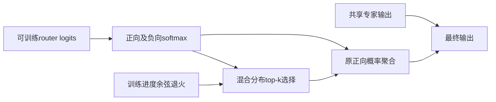
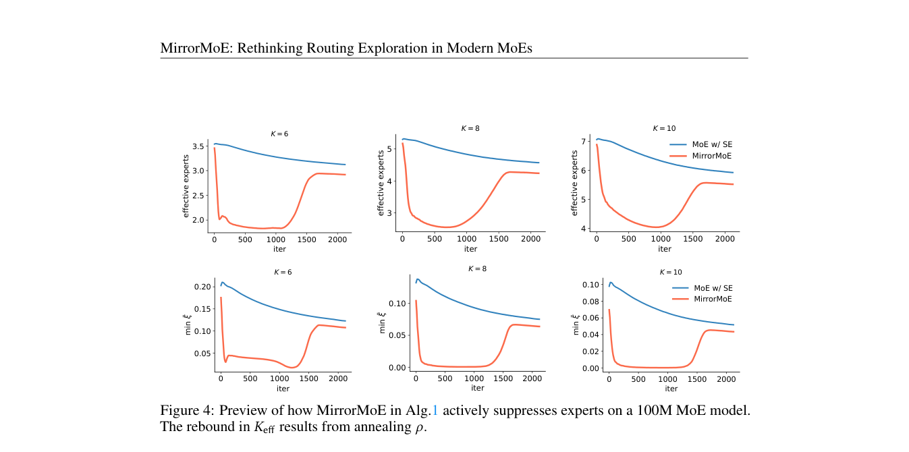

# MirrorMoE：选择与聚合解耦的镜像路由组件

## 论文信息

| 字段 | 内容 |
| --- | --- |
| 论文链接 | [arXiv 2610.22353](https://arxiv.org/abs/2610.22353)；[v1 全文](https://arxiv.org/html/2610.22353v1) |
| 原文标题 | Rethinking Routing Exploration in Modern Mixture-of-Experts |
| 公司/机构 | 一作 Bingcong Li：ETH Zurich，另署 University of Hong Kong；协作含 Max Planck / WU Vienna |
| 首次公开日期 | 2026-10-15；`2026-10-15T17:58:02Z` |
| 原文开源代码 | 是：[BingcongLi/MirrorMoE](https://github.com/BingcongLi/MirrorMoE)，MIT；本地独立公式实现，不引入 Megatron |
| Adapter | `mirror-moe`（目录键）；`adapter: null` |
| 本地复现代码目录 | `src/auto_research/foundation_models/mirror_moe.py`；`scripts/run_oct17_foundation_components.py` |
| 实现状态 | `component_only`、L1 机制诊断；未接入 evolve |
| 完整实验 | 成本过高，不复现（审查 DONE）；`not_reproduced_high_cost` |

## 原始论文总结

### 背景与主要改动

共享专家占据较多输出后，改变路由专家带来的表征差异减弱，而细粒度分割又扩大组合空间。MirrorMoE 不简单增噪，而是以镜像选择暂时抑制部分专家，随训练退火恢复普通路由。主源是 §3 的公式 3–6。



<!-- paper-figure:start -->
### 原论文关键图

[](https://arxiv.org/pdf/2610.22353#page=8)

> **原论文 Figure 4（关键图）**：训练中的专家抑制、有效专家数及最小混合比 ξ 的变化；这是原论文训练诊断，不是本地预训练结果。图片来自[原论文](https://arxiv.org/abs/2610.22353)，版权归原作者所有；点击图片可查看来源。
<!-- paper-figure:end -->

### 核心公式

$$
\xi=\operatorname{softmax}(Gh),\quad\zeta=\operatorname{softmax}(-Gh),\quad p=(1-\rho)\xi+\rho\zeta.
$$

取 $\mathcal A=\operatorname{TopK}(p)$，但输出为 $\sum_sSE_s(h)+\sum_{e\in\mathcal A}\xi_eRE_e(h)$。本地遵循原文 $Z=1$，不对选中权重重归一化。$\rho$ 从 0.4 余弦退火至 0；负载项使用实际选中频率与原概率 $\xi$，而非混合概率 $p$。

### 论文离线与线上效果

论文在公共 DCLM 与下游任务、100M–2.4B 多规模比较共享/非共享 MoE；大规模结果来自完整预训练，不是路由函数的数学属性。§4 指出无共享专家时也可能退化，不能将本方法视为普适 MoE 加速。线上 A/B：未报告。

## 本地复现

### 数据协议与运行

revision `synthetic-formula-and-bit-patterns@oct17-foundation-components-v1`；无 checkpoint、公共语料或能力 benchmark。固定种子 42/43/44 初始化 8 维、6 个可路由专家、2 个共享专家、top-3 的真实可训练小网络。每 seed 仅一个 SGD 更新核验梯度，不是语言模型训练。

```bash
PYTHONPATH=src python scripts/run_oct17_foundation_components.py \
  --papers mirror-moe --device cpu --seeds 42,43,44 \
  --output runs/oct17-foundation/mirror-cpu.json
```

同命令可 `--device cuda`，不回退 CPU；不可覆盖已有输出。

### 结果与独立对照

CPU 定向测试通过，并已在真实 NVIDIA A100 上执行三个种子。GPU seed42 手工逐 token/专家聚合误差 `1.11e-16`，误用混合权重的负对照差 `0.08780`。router 梯度范数 `0.02863`，实际更新范数 `0.0005727`；退火末端恢复普通 top-k。[CUDA 诊断记录](metrics/component-cuda-seeds42-44.json) 与[真实GPU回执](../../gpu-validations/mirror-moe-a100-20261017.json) 列出设备与源码 hash。上述数字仅说明实现不是空标签或固定输出。

### 代码映射与边界

`mirror_routing` 对应公式 3–6；`cosine_mirror_ratio` 对应退火；`MirrorMoELayer` 包含真实 router 和 FFN 专家。测试独立手工求和、错误权重负对照、共享专家梯度和退火端点。参考层密集计算所有专家再选择，没有稀疏 dispatch、专家并行或吞吐收益。

原文最小 100M 训练也使用 2 H100，其余 4 H100、4.4B–12.8B tokens。现有单 A100/A30/Mac 不运行此完整预训练，**成本过高，不复现（审查 DONE）**。没有把本地一步梯度诊断称为预训练改善；`diagnostic_only: true`、`promotion_eligible: false`，不进入 evolve 晋级。
