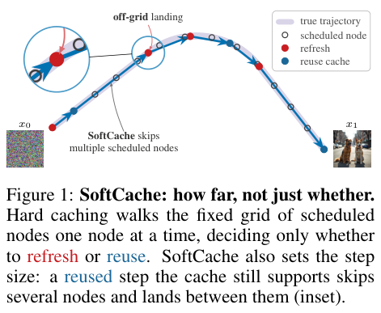

# SoftCache: Turning cache headroom into an adaptive sampling step size

<!-- source-sha256: ccdf272fc618a62f640a1893e12e1c0b5afe2dba0a01ca5c2190a47dd9c73f16 -->

[简体中文](README.md)

## Paper information

| Field | Details |
| --- | --- |
| Paper links | [arXiv 2610.22369](https://arxiv.org/abs/2610.22369); [v1 full text](https://arxiv.org/html/2610.22369v1) |
| Original title | SoftCache: Adaptive Step Size Caching for Diffusion Transformers |
| Company / institution | First author Shimon Malnick: Tel Aviv University; collaboration with Reichman University |
| First public release | 2026-10-15; `2026-10-15T17:59:34Z` |
| Author code | The [official project page](https://malnick.net/softcache/) was inaccessible during review. No verified author repository or license was found. |
| Adapter | Catalog key `softcache`; `adapter: null`, no reproduction CLI or Evolve operator |
| Local implementation | `src/auto_research/foundation_models/softcache.py`; `scripts/run_oct18_foundation_components.py` |
| Implementation status | `component_only`, L1 mechanism diagnostic; `diagnostic_only: true`, `promotion_eligible: false` |
| Full experiment | Reviewed and not reproduced because of cost; `not_reproduced_high_cost` |

## Paper summary

### Background and main changes

Dynamic caching typically chooses between refresh and reuse while keeping a fixed time grid. SoftCache converts the headroom between accumulated staleness and its threshold into a continuous step size: a more reliable cache takes a longer step. It extrapolates from two fresh residuals and rearranges the remaining grid so skipped nodes are not visited later.

~~~mermaid
flowchart LR
  P[Relative change in inexpensive probe] --> A[Accumulated staleness]
  A --> F{Exceeds threshold}
  F -->|Yes| R[Fresh forward pass and reset]
  F -->|No| H[Headroom controls step size]
  H --> E[Two-anchor residual extrapolation]
  E --> G[Off-grid step and tail rearrangement]
  R --> G
  G --> P
~~~

<!-- paper-figure:start -->
### Original paper figure

> **Paper Figure 1:** Fixed-grid hard caching versus SoftCache's headroom-driven steps, including the zoomed off-grid landing. Not a local quality or speed result. From the [original paper](https://arxiv.org/abs/2610.22369); copyright remains with the authors. Click the image to open its source.
<!-- paper-figure:end -->

### Core equations

$$
\rho_i=\frac{\|I_i-I_{i-1}\|_1}{\|I_{i-1}\|_1+\epsilon},\quad A_i=\sum_{j>a}\rho_j,\quad H_i=1-A_i/\tau.
$$

The cached step is $\bar\Delta_i=\min(1-t_i,\Delta_i[1+(J-1)H_i])$; fresh nodes keep the original step. Extrapolate the residual as

$$
\hat r_i=r_a+\beta\frac{t_i-t_a}{t_a-t_{a-1}}(r_a-r_{a-1}).
$$

With one anchor the residual stays constant. No skipping when $t<0.1$ or $\rho>0.18$. These thresholds come from Appendix A.3.

### Offline and online results reported in the paper

The authors report about 3.5–6.9× speedup on FLUX images and HunyuanVideo/Wan2.1 videos and compare fidelity to uncached outputs from the same seed. Fidelity is not improved generation quality. Neither speed nor image metrics were measured locally. No online A/B is reported.

## Local reproduction

### Data protocol and execution

Pinned revision `synthetic-memory-spatial-vision-recurrence-and-ode@oct18-foundation-mechanisms-v1`, seeds 42/43/44. No generator model is downloaded. An 8-dimensional MLP takes one actual gradient update, then SoftCache, hard-cache, and full Euler share the initial value and a 20-step grid. All differences, including negative outcomes, are retained.

~~~bash
PYTHONPATH=src python scripts/run_oct18_foundation_components.py \
  --papers softcache --device cpu --seeds 42,43,44 \
  --output runs/oct18-components/softcache-cpu.json
~~~

### Results and independent comparison

CPU tests verify exact agreement with independent Euler when cache is off, residual extrapolation, actual refresh/reuse/skips, total step length of 1, and no endpoint overshoot. Hard caching is a negative control whose endpoint difference is recorded; SoftCache need not be better for arbitrary random MLPs. Each sample starts with a fresh cache to prevent cross-sample state.

On a real NVIDIA A100 all seeds 42/43/44 passed: zero cache-disabled Euler error, maximum residual extrapolation error below $4.45\times10^{-16}$, residual-network gradient norm at least 0.3020, and SGD update norm at least 0.003020. Each seed visits 11 nodes with three fresh passes; full Euler has 20 passes. The endpoint error norm relative to full Euler remains 0.01620–0.03926 and is retained as an approximation cost. See [per-seed metrics](metrics/component-cuda-seeds42-44.json) and the [GPU receipt](../../gpu-validations/softcache-a100-20261018.json). Fewer calls do not establish end-to-end DiT speedup.

### Code mapping and limits

`SoftCacheSampler.sample` accepts explicit probe, residual, and readout callbacks. `cached_step` and `residual_extrapolation` can be tested independently. The probe is a small explicit time signal, not SeaCache's spectral filter. There are no FLUX/Wan hooks, VAE, or video timings. Cache and trajectory are scoped to one call.

The paper's uncached HunyuanVideo takes about 213 seconds per sample on 946 VBench prompts, with multiple methods and budgets. The full matrix does not fit the available single card. **Reviewed and not reproduced because of cost.** No Evolve promotion.
