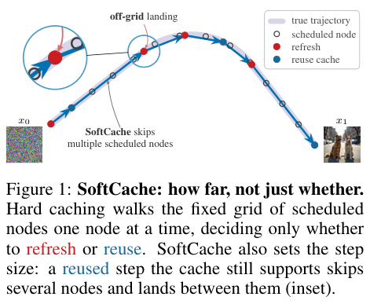

# SoftCache：缓存可信空间控制采样步长

## 论文信息

| 字段 | 内容 |
| --- | --- |
| 论文链接 | [arXiv 2610.22369](https://arxiv.org/abs/2610.22369)；[v1 全文](https://arxiv.org/html/2610.22369v1) |
| 原文标题 | SoftCache: Adaptive Step Size Caching for Diffusion Transformers |
| 公司/机构 | 一作 Shimon Malnick：Tel Aviv University；合作 Reichman University |
| 首次公开日期 | 2026-10-15；`2026-10-15T17:59:34Z` |
| 原文开源代码 | [官方项目页](https://malnick.net/softcache/)本轮无法访问；未核到可确认的原作者源代码仓库或许可证 |
| Adapter | `softcache`（目录键）；`adapter: null`，未注册 reproduction CLI/evolve operator |
| 本地复现代码目录 | `src/auto_research/foundation_models/softcache.py`；`scripts/run_oct18_foundation_components.py` |
| 实现状态 | `component_only`；L1 机制诊断；`diagnostic_only: true`、`promotion_eligible: false` |
| 完整实验 | 成本过高，不复现（审查 DONE）；`not_reproduced_high_cost` |

## 原始论文总结

### 背景与主要改动

动态缓存通常只决定“刷新/重用”，仍沿固定时间网格走。SoftCache 将累计陈旧度距离阈值的 headroom 转成连续步长：缓存越可靠就走得更远。它用两次新鲜残差作时间外推，并重新排布剩余节点，使跳过的节点不会又被访问。

```mermaid
flowchart LR
  P[便宜probe相对变化] --> A[累计陈旧度]
  A --> F{超过阈值}
  F -->|是| R[新鲜网络前向并重置]
  F -->|否| H[headroom控制步长]
  H --> E[两锚点残差外推]
  E --> G[off-grid更新及尾部重排]
  R --> G
  G --> P
```



<!-- paper-figure:start -->
### 原论文关键图

[](https://arxiv.org/pdf/2610.22369v1#page=2)

> **原论文 Figure 1（关键图）**：固定网格上的 hard caching 与按缓存 headroom 跳步的 SoftCache 对比，保留 off-grid landing 放大示意；不是本地质量或速度结果。图片来自[原论文](https://arxiv.org/abs/2610.22369)，版权归原作者所有；点击图片可查看来源。
<!-- paper-figure:end -->

### 核心公式

$$
\rho_i=\frac{\|I_i-I_{i-1}\|_1}{\|I_{i-1}\|_1+\epsilon},\quad A_i=\sum_{j>a}\rho_j,\quad H_i=1-A_i/\tau.
$$

缓存步长为 $\bar\Delta_i=\min(1-t_i,\Delta_i[1+(J-1)H_i])$；新鲜节点仍用原步长。残差为

$$
\hat r_i=r_a+\beta\frac{t_i-t_a}{t_a-t_{a-1}}(r_a-r_{a-1}).
$$

只有一个锚点时保持常数；$t<0.1$ 或 $\rho>0.18$ 禁止跳步。以上阈值来自原文附录 A.3。

### 论文离线与线上效果

作者在 FLUX 图像与 HunyuanVideo/Wan2.1 视频实验中报告约3.5–6.9倍加速，并比较相对同 seed 未缓存输出的保真度。保真度不等于生成质量提升；本地没有测量这些速度或图像指标。线上 A/B：未报告。

## 本地复现

### 数据协议与运行

固定 revision `synthetic-memory-spatial-vision-recurrence-and-ode@oct18-foundation-mechanisms-v1`、seeds42/43/44。不下载生成模型。8维小 MLP 先做一次真实梯度更新，再在同一初值和20步网格上比较 SoftCache、hard-cache 与全量 Euler；所有差异包括负结果保留。

```bash
PYTHONPATH=src python scripts/run_oct18_foundation_components.py \
  --papers softcache --device cpu --seeds 42,43,44 \
  --output runs/oct18-components/softcache-cpu.json
```

### 结果与独立对照

CPU 已验证缓存禁用时与独立逐步 Euler 完全一致、时间外推公式、刷新/重用/真实跳步均被执行、总步长等于1、不会越过终点。hard-cache 是负对照，记录其端点差异，不要求 SoftCache 在任意随机 MLP 上“效果更好”。新 sample 必须新建缓存，测试防止跨样本状态污染。

真实 NVIDIA A100 上 seeds42/43/44 全部通过：禁用缓存与独立Euler的误差均为0，残差外推最大误差低于 $4.45\times10^{-16}$；残差网络梯度范数至少0.3020、SGD更新范数至少0.003020。每个 seed 访问11个节点、执行3次新鲜前向，全量Euler为20次前向。相对全量Euler的端点范数误差仍为0.01620–0.03926，保留这一近似代价。完整逐 seed 数据见[诊断指标](metrics/component-cuda-seeds42-44.json)和[GPU 回执](../../gpu-validations/softcache-a100-20261018.json)。调用次数降低不等于真实 DiT 端到端加速。

### 代码映射与边界

`SoftCacheSampler.sample` 接收明确的 probe、residual、readout 回调；`cached_step` 与 `residual_extrapolation` 独立可测。当前诊断 probe 是显式小幅时间信号，不是 SeaCache 的谱滤波器；也没有 FLUX/Wan hook、VAE 或视频计时。缓存与轨迹只存于单次调用。

原文 HunyuanVideo 每条未缓存样本约213秒、VBench946 prompts，加上多方法多预算需长时间运行；完整实验不适合当前单卡，**成本过高，不复现（审查 DONE）**。不接入 evolve 晋级。
