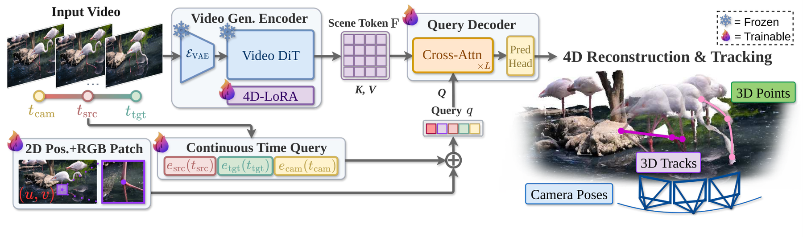

# Gen4P: Turning a video generator into a single-forward-pass 4D perceiver

<!-- source-sha256: ea8316aee5f979fd7b8b6d4dda0a27164f354fc8a2c3853cb445060d0d28547e -->

[简体中文](README.md)

> Research reference only. **Reviewed and not reproduced because of cost.** No local training, capability metrics, or Evolve operator.

## Paper information

| Field | Details |
| --- | --- |
| Paper links | [arXiv 2610.22371](https://arxiv.org/abs/2610.22371); [pinned v1 full text](https://arxiv.org/html/2610.22371v1); [official project](https://gen4p.github.io/) |
| Original title | Gen4P: Video Generators are 4D Perceivers |
| Company / institution | First author Yitong Xia: Physical Vision Group, Nanyang Technological University; collaboration with VGG, University of Oxford |
| First public release | 2026-10-15 17:59:48 UTC. Backfilled from the October 16 announcement, not first released October 19. |
| Author code | The [official repository](https://github.com/yitongx/Gen4P) has a README and assets only at review time, with Installation/Usage marked WIP. Runnable training/inference source and its license were not verified. |
| Local adapter / stable key | `gen4p`, reference key, no executable adapter |
| Local implementation | No algorithm implementation. Documentation and catalog entry: `src/auto_research/paper_specs/catalog/foundation-models/gen4p.json`. |
| Review status | `not_reproduced_high_cost`; review complete, no watermark blockage or automatic retry |

## Paper summary

### Background and main changes

Video-generation pretraining learns motion and geometry priors. Gen4P does not recover geometry through repeated denoising: it encodes clean video latents with one DiT pass and uses on-demand cross-attention queries to output 3D tracks, point clouds, depth, and camera parameters. Continuous-time queries support different lengths, frozen depth LoRA supplies an additional geometry prior, and separate 4D LoRA learns the new tasks.

~~~mermaid
flowchart LR
  V[Monocular video] --> E[Frozen Wan VAE]
  E --> D[One DiT pass over clean latents]
  P[Frozen depth LoRA] --> D
  A[Trainable 4D LoRA] --> D
  D --> S[Shared scene tokens]
  Q[Continuous-time and pixel-patch queries] --> C[Cross-attention decoder]
  S --> C
  C --> O[3D tracks, depth, and camera properties]
~~~

<!-- paper-figure:start -->
### Original paper figure

> **Paper Figure 2:** Video VAE and DiT, trainable 4D LoRA, continuous-time queries, and cross-attention decoder. This high-cost paper method was not reproduced locally. From the [original paper](https://arxiv.org/abs/2610.22371); copyright remains with the authors. Click the image to open its source.
<!-- paper-figure:end -->

### Core equations

Clean latents $z_0=E_{\mathrm{VAE}}(V)$ pass through a DiT with final scheduler-time and empty-text conditioning to produce scene tokens. No noise is injected and there is no iterative denoising. Continuous-time encoding is

$$
\alpha(t)=t/(T-1),\quad e(t)=(1-\alpha)e_0+\alpha e_1.
$$

Adapted layers use

$$
W=W_{DiT}+\Delta W_{Depth}^{512}+\Delta W_{4D}^{512}.
$$

Base and depth updates are frozen. Train 4D LoRA, queries, decoder, and prediction heads. The joint objective has six losses: 3D position, confidence, 2D position, visibility, 3D displacement, and surface normals (Appendix C).

### Offline and online results reported in the paper

For unseen Sintel video depth in Table 2, the base variant reaches AbsRel 0.180 and $\delta_{<1.25}$ of 76.13%. The double-LoRA variant gives 0.182 and 74.99%, so the geometry prior does not improve every metric. The authors report 3D tracking, video depth, and camera pose across datasets; these are not local measurements. No production user A/B is reported.

## Local reproduction

This review verified mechanism, code release status, and resources. No videos or checkpoints were downloaded, training was not run, and no small-model 4D capability score was fabricated.

### Cost decision

Section 4.1 uses about 200,000 videos from 11 sources, 21–49-frame training clips, encoded resolution up to 480×832, 75K optimization steps, and **eight NVIDIA H200s**. About 0.70B encoder and 0.18B eight-layer decoder parameters are trainable. Even the ablation needs 45K steps and multiple video sources.

That exceeds the single A100/A30 and Mac budget and upstream implementation was not public. **Reviewed and not reproduced because of cost.** This is not a TODO for a long single-card run; no resources are downloaded and there is no automatic retry if network access returns.

## Reproduction limits

There is no local adapter, GPU validation, training metric, or executable Evolve mapping. A repository alone does not establish source release. If implementation is later released, review again only with new independent evidence or an explicit user request.
