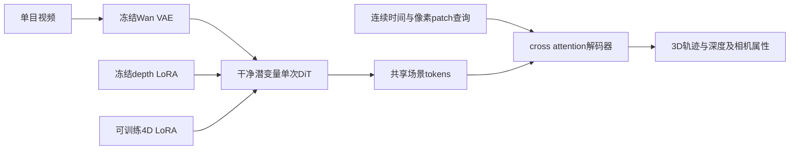
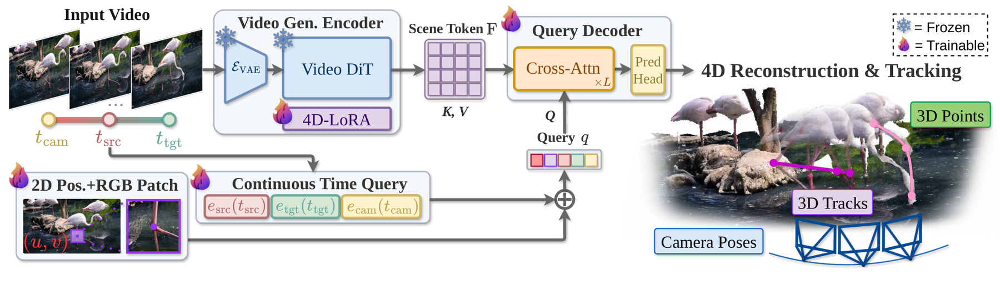

# Gen4P：将视频生成器转为单次前向四维感知器

> 仅研究资料；**成本过高，不复现（审查 DONE）**。无本地训练、能力指标或Evolve算子。

## 论文信息

| 字段 | 内容 |
| --- | --- |
| 论文链接 | [arXiv 2610.22371](https://arxiv.org/abs/2610.22371)；[固定v1全文](https://arxiv.org/html/2610.22371v1)；[官方项目页](https://gen4p.github.io/) |
| 原文标题 | Gen4P: Video Generators are 4D Perceivers |
| 公司 / 机构 | 一作Yitong Xia：Physical Vision Group, Nanyang Technological University；合作VGG, University of Oxford |
| 首次公开日期 | 2026-10-15 17:59:48 UTC；10月16日公告的重叠补漏，不是10月19日首发 |
| 原作者代码 | [官方仓库](https://github.com/yitongx/Gen4P)存在；本轮仅README和assets，Installation/Usage为WIP，未发布可运行训练/推理源代码，未核到实现代码许可证 |
| 本地 adapter / 稳定键 | `gen4p`（资料键，无可执行adapter） |
| 本地复现代码 | 无算法实现；仅本文与`src/auto_research/paper_specs/catalog/foundation-models/gen4p.json` |
| 验收状态 | `not_reproduced_high_cost`，审查DONE；不阻塞水位，不自动重试 |

## 原始论文总结

### 背景与主要改动

视频生成预训练包含运动与几何先验。Gen4P不通过多次去噪恢复几何，而是在干净视频潜变量上运行一次DiT编码，用按需cross-attention查询输出3D轨迹、点云、深度和相机参数。连续时间查询适配不同视频长度，冻结depth-LoRA提供额外几何先验，独立4D-LoRA学习新任务。

<!-- paper-figure:start -->
### 原论文关键图

> **原论文 Figure 2（关键图）**：视频 VAE 与 DiT、可训练 4D-LoRA、连续时间查询和交叉注意力解码器的单次前向 4D 感知架构；这是高成本论文方法，未宣称本地复现。图片来自[原论文](https://arxiv.org/abs/2610.22371)，版权归原作者所有；点击图片可查看来源。
<!-- paper-figure:end -->

### 核心公式

干净潜变量 $z_0=E_{VAE}(V)$ 经过最终scheduler时间条件和空文本条件的DiT得到场景tokens，不注入噪声或运行迭代去噪。连续时间编码为

$$
\alpha(t)=t/(T-1),\quad e(t)=(1-\alpha)e_0+\alpha e_1.
$$

各适配层权重为

$$
W=W_{DiT}+\Delta W_{Depth}^{512}+\Delta W_{4D}^{512}.
$$

基础权重与Depth更新冻结；训练4D-LoRA、查询、解码器和预测头。联合目标包含3D位置、置信度、2D位置、可见性、3D位移与表面法线六项损失，详见原文附录C。

### 论文离线与线上效果

原文Table2中，基础变体在未见Sintel视频深度上AbsRel为0.180、$\delta_{<1.25}$为76.13%；double-LoRA变体分别为0.182和74.99%，说明几何先验并非对每项指标都改善。作者在多数据集报告3D追踪、视频深度和相机位姿结果；不是本地测量。生产用户线上A/B：未报告。

## 本地复现

本轮只完成方法、代码发布状态与资源配置核验；没有下载视频、checkpoint、运行训练或制造小模型“4D能力”分数。

### 成本判断

原文Section4.1采用约20万视频、11个数据源、21–49帧训练clip、最长480×832编码分辨率、75K优化步和**8张NVIDIA H200**。编码器约0.70B、8层解码器约0.18B参数可训练。即使ablation仍需45K步、多视频数据源。

这超过当前单张A100/A30及Mac预算，且上游实现尚未公开。结论为**成本过高，不复现（审查 DONE）**，不是等待单卡长跑的TODO；不下载资源，不因未来网络恢复自动重试。

## 复现边界

无本地adapter、GPU验收、训练指标或可执行Evolve映射。上游repo存在不等同代码已开源；未来若作者真正发布实现，只有出现新的独立证据或用户明确需求时再审查。
