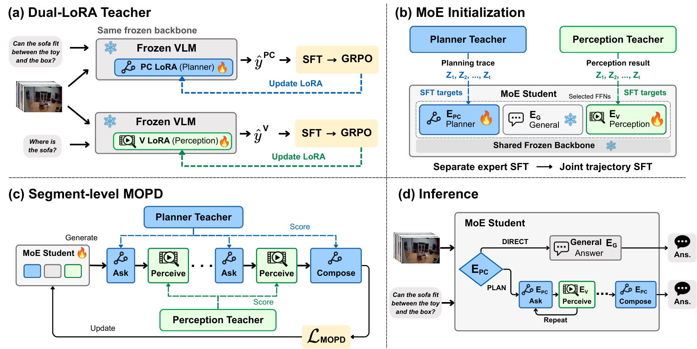

# EgoP²C: Role isolation and segmented multi-teacher on-policy distillation

<!-- source-sha256: 32ed4ec948c5aecbb3efc0cb41377df77da64aeb68f80c51ac760bebfb3a10f2 -->

[简体中文](README.md)

## Paper information

| Field | Details |
| --- | --- |
| Paper links | [arXiv 2610.22681](https://arxiv.org/abs/2610.22681); [pinned v1 full text](https://arxiv.org/html/2610.22681v1) |
| Original title | EgoP²C: Internalizing Plan-Perceive-Compose for Spatial Reasoning in Egocentric Video |
| Company / institution | First author Chaoyu Li: Arizona State University (first listed) and Meta; work completed during a Meta internship. Arka Sadhu, Yuliang Li, Hyo Jin Kim, and Yuning Chai are from Meta. |
| First public release | 2026-10-15 21:51:56 UTC; announced October 19, not first released then |
| Author code | The arXiv abstract and v1 text list no repository. No verifiable author implementation or code license was found. |
| Local adapter / stable key | `ego-p2c`; `adapter: null`, no paper reproduction CLI or Evolve operator |
| Local implementation | `src/auto_research/foundation_models/ego_p2c.py`; `scripts/run_oct19_evening_foundation_components.py` |
| Implementation status | `component_only`, `l1_mechanism`, no capability comparison or automatic promotion |
| Full experiment | Reviewed and not reproduced because of cost; `not_reproduced_high_cost` |

## Paper summary

### Background and main changes

Egocentric video reasoning needs to ask questions and collect evidence while keeping perceptual answers reliable. A fixed external vision tool cannot improve with the reasoning policy, while sharing all planning and perception parameters can create conflicting gradients.

EgoP²C first trains separate plan/compose (PC) and perception (V) LoRA teachers on a frozen VLM. It copies selected FFNs into PC, V, and general direct-answer (G) experts. The student generates its own interaction segments and the respective frozen teachers score **those same student tokens**, rather than supplying separate answers to imitate. The public video prefix always uses the frozen base path; role-private text, choices, and history do not enter public KV.

~~~mermaid
flowchart LR
  B[Frozen shared base VLM] --> PC[Plan/compose teacher PC]
  B --> V[Perception teacher V]
  B --> G[Base direct-answer teacher G]
  S[Student with copied role FFNs and role LoRA] --> Y[Student samples segments]
  Y --> A[Assign teachers by PC, V, and G]
  PC --> A
  V --> A
  G --> A
  A --> L[Role-length-normalized MOPD]
  L --> S
~~~

Figure 2 covers training and inference; Figure 3 shows segmented MOPD. See [Section 3](https://arxiv.org/html/2610.22681v1#S3).

<!-- paper-figure:start -->
### Original paper figure

> **Paper Figure 2:** The architecture and connections between its major modules. From the [original paper](https://arxiv.org/abs/2610.22681); copyright remains with the authors. Click the image to open its source.
<!-- paper-figure:end -->

### Core equations and information boundaries

For a token $Y_t$ sampled by the frozen student snapshot $\bar\theta$, assign $T(PC)=\pi_{PC}$, $T(V)=\pi_V$, and $T(G)=\pi_B$:

$$
\widetilde A_t=\operatorname{clip}\left(
\operatorname{sg}[\log T(r_t)(Y_t\mid C_t)-\log\pi_{\bar\theta}^{r_t}(Y_t\mid C_t)],-5,5\right),
$$

$$
\mathcal L=-\sum_{s\in\mathcal S(Y)}\frac{\omega_{r_s}}{N_{r_s}(Y)}
\sum_{t\in\mathcal I_s}\widetilde A_t\log\pi_\theta^{r_s}(Y_t\mid C_t).
$$

$N_r$ counts supervised tokens across **every segment of that role in one trajectory**, not an independent mean per segment. Teacher and old student log probabilities are detached and normalized over the full vocabulary. This is a local reverse-KL surrogate on fixed sampled contexts, not exact trajectory KL.

Initialize experts as $E_r=F_0$ and role projections as $W_r=W_0+B_rA_r$, with $B_{PC}=B_V=0$ initially. The final 12 layers use role experts and q/k/v/o residuals. The G FFN stays frozen; G attention residuals train only during MOPD.

V sees only the video, a self-contained subquestion, and its own generated answer tokens, not the original choices or PC history. G sees the original video, question, and choices, not PC mode text or private history. PC sees the currently available question, choices, and previous interactions. Training, sampling, and teacher scoring share these boundaries; teacher switches do not reuse private decoder KV.

### Offline and online results reported in the paper

In Table 5 the Qwen3-VL-8B base gives 57.9 / 31.0 / 35.2 on VSI-Bench, EgoProx, and R3D-Bench. The full MoE plus role initialization and MOPD gives 62.1 / 45.9 / 43.7. Compared to the Dual-LoRA teacher the authors report 65.8–66.3% fewer FLOPs and 1.29–1.49× speedup, dependent on actual 8B video models, cache, and training. These are not local results. No production user A/B is reported.

## Local reproduction

### Implementation, data, and execution

The local component actually copies role FFNs, applies q/k/v/o low-rank residuals and causal attention, freezes the public-prefix path and required parameters, scores the full vocabulary, and computes the above loss. It uses a 12-dimensional single-layer decoder and artificial token IDs, **not a vision encoder or real video**. PLAN and DIRECT scaffolds are fixed; only tokens inside each segment are sampled live from the student. There is no trained spatial teacher, free-form tool calling, or learned router.

Pinned synthetic recipe `synthetic-role-decoder-mlp-attention@oct19-evening-foundation-mechanisms-v1`, seeds 42/43/44. No checkpoints or data are downloaded. Teachers are independently frozen random perturbation distributions to test assignment, gradients, and freezing, not capable models.

~~~bash
PYTHONPATH=src python scripts/run_oct19_evening_foundation_components.py \
  --methods ego-p2c --device cpu --seeds 42,43,44 \
  --output runs/oct19-evening/ego-p2c-cpu.json
~~~

Use `--device cuda` for CUDA; unavailability fails without fallback. Each run needs a new output path. Raw artifacts retain trajectories, visible fields, student/teacher scores, role counts, source SHA256, and commit. Public summaries store per-seed scalars and hashes, not long trajectories.

### Results and independent comparison

Targeted tests check independent scalar log-sum-exp loss, manual logit gradients, old-policy rescoring, segmented normalization, equality at copied initialization, isolation of the public prefix, zero gradient to frozen teachers/base, and a real nonzero SGD update. Wrong teacher assignment and illegal Perception options are negative controls. An all-ones success rate is not used as capability evidence.

Real A100 execution at frozen source `73a1e8b8` passed forward/gradient references, context isolation, and nonzero update for seeds 42/43/44. See [per-seed metrics](metrics/component-cuda-seeds42-44.json) and the [sanitized GPU receipt](../../gpu-validations/ego-p2c-a100-20261019.json). This covers small operators, not video capability.

### Cost decision and limits

The paper uses an 8B backbone, 12 MoE layers, rank-16 residuals, three student SFT stages of three epochs each, then 600 MOPD updates on 8,000 prompts. Teachers also have 35,811 / 17,817 SFT examples and two GRPO stages. Training uses eight H100s. **The full experiment was reviewed and not reproduced because of cost.**

No video spatial capability, teacher SFT/GRPO, real checkpoint upcycling, cache acceleration, or end-to-end benchmark is implemented. `diagnostic_only: true`, `promotion_eligible: false`, `evolve_integrated: false`. Three random seeds do not change the evidence level.
