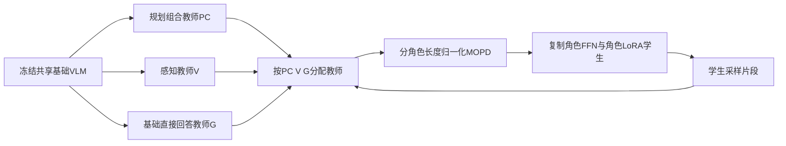
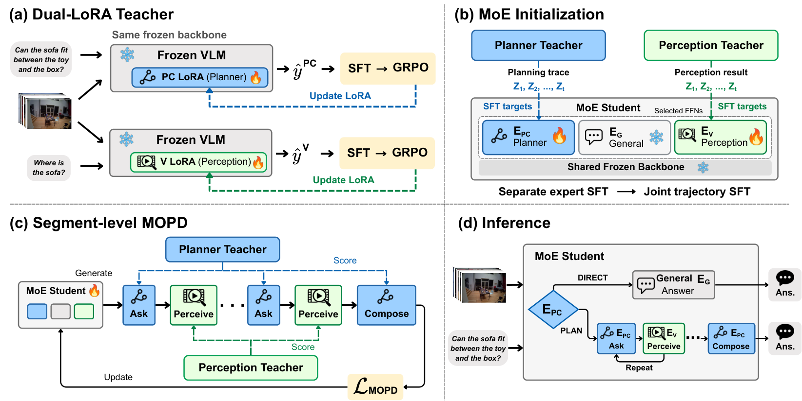

# EgoP²C：角色隔离与分段多教师在策略蒸馏

## 论文信息

| 字段 | 内容 |
| --- | --- |
| 论文链接 | [arXiv 2610.22681](https://arxiv.org/abs/2610.22681)；[固定v1全文](https://arxiv.org/html/2610.22681v1) |
| 原文标题 | EgoP²C: Internalizing Plan-Perceive-Compose for Spatial Reasoning in Egocentric Video |
| 公司 / 机构 | 一作Chaoyu Li：Arizona State University（首列）、Meta；在Meta实习期间完成。合作作者Arka Sadhu、Yuliang Li、Hyo Jin Kim、Yuning Chai来自Meta |
| 首次公开日期 | 2026-10-15 21:51:56 UTC；2026-10-19 arXiv公告，不是10月19日首发 |
| 原作者代码 | 官方arXiv摘要与v1正文未列代码仓库；本轮未找到可核验的作者实现或代码许可证 |
| 本地 adapter / 稳定键 | `ego-p2c`；`adapter: null`，未注册论文复现CLI或Evolve算子 |
| 本地复现代码目录 | `src/auto_research/foundation_models/ego_p2c.py`；`scripts/run_oct19_evening_foundation_components.py` |
| 实现状态 | `component_only`、`l1_mechanism`，仅机制诊断；禁止能力比较与自动晋级 |
| 完整实验 | 成本过高，不复现（审查 DONE）；`not_reproduced_high_cost` |

## 原始论文总结

### 背景与主要改动

第一视角视频空间推理既要提问、采集证据，也要保证感知回答可靠。固定外部视觉工具无法随推理策略一起改进；把规划与感知压到同一组参数中又可能引入梯度冲突。

EgoP²C先在冻结VLM上分别训练规划/组合（PC）与感知（V）的LoRA教师，再复制选定FFN形成PC、V、通用直接回答（G）专家。学生自己生成交互片段，由相应冻结教师实时评价**同一批学生tokens**，而非模仿教师另行生成的答案。公共视频前缀始终走冻结基础路径；角色私有文字、选项和历史不混入公共KV。



最有价值的方法图是原文Figure 2（整体训练与推理）及Figure 3（分段MOPD）；参见[原文Section3](https://arxiv.org/html/2610.22681v1#S3)。

<!-- paper-figure:start -->
### 原论文关键图

[](https://arxiv.org/html/2610.22681v1/pipeline.png)

> **原论文 Figure 2（关键图）**：展示原论文提出的核心架构、主要模块及其连接关系。图片来自[原论文](https://arxiv.org/abs/2610.22681)，版权归原作者所有；点击图片可查看来源。
<!-- paper-figure:end -->

### 核心公式与信息边界

对于学生在冻结采样快照 $\bar\theta$ 下生成的token $Y_t$，分配 $T(PC)=\pi_{PC}$、$T(V)=\pi_V$、$T(G)=\pi_B$：

$$
\widetilde A_t=\operatorname{clip}\left(\operatorname{sg}[\log T(r_t)(Y_t\mid C_t)-\log\pi_{\bar\theta}^{r_t}(Y_t\mid C_t)],-5,5\right),
$$

$$
\mathcal L=-\sum_{s\in\mathcal S(Y)}\frac{\omega_{r_s}}{N_{r_s}(Y)}\sum_{t\in\mathcal I_s}\widetilde A_t\log\pi_\theta^{r_s}(Y_t\mid C_t).
$$

$N_r$是**整个单条轨迹中该角色所有片段的监督token总数**，不是每段独立平均。教师和旧学生log-prob均停止梯度，完整词表归一化；它是固定采样上下文上的局部reverse-KL代理，不是精确完整轨迹KL。

专家初始化 $E_r=F_0$；角色投影 $W_r=W_0+B_rA_r$，初始 $B_{PC}=B_V=0$。原文最后12层使用角色专家及q/k/v/o residual；G的FFN始终冻结，G attention residual在MOPD阶段才训练。

V只看视频、自包含子问题和自己已生成的回答tokens；不看原问题选项或PC历史。G看原视频和原问题/选项，不看PC的mode文字或私有历史。PC看当前可用的问题、选项与既往交互。训练、学生采样和教师打分必须采用相同边界，教师切换不复用私有decoder KV。

### 论文离线与线上效果

原文Table5中Qwen3-VL-8B基础模型在VSI-Bench/EgoProx/R3D-Bench为57.9/31.0/35.2，完整MoE＋角色初始化＋MOPD为62.1/45.9/43.7。作者相对Dual-LoRA教师报告65.8–66.3% FLOPs下降和1.29–1.49倍加速；这些依赖真实8B视频模型、缓存和训练，不是本地结果。生产用户线上A/B：未报告。

## 本地复现

### 实现、数据与运行

本地保留真实角色FFN复制、q/k/v/o低秩残差、因果attention、公共前缀冻结、严格参数冻结、完整词表打分及上述损失。使用12维单层小型decoder和人工token ids，**没有视觉编码器或真实视频**。预设PLAN和DIRECT骨架，仅各片段内部由学生当前分布实时采样；没有训练过的空间教师、自由工具调用或学习到的路由器。

固定合成recipe `synthetic-role-decoder-mlp-attention@oct19-evening-foundation-mechanisms-v1`，seeds42/43/44；不下载checkpoint或数据。教师是独立冻结的随机扰动分布，只用于验证教师分配、梯度和冻结协议，不代表强模型。

```bash
PYTHONPATH=src python scripts/run_oct19_evening_foundation_components.py \
  --methods ego-p2c --device cpu --seeds 42,43,44 \
  --output runs/oct19-evening/ego-p2c-cpu.json
```

CUDA将device改为`cuda`；无CUDA明确失败，不回退。每次使用新输出路径；raw保留轨迹、可见字段、学生/教师分数、角色计数、源码SHA256与commit。正式汇总只保留逐seed标量和hash，不把大轨迹塞进公共看板。

### 结果与独立对照

定向测试核对独立标量log-sum-exp损失、手工logit梯度、旧策略重新打分、分段长度归一化、复制初始化恒等、公共前缀不受角色改动、冻结教师/基础参数零梯度和真实非零SGD更新。错误教师分配与非法Perception选项输入作为负对照；不以全1成功率包装能力。

已在真实 A100 上按固定源码 `73a1e8b8` 执行 seeds 42/43/44，前向/梯度参考、上下文隔离与非零更新检查通过：[逐 seed 指标](metrics/component-cuda-seeds42-44.json)、[脱敏 GPU 收据](../../gpu-validations/ego-p2c-a100-20261019.json)。仅覆盖上述小规模算子，不是视频能力。

### 成本判断与边界

原文使用8B骨干、12个MoE层、rank16残差，三段学生SFT各3epoch，再用8000提示训练600次MOPD更新；教师另有35,811/17,817条SFT和两段GRPO，训练设备为**8张H100**。完整实验**成本过高，不复现（审查 DONE）**。

本地不含视频空间能力、教师SFT/GRPO、真实checkpoint upcycling、缓存加速或端到端benchmark。`diagnostic_only: true`、`promotion_eligible: false`、`evolve_integrated: false`；三个随机seed不会改变这一证据等级。
