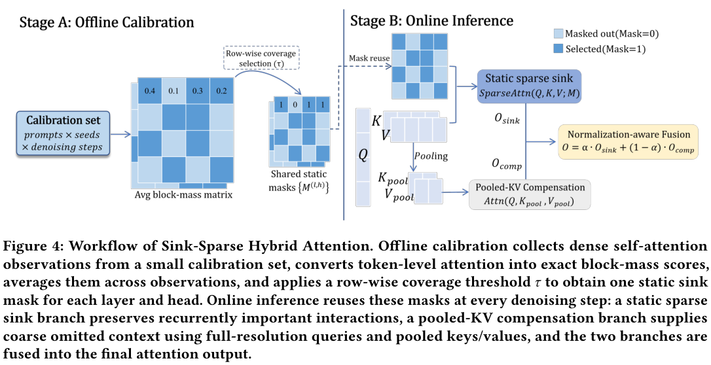

# Sink-Sparse: Static probability-mass coverage and normalizer-aware hybrid attention

<!-- source-sha256: fc1ff073b03c88e8fdd92a380029e4fe9742b81cc4242f5e5b942b9a9809fb6d -->

[简体中文](README.md)

## Paper information

| Field | Details |
| --- | --- |
| Paper links | [arXiv 2610.22975](https://arxiv.org/abs/2610.22975); [pinned v1 full text](https://arxiv.org/html/2610.22975v1) |
| Original title | Sink-Sparse Hybrid Attention for Efficient Inference in T2I/T2V Diffusion Transformers |
| Company / institution | First author Bingxin Xing: Xi'an Jiaotong University; collaboration with Xiamen University and Shanghai Jiao Tong University |
| First public release | 2026-10-16 05:50:56 UTC; announced October 19, not first released then |
| Author code | No repository is listed in the abstract or v1 text. No verifiable author implementation or code license was found. |
| Local adapter / stable key | `sink-sparse`; `adapter: null`, no full DiT reproduction or Evolve operator |
| Local implementation | `src/auto_research/foundation_models/sink_sparse.py`; `scripts/run_oct19_evening_foundation_components.py` |
| Implementation status | `component_only`, L1 mechanism diagnostic, no end-to-end video generation speedup |
| Full experiment | Reviewed and not reproduced because of cost; `not_reproduced_high_cost` |

## Paper summary

### Background and main changes

A diffusion Transformer repeats costly attention at every denoising step. The authors observe that high-probability block relationships in some layers and heads are relatively stable across prompts and seeds. One offline calibration can therefore select a static sparse support. A lower-resolution global KV branch recovers distributed context without changing weights or the sampling schedule.

~~~mermaid
flowchart LR
  C[Independent offline calibration Q and K] --> M[Aggregate exact token probabilities into block mass]
  M --> S[Static mask from shortest mass-covering prefix per row]
  Q[New Q, K, and V] --> A[Sparse attention over selected blocks]
  S --> A
  Q --> P[Mean-pooled global K and V branch]
  A --> F[Fuse with LSE and pooling-factor correction]
  P --> F
  F --> O[Hybrid output]
~~~

Paper Figure 4 shows both stages; see [Section 4](https://arxiv.org/html/2610.22975v1#S4).

<!-- paper-figure:start -->
### Original paper figure

> **Paper Figure 4:** Offline block-mass calibration and static mask, online sparse attention, and pooled-KV/LSE fusion. The white-background PDF version keeps black text readable rather than converting the transparent HTML image to RGB. From the [original paper](https://arxiv.org/abs/2610.22975); copyright remains with the authors. Click the image to open its source.
<!-- paper-figure:end -->

### Core equations

Using dense probabilities $A=\operatorname{softmax}(QK^\top/\sqrt d)$, compute exact mass from each query block to each key block:

$$
m_{rc}=\frac1{|\mathcal B_r|}\sum_{i\in\mathcal B_r}\sum_{j\in\mathcal B_c}A_{ij},\qquad \sum_c m_{rc}=1.
$$

Average independent calibration observations into $\bar m$. In each row, take the shortest descending prefix reaching $\tau\sum_c\bar m_{rc}$. Attention over averaged Q/K is not a replacement for exact mass, and masks are not reselected on test inputs.

The sparse branch yields $O_s$ and row log-normalizer $\ell_s$. The compensation branch uses nonoverlapping mean-pooled KV groups of size $g$, producing $O_c,\ell_c$. Pool **all tokens, including sink blocks**, not just the omitted ones:

$$
\alpha_i=\frac{e^{\ell_{s,i}}}{e^{\ell_{s,i}}+e^{\ell_{c,i}+\log g}}
=\sigma(\ell_{s,i}-\ell_{c,i}-\log g),\qquad
O_i=\alpha_iO_{s,i}+(1-\alpha_i)O_{c,i}.
$$

`log(g)` corrects support size rather than giving each branch a fixed half weight. Supports overlap, so hybrid and dense outputs are not generally equal. A degenerate case such as full support and gap 1 should recover dense attention.

### Offline and online results reported in the paper

For Wan2.1-T2V-1.3B at 832×480 and 81 frames / 50 steps, dense attention takes 164.80 s with mean VBench 0.656. The $\tau=.85$ hybrid takes 106.73 s (1.54×) with 0.659. At $.70$ it takes 94.57 s (1.74×), but quality drops to 0.647. Z-Image-Turbo at 2048 image resolution takes 14.88 s versus 23.39 s (1.57×), with Soft-TIFA GM 15.21 versus 16.38 dense. These are single-A800 80 GB paper measurements, not local GPU results, and quality does not improve on every metric. No production user A/B is reported.

## Local reproduction

### Implementation and data protocol

The component executes exact probability-mass calibration, shortest prefixes, static-mask reuse, actual selected-block gathers, global mean pooling, and stable sigmoid fusion. Python loops check correctness rather than serve as FlashAttention/Triton production kernels. Sparsity is not converted into a measured speedup.

Pinned synthetic recipe `synthetic-role-decoder-mlp-attention@oct19-evening-foundation-mechanisms-v1`: six independent calibration observations and two new evaluation observations, two heads × 12 tokens, block 3 and gap 3. The two sets are independently generated, with a fixed threshold rather than hyperparameter selection from evaluation outputs. Q/K/V gradients use real Torch backward; synthetic MSE checks nonzero updates, not image-generation capability.

~~~bash
PYTHONPATH=src python scripts/run_oct19_evening_foundation_components.py \
  --methods sink-sparse --device cpu --seeds 42,43,44 \
  --output runs/oct19-evening/sink-sparse-cpu.json
~~~

Use `--device cuda` for CUDA. Existing results cannot be overwritten. Raw results retain calibration mass, mask, fusion weights, source hash, and commit; public summaries keep scalar metrics and hashes only.

### Results and independent comparison

The independent reference concatenates selected token logits with all pooled logits plus `log(g)` and performs **one softmax** to compare outputs and Q/K/V gradients. A per-token scalar reference checks calibration mass. Tests cover shortest prefix, dense recovery at full support and gap 1, rejection of empty support, static-mask independence from new inputs, and real nonzero updates. Fixed averaging and omission of `log(g)` are negative controls.

A real A100 at frozen source `73a1e8b8` passed reference output/gradient, calibration isolation, and nonzero-update checks for seeds 42/43/44. See [per-seed metrics](metrics/component-cuda-seeds42-44.json) and the [GPU receipt](../../gpu-validations/sink-sparse-a100-20261019.json). `heldout_dense_output_rmse` measures approximation error on random tensors, not VBench/GenEval or fused-kernel speed.

### Cost decision and limits

The full paper needs the 1.3B video and Z-Image backbones, calibration across four prompts × two seeds × multiple denoising steps, and multi-metric, multi-method generation at 81 frames and 2048 image resolution. Even though the authors use one 80 GB card, the full evaluation is costly on the available A100/A30. **The full experiment was reviewed and not reproduced because of cost.** No video checkpoint was downloaded, no complete generation was run, no end-to-end speedup is claimed, and the diagnostic cannot promote Evolve.
