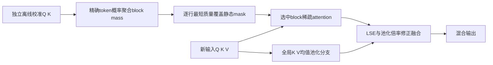
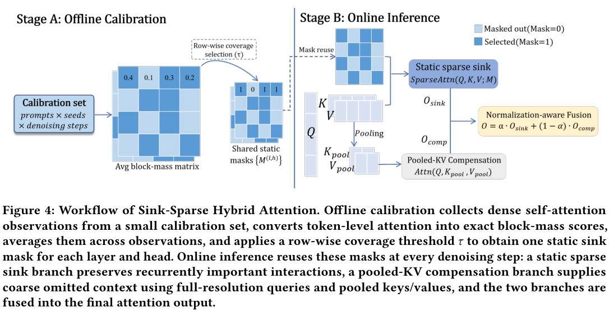

# Sink-Sparse：静态质量覆盖与归一化感知双分支注意力

## 论文信息

| 字段 | 内容 |
| --- | --- |
| 论文链接 | [arXiv 2610.22975](https://arxiv.org/abs/2610.22975)；[固定v1全文](https://arxiv.org/html/2610.22975v1) |
| 原文标题 | Sink-Sparse Hybrid Attention for Efficient Inference in T2I/T2V Diffusion Transformers |
| 公司 / 机构 | 一作Bingxin Xing：Xi'an Jiaotong University；合作Xiamen University、Shanghai Jiao Tong University |
| 首次公开日期 | 2026-10-16 05:50:56 UTC；2026-10-19 arXiv公告，不是10月19日首发 |
| 原作者代码 | 官方arXiv摘要和v1正文未列代码仓库；本轮未找到可核验的作者实现或代码许可证 |
| 本地 adapter / 稳定键 | `sink-sparse`；`adapter: null`，未注册完整DiT复现或Evolve算子 |
| 本地复现代码目录 | `src/auto_research/foundation_models/sink_sparse.py`；`scripts/run_oct19_evening_foundation_components.py` |
| 实现状态 | `component_only`，L1机制诊断；不包含端到端视频生成加速 |
| 完整实验 | 成本过高，不复现（审查 DONE）；`not_reproduced_high_cost` |

## 原始论文总结

### 背景与主要改动

扩散Transformer在每个去噪步重复执行昂贵的attention。本文观察到某些层/头中的高概率block关系在不同提示和seed下较稳定，因此一次离线校准即可得到静态稀疏支持；另用低分辨率全局KV分支补回分散上下文，无需改权重或采样schedule。



原文Figure 4是两阶段方法总览，见[Section4](https://arxiv.org/html/2610.22975v1#S4)。

<!-- paper-figure:start -->
### 原论文关键图

[](https://arxiv.org/pdf/2610.22975v1#page=6)

> **原论文 Figure 4（关键图）**：Sink-Sparse 的离线 block-mass 校准、静态 mask、在线稀疏注意力及 pooled-KV/LSE 融合。使用白底 PDF 原图，避免 HTML 透明图转 RGB 后黑字不可读。图片来自[原论文](https://arxiv.org/abs/2610.22975)，版权归原作者所有；点击图片可查看来源。
<!-- paper-figure:end -->

### 核心公式

首先由dense概率 $A=\operatorname{softmax}(QK^\top/\sqrt d)$ 统计每个query block到key block的精确质量：

$$
m_{rc}=\frac1{|\mathcal B_r|}\sum_{i\in\mathcal B_r}\sum_{j\in\mathcal B_c}A_{ij},\qquad\sum_c m_{rc}=1.
$$

对独立校准观测平均 $\bar m$ 后，逐行降序取达到 $\tau\sum_c\bar m_{rc}$ 的最短前缀。不能用平均Q/K的近似attention替代精确质量，也不能在测试输入上重选mask。

稀疏分支输出 $O_s$ 与行log-normalizer $\ell_s$；补偿分支用不重叠gap为 $g$ 的均值池化KV输出 $O_c,\ell_c$。其KV包括**全部token，包含sink块**，不是只池化遗漏部分：

$$
\alpha_i=\frac{e^{\ell_{s,i}}}{e^{\ell_{s,i}}+e^{\ell_{c,i}+\log g}}
=\sigma(\ell_{s,i}-\ell_{c,i}-\log g),\qquad
O_i=\alpha_iO_{s,i}+(1-\alpha_i)O_{c,i}.
$$

`log(g)`修正支持大小，不是固定一半平均。两分支有重叠，不承诺混合输出与原dense attention严格相同；只有例如全支持且gap1的退化情形应恢复dense结果。

### 论文离线与线上效果

原文Wan2.1-T2V-1.3B、832×480、81帧/50步：dense164.80s、VBench均值0.656；$\tau=.85$混合为106.73s（1.54倍）、0.659。更激进$.70$为94.57s（1.74倍）但质量0.647，存在质量损失。Z-Image-Turbo2048图像上14.88s vs23.39s（1.57倍），Soft-TIFA GM15.21 vsdense16.38，也非全部指标不降。原文单A80080GB测量，不是本地GPU测量。生产用户线上A/B：未报告。

## 本地复现

### 实现与数据协议

本地执行真实精确概率质量校准、最短前缀、静态mask复用、选中block实际gather计算、全局均值池化及稳定sigmoid融合。Python循环仅用于正确性，不是FlashAttention/Triton生产kernel，不以稀疏比例换算实测加速。

固定人工recipe `synthetic-role-decoder-mlp-attention@oct19-evening-foundation-mechanisms-v1`：6份独立校准观测、2份新评测观测、2头×12tokens，block3/gap3。两个集合独立生成；阈值固定，不用评测输出选择超参。Q/K/V梯度是真实torch反向，人工MSE目标只用于检查非零更新，不是图像生成能力分数。

```bash
PYTHONPATH=src python scripts/run_oct19_evening_foundation_components.py \
  --methods sink-sparse --device cpu --seeds 42,43,44 \
  --output runs/oct19-evening/sink-sparse-cpu.json
```

CUDA运行改为`--device cuda`；不可覆盖已有结果。raw记录校准质量、静态mask、融合权重、源码hash与commit；公共汇总只保留标量指标及hash。

### 结果与独立对照

独立参考把“选中token logits”和“所有pooled logits＋log(g)”拼接后执行**一次softmax**，核对输出及Q/K/V梯度；另以逐token标量计算校准质量。测试覆盖最短前缀、完整支持gap1恢复dense、空支持拒绝、mask不随新输入改变与真实非零参数更新。负对照是固定平均，以及漏掉`log(g)`修正。

已在真实 A100、固定源码 `73a1e8b8` 下完成 seeds 42/43/44 的输出/梯度参考、静态校准隔离和非零更新检查：[逐 seed 指标](metrics/component-cuda-seeds42-44.json)、[GPU 收据](../../gpu-validations/sink-sparse-a100-20261019.json)。`heldout_dense_output_rmse`仅衡量随机张量上的近似误差，不是VBench/GenEval得分，也不是融合 kernel 加速测量。

### 成本判断与边界

完整论文需1.3B视频及Z-Image生成骨干、4提示×2seed×多去噪步校准，以及81帧视频/2048图像的多指标和多方法生成矩阵。即使原文用单张80GB卡，整个评测对当前单A100/A30仍属高成本；**成本过高，不复现（审查 DONE）**。不下载视频checkpoint，不跑完整生成或宣称端到端加速，禁止Evolve基于本诊断晋级。
