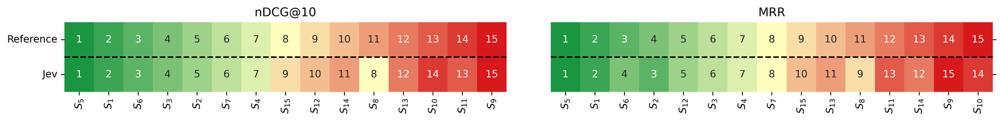

# JEV Portuguese retrieval: Relevance judgments, independent-probability reranking, and evaluation

<!-- source-sha256: c083c4ee03d1fff18bb89722ee0168c89034d193bf6f1c455f265388931fcf0a -->

[简体中文](README.md)

> **Low-cost evaluation protocol, not a reproduction of the JEV model.** Local work checks the offline contract and the arithmetic of published confusion matrices. It makes no commercial API calls, produces no new model predictions, and does not reproduce the paper's retrieval gains.

## Paper information

| Field | Details |
| --- | --- |
| Paper links | [arXiv 2610.23346](https://arxiv.org/abs/2610.23346); [v1 full text](https://arxiv.org/html/2610.23346v1) |
| Company / institution | First author Leandro Carísio Fernandes: Câmara dos Deputados; collaboration with UFCA and Unicamp |
| First public release | 2026-10-16 11:52:46 UTC, v1; announced October 19 |
| Author code | No author implementation repository was found as of 2026-10-19. The TypeSafe API or SDK does not make the paper code open source. |
| Adapter | No full algorithm adapter; standalone interface key `jev-portuguese-ir` |
| Local implementation | [`src/auto_research/system_one/portuguese_ir.py`](https://github.com/daiwk/auto-research/blob/main/src/auto_research/system_one/portuguese_ir.py) |

## Paper summary

### Background and main changes

Assigning discrete relevance grades and ordering retrieval candidates are different tasks. On four Brazilian Portuguese retrieval sets, the paper uses Choice to output ordinal labels and compares them to the human or original qrels. On Quati it separately uses an independent Noul probability that each document directly answers the query, gathers every batch, and sorts the results. Candidates do not compete in a single Choice, probabilities are not mixed with BM25 scores, and there is no trained calibrator.

~~~mermaid
flowchart LR
  Q[Public queries and documents] --> C[Choice ordinal relevance grades]
  Q --> N[Independent Noul probability per document]
  N --> B[Batch a query and collect all scores]
  B --> R[Stable descending sort with optional tail preservation]
  C --> A[Separate weighted kappa and system-rank tau evaluation]
  R --> E[Separate qrels with linear nDCG and MRR]
~~~

<!-- paper-figure:start -->
### Original paper figure

> **Paper Figure 1:** System-ranking heatmap on NormasTCU with original versus Jev qrels. Colors and numbers show ranking changes, not a local model evaluation. From the [original paper](https://arxiv.org/abs/2610.23346); copyright remains with the authors. Click the image to open its source.
<!-- paper-figure:end -->

### Core equations

Quati/JurisTCU retain the original 0–3 grade order and NormasTCU/Ulysses-RFCorpus retain 0–2; neither is collapsed to binary. Quadratic weighted kappa is $1-\sum w_{ij}O_{ij}/\sum w_{ij}E_{ij}$ with $w_{ij}=(i-j)^2$. If expected disagreement is zero, the result is unknown, not automatically 1. System ranking uses Kendall's tie-aware $\tau_b$.

The direct reranking score is $s(q,d)=P(\text{document directly answers the query})$. Normalize whitespace and truncate only the body; the separate title does not count against the body character limit. Sort stably after collecting all scores. Missing, extra, duplicate, or nonfinite scores or a wrong model identity invalidate the whole query rather than silently zeroing or dropping it. nDCG uses **linear** relevance gains, MRR treats grades above 0 as relevant, and metrics are macro-averaged over a fixed query set. Queries with no annotated relevant document count as zero and remain in the denominator.

## Paper results and limitations

Across four sets, the paper reports exact agreement of 52.9%–64.9%, quadratic weighted kappa of 0.52–0.82, and system-rank tau of 0.90–0.93. On 50 Quati test queries with 1,000 candidates each, nDCG@10 rises from 0.3329 to 0.6331 and MRR from 0.6852 to 0.9033. These are paper numbers, not local capability results.

Table 9's mT5-XL and the current BM25 setups differ; they cannot establish whether JEV is better or worse than mT5. The paper does not measure latency, actual cost, or significance. Qrels come from different sources, including LLM and expert annotation; they are not all human gold.

## Local reproduction and limits

~~~bash
PYTHONPATH=src python scripts/run_oct19_evening_system_one.py \
  --seeds 42,43,44 --output runs/jev-portuguese-ir-new.json
~~~

The command runs constructed protocol examples only. The fixture provider returns fixed probabilities by public ID. It does not understand Portuguese and is not JEV. Qrels go to independent scoring, not model requests. Three seeds only vary input candidate order, not model capabilities. Output explicitly records `real_backend_used=false` and `language_model_evaluated=false`; there is no Evolve promotion.

The public confusion matrices in Tables 4–7 are also recomputed across 13,200 pairs. This is labeled `published_table_arithmetic` separately from fixture metrics; it verifies published arithmetic without new inference or test-data access.

## Cost gate

**The full experiment was reviewed and not reproduced because of cost.** It requires a closed JEV API for 13,200 relevance judgments and 50,000 reranking query–document pairs: 100 requests per query, 5,000 reranking requests in total, plus comparisons across multiple retrieval systems. Actual cost and runtime are not reported and cannot be cheaply confirmed under the budget. No API requests, credentials, million-item corpus download, or cost probe were used, and this is not an unfinished training TODO. The interface itself runs on CPU and makes no GPU claim.
