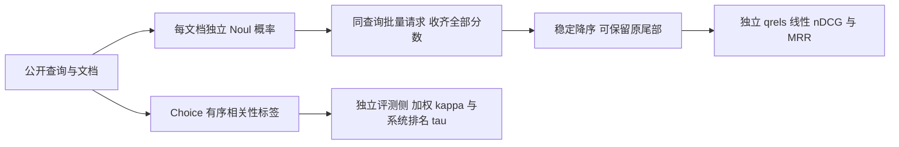
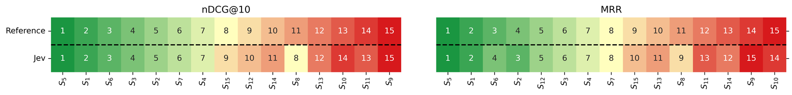

# JEV 葡语检索：相关性判定、独立概率重排与评测协议

> **状态：低成本评测协议接口，不是 JEV 模型复现。** 本地只做离线合同验证和已发表混淆矩阵的算术复核，不调用商业 API、不生成新模型预测、不声称重现论文检索提升。

## 论文信息

| 项目 | 内容 |
| --- | --- |
| 论文链接 | [arXiv 2610.23346](https://arxiv.org/abs/2610.23346) / [v1 全文](https://arxiv.org/html/2610.23346v1) |
| 公司/机构 | 一作 Leandro Carísio Fernandes：Câmara dos Deputados；合作 UFCA / Unicamp |
| 首次公开日期 | 2026-10-16 11:52:46 UTC，v1；10 月 19 日公告 |
| 原文开源代码 | 未找到作者论文实现仓库（2026-10-19 核验）；TypeSafe API/SDK 不等于论文代码开源 |
| Adapter | 无完整算法 adapter；独立接口 key `jev-portuguese-ir` |
| 本地复现代码 | [`src/auto_research/system_one/portuguese_ir.py`](https://github.com/daiwk/auto-research/blob/main/src/auto_research/system_one/portuguese_ir.py) |

## 原始论文总结

### 背景与主要改动

检索中“给文档打离散相关性标签”和“给候选排序”并不是同一个任务。论文在四个巴西葡语检索集上，用 Choice 输出有序标签并比较人工/原始 qrels；另在 Quati 中把每个文档是否直接回答查询表示为独立 Noul 概率，收集全部批次再排序。候选不在单一 Choice 中竞争，也不与 BM25 分数混合，不训练校准模型。



<!-- paper-figure:start -->
### 原论文关键图

[](https://arxiv.org/html/2610.23346v1/normas_heatmap_rankings_llms.png)

> **原论文 Figure 1（关键图）**：NormasTCU 使用原始 qrels 与 Jev qrels 后的系统排名热力图；颜色和数字表示排名变化，不是本地模型评测。图片来自[原论文](https://arxiv.org/abs/2610.23346)，版权归原作者所有；点击图片可查看来源。
<!-- paper-figure:end -->

### 核心公式

Quati/JurisTCU 保留 0–3，NormasTCU/Ulysses-RFCorpus 保留 0–2 的原始标签顺序，不合并成二分类。二次加权 κ 为 $1-\sum w_{ij}O_{ij}/\sum w_{ij}E_{ij}$，$w_{ij}=(i-j)^2$；若期望分歧为零则未知，不强填 1。系统排名使用带 tie 的 Kendall τ-b。

重排得分直接为 $s(q,d)=P(\text{文档直接回答查询})$。归一空白后只截断正文，标题独立，不计入正文字符上限。分数收齐后稳定排序；遗漏、额外、重复、非有限值或模型身份不符均拒绝整个查询，不能悄悄置零或删查询。nDCG 使用**线性** relevance gains，MRR 以 grade>0 定义相关；按固定查询集合宏平均。无已标注相关文档的查询按零分计，不从分母删除。

## 论文原始结果与限制

原文四个集合 exact agreement 为 52.9%–64.9%，二次加权 κ 为 0.52–0.82；系统排名 τ 为 0.90–0.93。Quati 50 个测试查询、每个 top-1000 候选，nDCG@10 从 0.3329 至 0.6331，MRR 从 0.6852 至 0.9033。本文只转述这些原文数字，不是本地能力结果。

论文表 9 的 mT5-XL 和当前 BM25 设置不同，不能据此认定 JEV 优于/劣于 mT5；作者也没有测量延迟、实际费用或显著性。四数据集的 qrel 来源不同，包括 LLM 标注和专家标注，不能混称全人工 gold。

## 本地复现与边界

```bash
PYTHONPATH=src python scripts/run_oct19_evening_system_one.py \
  --seeds 42,43,44 --output runs/jev-portuguese-ir-new.json
```

此命令只运行构造协议样例。fixture provider 按公开 id 返回预设概率，不理解葡语、不称作 JEV。qrels 只传给独立评分函数，不进入模型请求。三种子只改变候选输入顺序，不表示三次模型能力实验；输出明确 `real_backend_used=false`、`language_model_evaluated=false`，不晋升 evolve。

另外复算原文 Tables 4–7 的公开混淆矩阵，共 13,200 对。该部分标为 `published_table_arithmetic`，与本地 fixture 指标分离；它只核对作者发表数字的算术，不是重新推理或访问测试数据。

## 成本门槛

**成本过高，不复现（审查 DONE）。** 完整方案需封闭 JEV API 的 13,200 次相关性判断和 50,000 个重排 query–document 对（每查询 100 请求，共 5,000 个重排请求），还包括多检索系统对照。原文未给实际费用/用时，无法在当前预算内廉价确认，因此不发 API 请求、不取用凭据、不下载 1M 语料，不启动试跑证明成本，不作为未完成训练 TODO。接口本身 CPU 即可，无 GPU 宣称。
