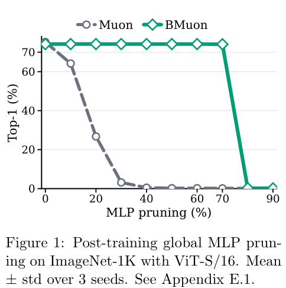

# BMuon: Two-sided spectral geometry under a global channel budget

<!-- source-sha256: 63336111a063a03aac6cdbabba62e889b31a1798cdbd9d4d31f0f0406d45132f -->

[简体中文](README.md)

## Paper information

| Field | Details |
| --- | --- |
| Paper links | [arXiv 2610.23571](https://arxiv.org/abs/2610.23571); [pinned v1 full text](https://arxiv.org/html/2610.23571v1) |
| Original title | BMuon: Budgeting Muon's Spectral Geometry for Structured Compressibility |
| Company / institution | First author Rida Assalouh: Inria (first listed), École polytechnique; collaborators from CISPA, University of Calgary, and ENS/PSL/CNRS |
| First public release | 2026-10-16 14:52:56 UTC; arXiv announcement October 19, not the first release |
| Author code | The [official repository](https://github.com/RidaAssalouh/BMuon) had only a README at review time. It says the implementation and reproduction scripts will be released later. No implementation or license was verified. |
| Local adapter / stable key | `bmuon`; `adapter: null`, no registered Evolve execution operator |
| Local implementation | `src/auto_research/foundation_models/bmuon.py`; `scripts/run_oct19_evening_foundation_components.py` |
| Implementation status | `component_only`, L1 mechanism diagnostic, not the paper's training or pruning outcome |
| Full experiment | Reviewed and not reproduced because of cost; `not_reproduced_high_cost` |

## Paper summary

### Background and main changes

Muon's spectral-norm update need not produce weights that are easy to prune by hidden channel. BMuon neither adds a forward-pass gate nor merely prunes a pretrained Muon model. **Hidden channels from all MLP blocks share one allocation budget**, and the update geometry changes jointly on the input-row and output-column sides of each channel.

~~~mermaid
flowchart LR
  G[Actual gradients of paired MLP matrices] --> M[Nesterov momentum]
  M --> P[Polar factors weighted by current allocation]
  P --> A[MM scores for channels in all blocks]
  A --> K[Solve global budget by bisection]
  K --> U[Recompute both polar updates using new allocation]
  M --> U
  U --> W[Update MLP input rows and output columns]
~~~

Figure 1 shows the paper's structured pruning results, not local measurements. [Algorithm 1 and Eqs. 7–8](https://arxiv.org/html/2610.23571v1#S4) specify the method directly.

<!-- paper-figure:start -->
### Original paper figure

> **Paper Figure 1:** Global MLP channel-pruning accuracy curves on ImageNet-1K for Muon and BMuon. These are author results, not an architecture diagram or local measurement. From the [original paper](https://arxiv.org/abs/2610.23571); copyright remains with the authors. Click the image to open its source.
<!-- paper-figure:end -->

### Core equations

Let $W_1^\ell\in\mathbb R^{m_\ell\times d_\ell}$ and $W_2^\ell\in\mathbb R^{p_\ell\times m_\ell}$, with global budget $\sum_{\ell,j}\mu_j^\ell=K$ and $\varepsilon\leq\mu\leq1$. Define $D_\mu=\operatorname{diag}(\mu)$ and $\operatorname{Polar}(M)=UV^\top$. Then

$$
\Delta_1=D_\mu^\alpha\operatorname{Polar}(D_\mu^\alpha M_1),\qquad
\Delta_2=\operatorname{Polar}(M_2D_\mu^\alpha)D_\mu^\alpha.
$$

To update allocation, compute $\bar P_1=\operatorname{Polar}(D_{\bar\mu}^\alpha M_1)$ and $\bar P_2=\operatorname{Polar}(M_2D_{\bar\mu}^\alpha)$ with the old $\bar\mu$:

$$
a_j^\ell=\langle M_{1,j:}^\ell,\bar P_{1,j:}^\ell\rangle+\langle M_{2,:,j}^\ell,\bar P_{2,:,j}^\ell\rangle,
\quad Q(\mu\mid\bar\mu)=\sum_{\ell,j}a_j^\ell(\mu_j^\ell)^\alpha.
$$

$$
\mu_j^\ell\leftarrow\operatorname{clip}_{[\varepsilon,1]}\left[(\alpha a_j^\ell/\lambda_\mu)^{1/(1-\alpha)}\right],\qquad\sum\mu=K.
$$

Bisection finds a **single $\lambda_\mu$ shared across all blocks**. The new allocation is used to recompute polar updates. The paper performs MM every five steps and uses $\alpha=1/2$. Local momentum is $B_t=\beta B_{t-1}+G_t$ and $M_t=G_t+\beta B_t$.

### Offline and online results reported in the paper

For ImageNet ViT-S/16, BMuon's Top-1 accuracy is 74.08% after pruning 70% of MLP channels versus 74.17% without pruning. Muon drops from 75.23% to 3.17% after pruning 30%. For 1B LLaMA, unpruned Muon has better PPL (10.92 versus 12.84), but BMuon remains around 12.85–12.86 after 80% pruning. Greater compressibility does not establish uniformly better unpruned capability. No production user A/B test is reported.

## Local reproduction

### Implementation and execution

`BudgetMuon` accepts multiple real paired MLPs and executes gradients, Nesterov momentum, global-budget MM, and two-sided parameter updates. The local implementation uses **exact small-matrix SVD polar**, not the paper's five-step Newton–Schulz implementation, and does not claim its speed. FP32/FP64 are supported; FP16/BF16 are explicitly rejected. A missing gradient on either side is also rejected to preserve channel coupling.

The pinned synthetic recipe `synthetic-role-decoder-mlp-attention@oct19-evening-foundation-mechanisms-v1` uses two small MLPs of hidden widths 4 and 3, total budget 2.8, and real GELU/MSE gradients. It is not FineWeb or a classification benchmark.

~~~bash
PYTHONPATH=src python scripts/run_oct19_evening_foundation_components.py \
  --methods bmuon --device cpu --seeds 42,43,44 \
  --output runs/oct19-evening/bmuon-cpu.json
~~~

Use `--device cuda` for CUDA. Output is not overwritten. It records source SHA256, commit, actual per-seed allocations, MM objective, and scalar metrics.

### Results and independent comparison

The independent reference computes polar using eigendecomposition in $A(A^\top A)^{-1/2}$ and uses Python scalar bisection for $\mu=\operatorname{clip}(c a^2)$. It checks an actual one-step parameter update, budget equality, bounds, nondecreasing MM objective, rectangular and zero matrices, and allocation cadence. Unweighted Muon is a negative control, not a substitute for BMuon.

The budget, independent polar, and actual parameter-update checks ran on a real A100 at frozen source `73a1e8b8` for seeds 42/43/44. See [per-seed metrics](metrics/component-cuda-seeds42-44.json) and the [GPU receipt](../../gpu-validations/bmuon-a100-20261019.json). No end-to-end accuracy, kernel throughput, or hardware compression gain was measured.

### Cost decision and limits

The paper trains 1B LLaMA on 13.1B FineWeb tokens, 6,242 steps per seed, taking about 8.4 hours on eight H100s. It also includes three seeds, ImageNet/CIFAR training, and several pruning/retraining settings. **The full experiment was reviewed and not reproduced because of cost.**

No three-matrix SwiGLU extension, LLM parameter routing, FineWeb training, channel removal, or accuracy or speed benchmark is implemented. The local pair of linear matrices follows the paper's basic MLP definition. Excess budget for zero-score channels is split deterministically and evenly, a valid nonunique optimum rather than a claimed unique solution. There is no automatic Evolve promotion, compression-gain claim, or full reproduction.
