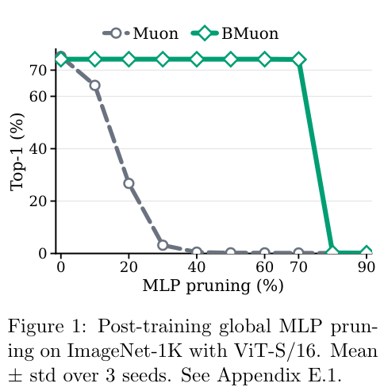

# BMuon：全局通道预算下的双边谱几何优化

## 论文信息

| 字段 | 内容 |
| --- | --- |
| 论文链接 | [arXiv 2610.23571](https://arxiv.org/abs/2610.23571)；[固定v1全文](https://arxiv.org/html/2610.23571v1) |
| 原文标题 | BMuon: Budgeting Muon's Spectral Geometry for Structured Compressibility |
| 公司 / 机构 | 一作Rida Assalouh：Inria（首列）、École polytechnique；合作CISPA、University of Calgary、ENS/PSL/CNRS |
| 首次公开日期 | 2026-10-16 14:52:56 UTC；2026-10-19 arXiv公告，不是10月19日首发 |
| 原作者代码 | [官方仓库](https://github.com/RidaAssalouh/BMuon)存在，但本轮仅README，明确实现与复现脚本将后续发布；未核到实现代码或许可证 |
| 本地 adapter / 稳定键 | `bmuon`；`adapter: null`，没有注册Evolve执行算子 |
| 本地复现代码目录 | `src/auto_research/foundation_models/bmuon.py`；`scripts/run_oct19_evening_foundation_components.py` |
| 实现状态 | `component_only`，L1机制诊断；不代表论文训练剪枝效果 |
| 完整实验 | 成本过高，不复现（审查 DONE）；`not_reproduced_high_cost` |

## 原始论文总结

### 背景与主要改动

Muon的spectral-norm更新不一定产生容易按隐藏通道剪枝的权重。BMuon不在前向额外加gate，也不只是对训练好的Muon模型剪枝；它让**所有MLP块的隐藏通道共享同一分配预算**，并在每个通道的输入行/输出列两侧共同改变更新几何。


原文Figure 1展示结构化剪枝结果；核心方法最直接的来源为[Algorithm1和Eq7/8](https://arxiv.org/html/2610.23571v1#S4)。该结果图不是本地测量。

<!-- paper-figure:start -->
### 原论文关键图

[](https://arxiv.org/pdf/2610.23571v1#page=2)

> **原论文 Figure 1（关键图）**：ImageNet-1K 上原论文的全局 MLP 通道剪枝准确率曲线，比较 Muon 与 BMuon；这是作者结果，不是架构图或本地精度测量。图片来自[原论文](https://arxiv.org/abs/2610.23571)，版权归原作者所有；点击图片可查看来源。
<!-- paper-figure:end -->

### 核心公式

对 $W_1^\ell\in\mathbb R^{m_\ell\times d_\ell}$、$W_2^\ell\in\mathbb R^{p_\ell\times m_\ell}$，全局 $\sum_{\ell,j}\mu_j^\ell=K$，$\varepsilon\leq\mu\leq1$。令 $D_\mu=\operatorname{diag}(\mu)$，$\operatorname{Polar}(M)=UV^\top$，则

$$
\Delta_1=D_\mu^\alpha\operatorname{Polar}(D_\mu^\alpha M_1),\qquad
\Delta_2=\operatorname{Polar}(M_2D_\mu^\alpha)D_\mu^\alpha.
$$

分配更新先用旧 $\bar\mu$ 计算 $\bar P_1=\operatorname{Polar}(D_{\bar\mu}^\alpha M_1)$、$\bar P_2=\operatorname{Polar}(M_2D_{\bar\mu}^\alpha)$，得到

$$
a_j^\ell=\langle M_{1,j:}^\ell,\bar P_{1,j:}^\ell\rangle+\langle M_{2,:,j}^\ell,\bar P_{2,:,j}^\ell\rangle,
\quad Q(\mu\mid\bar\mu)=\sum_{\ell,j}a_j^\ell(\mu_j^\ell)^\alpha.
$$

$$
\mu_j^\ell\leftarrow\operatorname{clip}_{[\varepsilon,1]}\left[(\alpha a_j^\ell/\lambda_\mu)^{1/(1-\alpha)}\right],\qquad\sum\mu=K.
$$

二分求一个**跨全部块共用**的 $\lambda_\mu$，然后按新分配重新计算polar更新。原文实践每5步做一次MM，$\alpha=1/2$。本地动量为 $B_t=\beta B_{t-1}+G_t$、$M_t=G_t+\beta B_t$。

### 论文离线与线上效果

原文ImageNet ViT-S/16中，BMuon剪70% MLP通道后Top1为74.08%，未剪为74.17%；Muon在剪30%后从75.23%降至3.17%。1B LLaMA未剪PPL中Muon更好（10.92 vs12.84），但80%剪枝后BMuon仍约12.85–12.86。不能把可压缩性收益说成未剪能力全面更好。生产用户线上A/B：未报告。

## 本地复现

### 实现与运行

`BudgetMuon`接受多个真实配对MLP，执行梯度、Nesterov动量、全局预算MM及双边参数更新。当前采用小矩阵**精确SVD polar**，不是原文生产实现的5步Newton–Schulz；不宣称运行速度相同。支持FP32/FP64；FP16/BF16明确拒绝，不默许低精度数值问题。缺失一侧梯度也拒绝，避免破坏通道耦合。

固定人工输入recipe `synthetic-role-decoder-mlp-attention@oct19-evening-foundation-mechanisms-v1`：两个隐藏宽度4/3的小MLP、总预算2.8、真实GELU/MSE梯度；不是FineWeb或分类benchmark。

```bash
PYTHONPATH=src python scripts/run_oct19_evening_foundation_components.py \
  --methods bmuon --device cpu --seeds 42,43,44 \
  --output runs/oct19-evening/bmuon-cpu.json
```

使用CUDA时改为`--device cuda`；输出不可覆盖，记录源码SHA256、commit、逐seed实际分配、MM目标与标量指标。

### 结果与独立对照

独立对照用特征分解 $A(A^\top A)^{-1/2}$ 求polar，用Python标量 $\mu=\operatorname{clip}(c a^2)$ 二分求分配，核对真实一步参数更新；验证预算等式、上下界、MM目标不降、矩形/零矩阵和分配周期。普通未加权Muon是负对照，不以相同API名字替代BMuon。

已在真实 A100、固定源码 `73a1e8b8` 下完成 seeds 42/43/44 的预算分配、独立 polar 参考及实际参数更新检查：[逐 seed 指标](metrics/component-cuda-seeds42-44.json)、[GPU 收据](../../gpu-validations/bmuon-a100-20261019.json)。未测量端到端训练精度、内核吞吐或硬件压缩收益。

### 成本判断与边界

原文1B LLaMA训练13.1B FineWeb tokens，每seed6242步，8张H100实测约8.4小时，还包含三seed、ImageNet/CIFAR训练与多档剪枝/重训。完整实验**成本过高，不复现（审查 DONE）**。

本地未做SwiGLU三矩阵扩展、LLM参数路由、FineWeb训练、通道删除或精度/速度benchmark；仅两个线性矩阵对应原文基本MLP定义。零分通道的预算盈余采用确定性均分这一合法非唯一最优解，不伪称严格唯一解。无Evolve自动晋级、模型压缩收益或完整复现声明。
