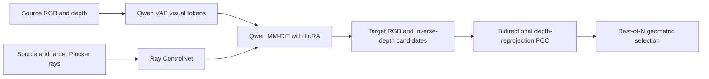
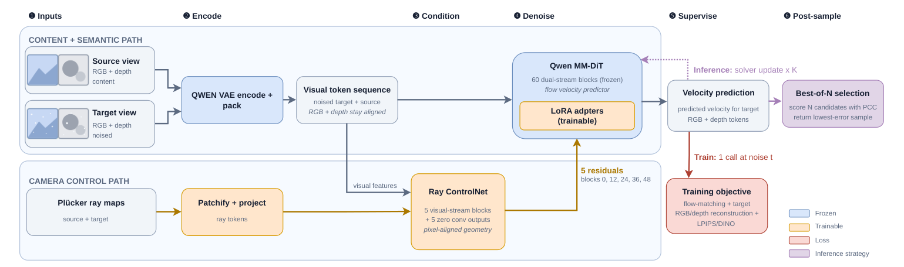

# ESC: Geometrically Consistent Novel-View Synthesis (High-Cost Reference Entry)

<!-- source-sha256: 137a12c88e2ad07fc039c06a7bbe3ddb8b6cd11b8ea51a548061484d9c56a9b4 -->

[简体中文](README.md) · English

> **Historical backfill, not a new first release on October 18–21. The full experiments exceed the cost budget and were not reproduced (review complete).** No runnable adapter or local performance metric, and no automatic training or Evolve promotion.

## Paper information

| Field | Details |
| --- | --- |
| Paper | [arXiv 2610.23732 v1](https://arxiv.org/abs/2610.23732v1); [pinned full text](https://arxiv.org/html/2610.23732v1) |
| Original title | ESC: Escaping 2D Diffusion Ambiguity with Geometric Constraints for Consistent Novel View Synthesis |
| Affiliations | First author Ge Ya (Olga) Luo: FAIR at Meta / Mila – Québec AI Institute / Université de Montréal. The work was done at Meta. |
| First public release | 2026-10-14 21:40:55 UTC (arXiv v1) |
| Authors' code | The paper provides no verified author repository URL, and none was found or confirmed in this review. Qwen or DA3 base-model repositories are not ESC implementations. |
| Local adapter / stable key | `esc`; `adapter: null`; `deferred_high_cost` is a terminal not-reproduced status, not a queue for automatic training. |
| Local implementation | None; this write-up and packaged catalog metadata only. |
| Full experiments | Above the cost budget and not reproduced (review complete). |

## Original paper summary

### Background and main changes

When a diffusion model generates a new view from a single image, visual quality in 2D or camera-pose alignment does not guarantee 3D consistency. ESC jointly generates RGB and inverse depth, conditions Qwen MM-DiT on Plücker ray maps, and uses a bidirectional depth-reprojection constraint, PCC, to identify missing and hallucinated geometry. At inference it selects from repeated stochastic generations using PCC.

<!-- paper-figure:start -->
### Key figure from the paper

**Figure 3:** Visual content path, camera ControlNet, LoRA, and PCC post-sampling. The figure comes from the [original paper](https://arxiv.org/html/2610.23732v1#S3.F3), © the original authors. [Provenance and hash](assets/provenance.json).
<!-- paper-figure:end -->

### Core equations

Back-project source depth into 3D points using camera intrinsics, transform and project them into the target camera using the relative pose, and resolve occlusion with a z-buffer. A valid pixel has positive depth, lies within the image, and has valid source depth:

$$
p_{u,v}^{(s)}=D_s(u,v)K^{-1}(u,v,1)^T,\qquad
\Delta_t=\mathcal V_{s\to t}\left(D_t-\widehat D_{s\to t}\right).
$$

Compute $\Delta_s$ in the reverse direction. Positive depth differences in the two directions indicate missing and hallucinated geometry, respectively. PCC also includes a noise threshold, log compression, clipping, and normalization by valid coverage. It is not a simple RGB difference or absolute depth error. Best-of-N in §3.2 is:

$$
\widehat y^*=\arg\min_{i\in\{1,\ldots,N\}}
\mathrm{PCC}(\widehat y_i,x_{\mathrm{src}}).
$$

Training combines RGB/inverse-depth flow matching with time-gated reconstruction, LPIPS, and DINO losses. This entry explains the definitions without substituting a simplified geometric fixture for full ESC.

### Reported offline and online results

Table 9 reports RE10K PCC, lower is better: ESC $0.0773$, ESC-PCC-BoN $0.0656$. On DL3DV the values are $0.2448$ and $0.2257$. Image and pose metrics are not uniformly best at once; PCC alone does not establish superiority on every measure. These are paper numbers, with no local measurement. No production online A/B test was reported.

## Local reproduction

**Not implemented, trained, or GPU-verified.** This round records the method and its limits, without a stand-in adapter, placeholder result JSON, or fake CUDA receipt. The pinned v1 text, method, architecture figure, and Appendix E.1 cost were checked.

### Cost and decision not to reproduce

Appendices B/E.1 describe a Qwen-Image-Edit backbone with LoRA and a 5-layer Ray ControlNet, approximately 22B active parameters. Training uses 177K steps, global batch 128, and 2304 latent tokens per example, about $5.2\times10^{10}$ tokens and $6.8\times10^{21}$ FLOPs, plus DA3 pseudo-geometry, multi-scene data preparation, and multi-candidate inference. This exceeds a short single-A100/A30 budget. **The expensive full experiments were not reproduced and count as review complete.** No large model was downloaded and no probe was launched merely to confirm cost.
