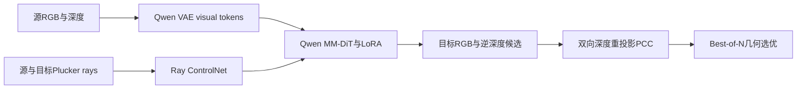
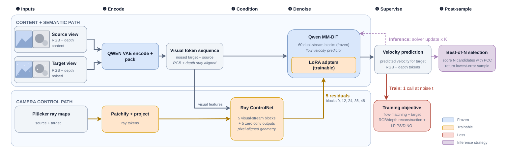

# ESC：几何一致的新视角生成（高成本资料收录）

> **历史补发现，不是10月18日至21日的新首发。完整实验成本过高，不复现（审查 DONE）。** 本页没有可运行 adapter、没有本地效果指标，不进入自动训练或 Evolve 晋级队列。

## 论文信息

| 字段 | 内容 |
| --- | --- |
| 论文链接 | [arXiv 2610.23732 v1](https://arxiv.org/abs/2610.23732v1)；[固定全文](https://arxiv.org/html/2610.23732v1) |
| 原文标题 | ESC: Escaping 2D Diffusion Ambiguity with Geometric Constraints for Consistent Novel View Synthesis |
| 公司 / 机构 / 学校 | 一作 Ge Ya (Olga) Luo：FAIR at Meta / Mila - Québec AI Institute / Université de Montréal；工作在 Meta 完成 |
| 首次公开日期 | 2026-10-14 21:40:55 UTC（arXiv v1） |
| 原作者代码 | 原文未提供已核验的原作者实现仓库 URL，本轮未找到/未确认；不以 Qwen 或 DA3 基础模型仓库冒充 ESC 实现 |
| 本地 adapter / 稳定键 | `esc`；`adapter: null`，`deferred_high_cost`（终态不复现，不表示等待自动训练） |
| 本地复现代码目录 | 未创建；仅本页文档与 packaged catalog 元数据 |
| 完整实验 | 成本过高，不复现（审查 DONE） |

## 原始论文总结

### 背景与主要改动

单幅图像经扩散模型生成新视角时，2D视觉质量或相机姿态对齐不保证3D几何一致。ESC 联合生成 RGB 与逆深度，用 Plücker ray maps 条件化 Qwen MM-DiT，并以双向深度重投影约束 PCC 识别“物体消失”与“凭空出现”。推理时按 PCC 在多次随机生成中选优。

<!-- paper-figure:start -->
### 原论文关键图

**Figure 3**：视觉内容通路、相机 ControlNet、LoRA 及 PCC 后采样。图片来自[原论文](https://arxiv.org/html/2610.23732v1#S3.F3)，版权归原作者所有；[来源与 hash](assets/provenance.json)。
<!-- paper-figure:end -->

### 核心公式

源深度以相机内参反投影为3D点，再用相对姿态投影到目标相机，执行 z-buffer 处理遮挡；有效像素需满足正深度、在图像范围内及有效源深度：

$$
p_{u,v}^{(s)}=D_s(u,v)K^{-1}(u,v,1)^T,\qquad
\Delta_t=\mathcal V_{s\to t}\left(D_t-\widehat D_{s\to t}\right).
$$

反向计算 $\Delta_s$。正的双向深度差分别指向缺失和幻觉几何；PCC 还含噪声阈值、对数压缩、裁剪和有效覆盖归一化，不等于简单的 RGB 差或绝对深度误差。原文 §3.2 的 Best-of-N 为：

$$
\widehat y^*=\arg\min_{i\in\{1,\ldots,N\}}
\mathrm{PCC}(\widehat y_i,x_{\mathrm{src}}).
$$

训练联合 RGB/逆深度 flow matching 及按时间门控的重建、LPIPS、DINO 损失。本文只解释定义，没有以简化几何 fixture 冒充完整 ESC。

### 论文离线与线上效果

原文 Table 9 的 RE10K PCC（越低越好）：ESC $0.0773$，ESC-PCC-BoN $0.0656$；DL3DV 为 $0.2448$ 与 $0.2257$。各项图像/姿态指标并非全面同时最优，不能只按PCC宣传所有能力领先。以上均为原文数字，无本地测量；未报告生产线上 A/B。

## 本地复现

**未实现、未训练、未 GPU 验证。** 本轮只有资料与算法边界收录，不提供伪 adapter、占位效果 JSON 或假 CUDA 回执。已核验固定 v1 正文、方法、架构图及 Appendix E.1 成本。

### 成本与不复现决定

原文 Appendix B/E.1：Qwen-Image-Edit backbone 加 LoRA 和5层 Ray ControlNet 约22B活跃参数；177K训练步、global batch128、每样本2304 latent tokens，约 $5.2\times10^{10}$ tokens、$6.8\times10^{21}$ FLOPs，另有 DA3 伪几何、多场景数据准备和多候选推理。该链路超出单 A100/A30 短时预算，故**高成本完整实验不复现，正常计为审查 DONE**；不为确认昂贵而下载大模型或试跑。
