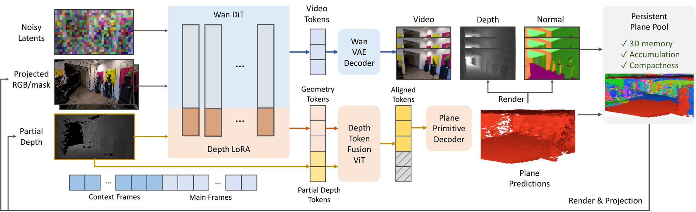

# PPMem: Persistent planar geometry memory for video world models

<!-- source-sha256: eb30c4bd44d3a1509609b2f0f6a188b358ffb333c67c69190456ae0fdb25811d -->

[简体中文](README.md)

> Research reference only. The full experiment was reviewed and not reproduced because of cost. No local world model, training result, or Evolve capability operator is provided.

## Paper information

| Field | Details |
| --- | --- |
| Paper links | [arXiv 2610.23795](https://arxiv.org/abs/2610.23795); [pinned v1 full text](https://arxiv.org/html/2610.23795v1); [project page listed in the paper](https://hyzcluster.github.io/ppmem) |
| Original title | Persistent Planar Memory for Video World Models |
| Company / institution | First author Yuze He: Tsinghua University (first listed), Ant Group; collaboration with HKUST |
| First public release | 2026-10-16 17:21:54 UTC. Announced on arXiv 2026-10-19, not first released then. |
| Author code | arXiv lists the project page above. The page could not be retrieved in this review, so runnable author code and license could not be verified. A project page alone does not establish release or non-release. |
| Local adapter / stable key | `ppmem`, reference key; `adapter: null`, no executable adapter |
| Local implementation | No algorithm implementation. Documentation and catalog entry only: `src/auto_research/paper_specs/catalog/foundation-models/ppmem.json`. |
| Review status | `not_reproduced_high_cost`; review complete. Does not block the review watermark or enter automatic retry. |

## Paper summary

### Background and main changes

Keeping only a few past frames can make a long-video generator forget a scene when revisiting it from another viewpoint, while retaining every pixel point cloud is expensive. PPMem compresses scene memory into rasterizable planar primitives. The same backbone jointly predicts them during video generation, and a persistent pool provides depth feedback to later chunks.

Each local plane has seven parameters: center depth, two rectangle scales, and a quaternion. Planes are merged after transformation to world coordinates. The pool uses occlusion votes to remove incorrect old planes, deduplicates by observation quality, and uses the provided next camera trajectory to evict planes likely to be replaced by better observations. It does not read ground-truth future video.

~~~mermaid
flowchart LR
  P[Persistent plane pool] --> R[Rasterize depth for target camera]
  R --> D[Depth Token Fusion]
  R --> V[Depth latent conditioning]
  C[Camera control and source views] --> W[Wan2.2 video DiT]
  D --> W
  V --> W
  W --> RGB[Video chunk]
  W --> G[Geometry LoRA and plane prediction]
  G --> M[Merge and maintain quality in world coordinates]
  M --> P
~~~

Figure 2 gives the architecture overview; see [Section 3.2](https://arxiv.org/html/2610.23795v1#S3.SS2).

<!-- paper-figure:start -->
### Original paper figure

> **Paper Figure 2:** The architecture, its main modules, and their connections. From the [original paper](https://arxiv.org/abs/2610.23795); copyright remains with the authors. Click the image to open its source.
<!-- paper-figure:end -->

### Core equations and pipeline

The following notation summarizes the paper's inference procedure; it is not a new algorithm:

$$
D_{k+1}=\operatorname{Render}(\mathcal P_k,C_{k+1}),\qquad
(V_{k+1},\mathcal P_{new})=f_\theta(I_{context},D_{k+1},C_{k+1}),
$$

$$
\mathcal P_{k+1}=\operatorname{Merge}(\mathcal P_k,\mathcal P_{new}).
$$

Video denoising uses the frozen Stage 1 backbone with geometry LoRA off. After video generation, one extra forward pass with geometry LoRA on extracts geometry; planes are not predicted at every denoising step. Depth Token Fusion uses an approximately 87M-parameter encoder initialized from DINOv2-Base. Depth tokens with holes are discarded or sampled by valid coverage before fusion with DiT features.

The Stage 2 geometry loss is

$$
\mathcal L=.2\mathcal L_{depth}+.05\mathcal L_{normal}
+ .02\mathcal L_{depth}^{rend}+.01\mathcal L_{normal}^{rend}+.02\mathcal L_{smooth}.
$$

Rasterization losses are disabled for the first 1,000 steps. First train camera-controlled video generation, then freeze the backbone and train the plane head, DTF, feature decoder, and geometry LoRA. Geometry merging alone is not a reproduction of the world model.

### Offline and online results reported in the paper

In Table 2's 49-frame DL3DV setting, PPMem reports PSNR 16.99 / LPIPS 0.335, versus Gen3C's 15.74 / 0.474. On RE10K the values are 22.46 / 0.168 versus 21.93 / 0.238. These complete systems generate at their native resolution and aspect ratio; the comparison is not a same-backbone operator ablation. Table 3 separately isolates memory on the same backbone, with depth AbsRel 0.210 for the joint plane pool and 0.272 without persistent memory. About 100K planes and 5 MB refer to scene geometry state, not total memory for the 5B model. No production user A/B test is reported.

## Local reproduction and cost decision

This review verifies the paper's mechanism, metadata, attribution of results, and cost only. It did not download a model or videos or fabricate small-tensor world-model capability scores. No GPU receipt is required because no CUDA implementation was accepted.

The paper uses a Wan2.2 TI2V5B backbone, over 80K DL3DV and RealEstate10K videos, $576\times1024$ inputs, and 25-frame chunks. Stage 1 takes about 7,000 steps and Stage 2 about 5,000. Stage 2 still has about 377M trainable parameters and needs offline MoGe2/VGGT depth and reconstruction preprocessing plus generation evaluations up to 300–400 frames. Even the $288\times512$ ablation needs about 5,000 clips and complete generation and geometry training.

That exceeds the current low-cost budget of a single A100/A30 or local Mac. **The full experiment was reviewed and not reproduced because of cost.** No automatic retry is kept. A heuristic plane list or fixed depth image is not substituted for the core predictor, and no Evolve integration is claimed.
