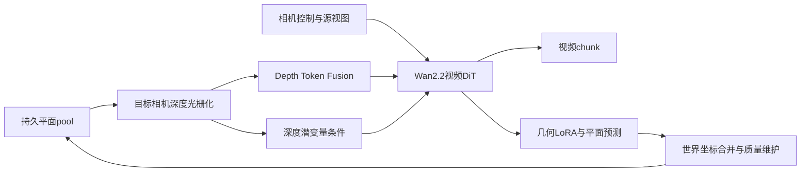
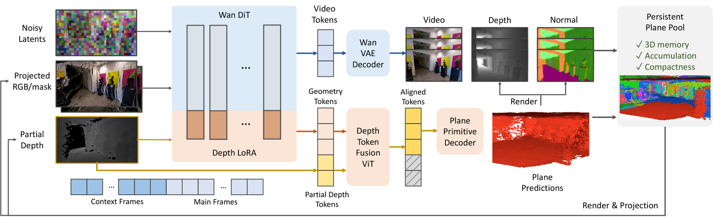

# PPMem：视频世界模型中的持久平面几何记忆

> 仅研究资料；**成本过高，不复现（审查 DONE）**。没有本地世界模型、训练结果或Evolve能力算子。

## 论文信息

| 字段 | 内容 |
| --- | --- |
| 论文链接 | [arXiv 2610.23795](https://arxiv.org/abs/2610.23795)；[固定v1全文](https://arxiv.org/html/2610.23795v1)；[原文所列项目页](https://hyzcluster.github.io/ppmem) |
| 原文标题 | Persistent Planar Memory for Video World Models |
| 公司 / 机构 | 一作Yuze He：Tsinghua University（首列）、Ant Group；合作HKUST |
| 首次公开日期 | 2026-10-16 17:21:54 UTC；2026-10-19 arXiv公告，不是10月19日首发 |
| 原作者代码 | arXiv仅列上述项目页；本轮项目页抓取失败，未核到可运行作者代码或许可证。不能把项目页存在等同代码已发布，也不能据此断言作者一定未发布 |
| 本地 adapter / 稳定键 | `ppmem`（资料键）；`adapter: null`，无可执行adapter |
| 本地复现代码 | 无算法实现；仅本文与`src/auto_research/paper_specs/catalog/foundation-models/ppmem.json` |
| 验收状态 | `not_reproduced_high_cost`、审查DONE；不阻塞水位，不进入自动重试 |

## 原始论文总结

### 背景与主要改动

长视频生成若只保存少量历史帧，跨视角回访容易遗忘场景；持续保存全部像素点云又非常大。PPMem把场景记忆压成可光栅化的平面primitive，在视频生成过程中由同一骨干联合预测，再通过持久pool向后续chunk反馈深度。

每个局部平面用中心深度、两个矩形尺度和四元数共7个参数表示，变换到世界坐标后合并。pool按遮挡投票删除错误旧面，按观察质量去重，并依据已给定的下一段相机轨迹提前淘汰即将被更好观测替换的面；它不是读取未来真实视频。

原文Figure 2为架构总览，见[Section3.2](https://arxiv.org/html/2610.23795v1#S3.SS2)。

<!-- paper-figure:start -->
### 原论文关键图

> **原论文 Figure 2（关键图）**：展示原论文提出的核心架构、主要模块及其连接关系。图片来自[原论文](https://arxiv.org/abs/2610.23795)，版权归原作者所有；点击图片可查看来源。
<!-- paper-figure:end -->

### 核心公式与流程

用记号概括原文推理（非新增算法）：

$$
D_{k+1}=\operatorname{Render}(\mathcal P_k,C_{k+1}),\qquad
(V_{k+1},\mathcal P_{new})=f_\theta(I_{context},D_{k+1},C_{k+1}),
$$

$$
\mathcal P_{k+1}=\operatorname{Merge}(\mathcal P_k,\mathcal P_{new}).
$$

实际视频去噪用Stage1冻结骨干、关闭几何LoRA；视频完成后额外一次开启几何LoRA的前向提取几何，而非每个去噪步都预测平面。DTF用DINOv2-Base初始化的约87M编码器，把有洞深度token按有效覆盖率丢弃/抽样后与DiT特征融合。

Stage2几何目标为

$$
\mathcal L=.2\mathcal L_{depth}+.05\mathcal L_{normal}
+ .02\mathcal L_{depth}^{rend}+.01\mathcal L_{normal}^{rend}+.02\mathcal L_{smooth}.
$$

前1000步不启用光栅化损失。先训练可相机控制的视频生成，再冻结骨干训练平面头、DTF、特征解码器和几何LoRA，不能只实现几何合并就称复现世界模型。

### 论文离线与线上效果

原文Table2的DL3DV49帧设置中，PPMem为PSNR16.99/LPIPS0.335，Gen3C为15.74/0.474；RE10K为22.46/0.168 vs21.93/0.238。不同完整系统按原生分辨率/宽高比生成，并非同骨干算子消融。原文Table3另用相同骨干隔离记忆机制，联合plane pool的深度AbsRel0.210，无持久记忆为0.272。约100K平面、5MB指场景几何状态，不是整个5B模型显存。生产用户线上A/B：未报告。

## 本地复现与成本判断

本轮只核原文方法、元数据、结果归属及成本，不下载模型或视频，不制造小张量“世界模型能力”分数。没有GPU回执要求，因为没有接受执行CUDA实现。

原文骨干Wan2.2 TI2V5B，80K+ DL3DV/RealEstate10K视频，576×1024输入、25帧chunk。Stage1约7000步，Stage2约5000步；后者仍有约377M可训练参数，并需离线MoGe2/VGGT深度与重建预处理、长达300–400帧的生成评测。即使缩至288×512的消融，仍需约5000clip及完整生成/几何训练。

这些成本超过当前单卡A100/A30或Mac低成本预算，结论为**成本过高，不复现（审查 DONE）**。不保留自动重试任务，不用启发式plane-list或固定深度图片替代核心预测器，不宣称Evolve已整合。
