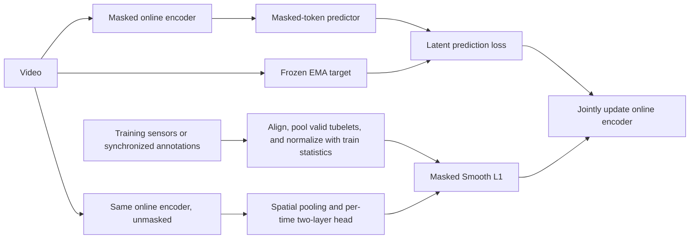
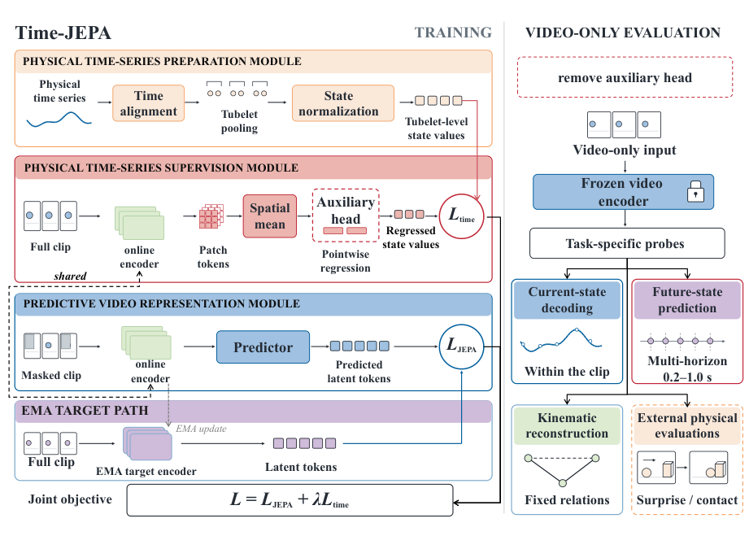

# Time-JEPA: Supervising Video Representations with Training-Only Physical Time Series

<!-- source-sha256: 5296b20ff5697af84daff8219ef1698640500e3b84af2b471f75c6078f336b3d -->

[简体中文](README.md) · English

## Paper information

| Field | Details |
| --- | --- |
| Paper | [arXiv 2610.23982](https://arxiv.org/abs/2610.23982); [pinned v1 full text](https://arxiv.org/html/2610.23982v1) |
| Original title | Time-JEPA: Grounding Video World Models with Physical Time Series |
| Affiliations | First author Shenyi Li: Harbin Institute of Technology (listed first), Shanghai Artificial Intelligence Laboratory; collaboration with Tsinghua University. |
| First public release | 2026-10-14 07:29:36 UTC; newly announced on arXiv 2026-10-20, not first released that day. |
| Authors' code | [Official repository](https://github.com/Lishenyi2004/Time-JEPA) includes src/app/configs/tests and evaluation scripts. MIT and Apache-2.0 files apply within their respective scopes. The full upstream training was not run. |
| Local adapter / stable key | `time-jepa`; `adapter: null`, no executable Evolve operator |
| Local implementation | `src/auto_research/foundation_models/time_jepa.py`; `scripts/run_oct20_foundation_components.py` |
| Implementation status | `component_only`; L1 training-mechanism and isolation diagnostic, not a pretrained video-model reproduction |
| Full experiments | Above the cost budget and not reproduced (review complete); `not_reproduced_high_cost` |

## Original paper summary

### Background and main changes

Video self-supervision need not preserve precise physical states such as speed or joint angles. Time-JEPA uses synchronized sensor readings or annotations as auxiliary targets, **not encoder inputs**. During training, the same online encoder processes masked context and unmasked video separately. Evaluation removes the physical-state head and still takes video only.



<!-- paper-figure:start -->
### Key figure from the paper

[](https://arxiv.org/pdf/2610.23982v1#page=4)

> **Figure 1 from the paper:** Physical-sequence alignment and tubelet pooling, two training paths using masked prediction and full-video auxiliary supervision on a shared encoder, and video-only evaluation. Physical states are training targets only. The figure comes from the [original paper](https://arxiv.org/abs/2610.23982), © the original authors. Select the image to see the source.
<!-- paper-figure:end -->

### Core equations and isolation requirements

[Appendix C.1](https://arxiv.org/html/2610.23982v1#A3) pools valid frames independently for each variable:

$$
\bar y_{k,j}=\frac{\sum_{r\in\{2k-1,2k\}}v_{r,j}y_{r,j}}{\sum_rv_{r,j}},\qquad
\widetilde y_{k,j}=\frac{\bar y_{k,j}-\mu_j^{train}}{\sigma_j^{train}}.
$$

An empty tubelet remains invalid rather than becoming a valid zero label. Fit normalization statistics only on training data and freeze them. Spatially average unmasked online features, then use a pointwise MLP to obtain $\widehat y$:

$$
L=L_{JEPA}+\lambda L_{time},\qquad
L_{time}=\frac{\sum_{k,j}v_{k,j}\operatorname{SmoothL1}_{\beta=.5}(\widehat y_{k,j}-\widetilde y_{k,j})}{\sum_{k,j}v_{k,j}}.
$$

Both tasks train the online encoder together. The target encoder updates only by EMA; labels and statistics receive no gradient. The paper's multi-domain training also keeps domain-specific heads, variables, normalization, loss weights, and warmup counters. Domains do not share one unconditional label space.

### Reported offline and online results

In [Table 1](https://arxiv.org/html/2610.23982v1#S5), in-distribution current-state decoding $R^2$ rises from matched Video FT's 0.713 to 0.849 for driving, from 0.424→0.725 for robots, and from 0.231→0.345 for humans. These are real-video probe results from the paper, not local measurements. The paper also evaluates jointly out-of-distribution conditions and variables, cross-domain transfer, and physics. No online A/B test on production users was reported, and the paper does not claim sensor-input inference.

## Local reproduction

### Components, execution, and verification

The implementation goes beyond a loss wrapper: nearest timestamp alignment, per-variable valid tubelet pooling, train-only statistics, an actual context self-attention encoder, masked latent predictor, unmasked two-layer physical head, frozen target, and explicit EMA. The caller sets the maximum alignment distance; ties choose the earlier measurement. That is a local alignment policy, not a claim about the original decoding pipeline for every dataset.

The small model consumes synthetic tubelet features only, with no V-JEPA weights, video decoding, or real data. Its local JEPA skeleton uses L1 and does not establish the full V-JEPA predictor architecture or capabilities. It provides a single-domain interface, not the paper's full multi-domain scheduling. The acceptance runner fixes FP64; it does not validate the paper's BF16/AMP training.

```bash
PYTHONPATH=src python scripts/run_oct20_foundation_components.py \
  --methods time-jepa --device cpu --seeds 42,43,44 \
  --output runs/oct20-foundation/time-jepa-cpu.json
```

The recipe fits statistics on 6 independent training examples and updates on 2 additional training minibatch examples. Being outside the statistics-fit set is not formal validation or test; no capability comparison was performed. Data ID `synthetic:oct20-time-jepa-v1` has a revision bound to the runner source SHA256, with no checkpoint. CUDA requires explicit `--device cuda` and has no CPU fallback. Outputs cannot be overwritten.

### Local results and independent checks

CPU and one real A100 completed seeds 42/43/44. Independent scalar Smooth L1/L1 references and analytic gradients checked joint loss. The A100 mean joint-loss reference error was about 2.41e-16. Latent and physical objectives gave nonzero gradients to the same online encoder, with actual SGD and EMA. Teacher/label gradients, target optimizer changes, masked-context leakage, and statistics changes were all 0. Misaligned time is a mechanism negative control, not a capability comparison. See [actual metrics](metrics/component-cuda-seeds42-44.json) and the [GPU receipt](../../gpu-validations/time-jepa-a100-20261020.json), tied to frozen commit `324217ed26fe2e297e25879ad092281eb0960b87`. This is only an FP64 diagnostic with a randomly initialized small model.

### Cost and work not reproduced

The paper uses V-JEPA 2.1 ViT-g/16, 64 frames at 5 FPS, 8 GPUs with batch 8 per GPU, 20 epochs of three-domain fine-tuning, a 15-epoch probe, and external GRASP/Physion and other evaluations. One A100, A30, or Mac is unsuitable for routine low-cost verification of this full multi-arm protocol. **The full experiments were not reproduced (review complete)**.

No real video encoder was trained. Physical-state decoding, long-horizon prediction, robot control, and cross-domain gains were not measured. Three seeds strengthen the mechanism diagnostic without upgrading it to a formal capability comparison. Automatic Evolve promotion is disabled.
