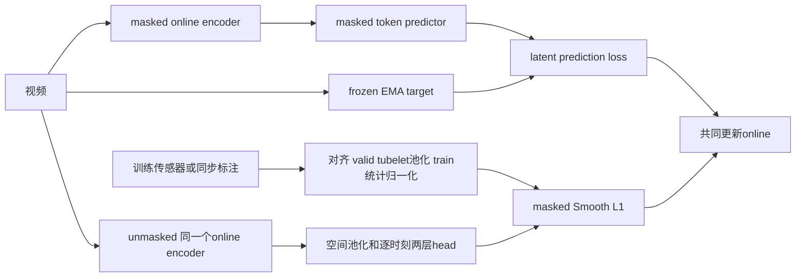
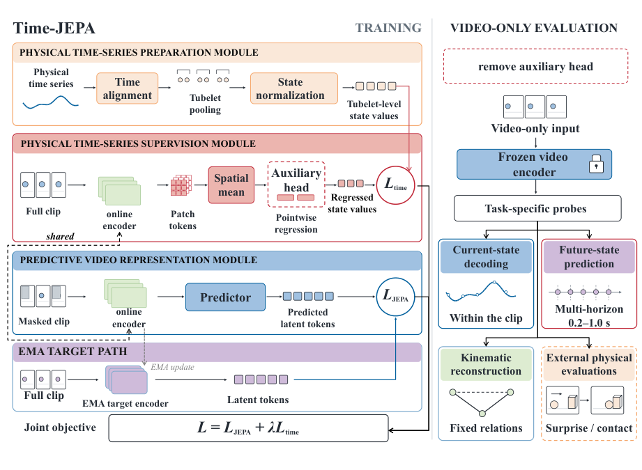

# Time-JEPA：用训练专用物理时序监督视频表征

## 论文信息

| 字段 | 内容 |
| --- | --- |
| 论文链接 | [arXiv 2610.23982](https://arxiv.org/abs/2610.23982)；[固定 v1 全文](https://arxiv.org/html/2610.23982v1) |
| 原文标题 | Time-JEPA: Grounding Video World Models with Physical Time Series |
| 公司 / 机构 | 一作 Shenyi Li：Harbin Institute of Technology（首列）、Shanghai Artificial Intelligence Laboratory；合作 Tsinghua University |
| 首次公开日期 | 2026-10-14 07:29:36 UTC；2026-10-20 arXiv 新公告，不是 10 月 20 日首发 |
| 原作者代码 | [官方仓库](https://github.com/Lishenyi2004/Time-JEPA)已公开，含 src/app/configs/tests 与评测脚本；有 MIT / Apache-2.0 文件，按具体文件适用范围使用；本轮未运行上游完整训练 |
| 本地 adapter / 稳定键 | `time-jepa`；`adapter: null`，不注册 Evolve 执行算子 |
| 本地复现代码目录 | `src/auto_research/foundation_models/time_jepa.py`；`scripts/run_oct20_foundation_components.py` |
| 实现状态 | `component_only`；L1 训练机制与隔离诊断，不是预训练视频模型复现 |
| 完整实验 | 成本过高，不复现（审查 DONE）；`not_reproduced_high_cost` |

## 原始论文总结

### 背景与主要改动

视频自监督目标不必保留精确的速度、关节角等物理状态。Time-JEPA 用同步传感器或标注作辅助目标，但它们**不是编码器输入**：训练时同一个 online encoder 分别处理 masked 上下文和 unmasked 视频，评测移除物理态 head，仍只输入视频。



<!-- paper-figure:start -->
### 原论文关键图

[](https://arxiv.org/pdf/2610.23982v1#page=4)

> **原论文 Figure 1（关键图）**：Time-JEPA 的物理序列对齐与tubelet池化、共享视频编码器上的掩码预测/完整视频辅助两路训练，以及只用视频的评测。物理态只作训练目标。图片来自[原论文](https://arxiv.org/abs/2610.23982)，版权归原作者所有；点击图片可查看来源。
<!-- paper-figure:end -->

### 核心公式与隔离要求

[Appendix C.1](https://arxiv.org/html/2610.23982v1#A3) 对每个变量独立汇聚有效帧：

$$
\bar y_{k,j}=\frac{\sum_{r\in\{2k-1,2k\}}v_{r,j}y_{r,j}}{\sum_rv_{r,j}},\qquad
\widetilde y_{k,j}=\frac{\bar y_{k,j}-\mu_j^{train}}{\sigma_j^{train}}.
$$

空 tubelet 保持无效；不能补成有效的零标签。归一化统计只能拟合训练集并冻结。对 unmasked online 特征在空间轴求平均，经 pointwise MLP 得 $\widehat y$：

$$
L=L_{JEPA}+\lambda L_{time},\qquad
L_{time}=\frac{\sum_{k,j}v_{k,j}\operatorname{SmoothL1}_{\beta=.5}(\widehat y_{k,j}-\widetilde y_{k,j})}{\sum_{k,j}v_{k,j}}.
$$

两个任务共同训练 online encoder；target encoder 只用 EMA 更新，标签和统计不接收梯度。原文多域训练另保留各域 head、变量、归一化、loss weight 与 warmup counter，不能把所有域混成一个无条件标签空间。

### 论文离线与线上效果

[Table 1](https://arxiv.org/html/2610.23982v1#S5) 中，驾驶域同分布当前状态解码 $R^2$ 从匹配 Video FT 的 0.713 升至 0.849；机器人 0.424→0.725，人体 0.231→0.345。它们是原文真实视频 probe 指标，不是本地测量。论文还有条件/变量双 OOD、跨域和物理评测；没有生产用户线上 A/B，也没有声称传感器输入式推理。

## 本地复现

### 组件、操作与验证

实现不只封装 loss：包含时间戳 nearest 对齐、逐变量 valid tubelet 池化、训练独占统计、真正的上下文 self-attention encoder、masked latent predictor、unmasked 两层物理 head、冻结 target 和显式 EMA 更新。nearest 的距离阈值由调用方传入、平局取较早测量，是本地明确的对齐策略，不冒充所有原始数据集的具体解码流程。

小模型只接收人工构造的 tubelet token 特征，不含 V-JEPA 权重、视频解码或真实数据。局部 JEPA 骨架使用 L1，不能据此声称完整 V-JEPA predictor 架构或能力；当前只实现单域接口，不宣称已完成原文多域调度。验收 runner 固定 FP64，不代表原文 BF16 / AMP 训练已验证。

```bash
PYTHONPATH=src python scripts/run_oct20_foundation_components.py \
  --methods time-jepa --device cpu --seeds 42,43,44 \
  --output runs/oct20-foundation/time-jepa-cpu.json
```

recipe 中 6 个独立训练样例拟合统计，另外 2 个训练 mini-batch 样例执行更新；“统计拟合外”不等于正式 validation/test，未做能力比较。数据 ID `synthetic:oct20-time-jepa-v1`，revision 绑定 runner 源码 SHA256；无 checkpoint。CUDA 需显式 `--device cuda`，无 CPU 回退，结果不可覆盖。

### 本地结果与独立对照

CPU与真实单张A100的42/43/44三seed诊断已完成。独立标量Smooth-L1/L1及解析梯度核验联合损失，A100联合损失参考误差均值约2.41e-16；latent与physical对同一online encoder均有非零梯度，并实际执行SGD/EMA。teacher/标签梯度、target优化器变更、masked context泄漏和统计变更均为0。时间错配是机制负对照，不是能力提升对照。见[实际指标](metrics/component-cuda-seeds42-44.json)和[GPU回执](../../gpu-validations/time-jepa-a100-20261020.json)，绑定冻结提交`324217ed26fe2e297e25879ad092281eb0960b87`，仅随机初始化小模型FP64诊断。

### 成本判断与未复现范围

原文基于 V-JEPA 2.1 ViT-g/16，64 帧、5 FPS、8 GPU、每卡 batch 8，三域 fine-tune 20 epochs，之后还有15 epoch probe 和 GRASP/Physion 等外部评测。单张 A100/A30 和 Mac 不适合把整套多臂实验作为日常低成本验证；完整实验**成本过高，不复现（审查 DONE）**。

未训练真实视频 encoder，未测物理状态解码、长时预测、机器人控制或跨域收益。三 seed 只提高机制诊断可信度，不升级为正式能力比较；禁止 Evolve 自动晋级。
