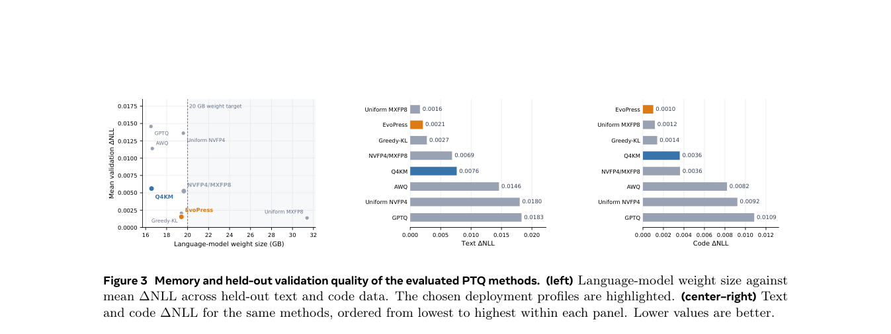

# Muse Glimmer 30B: Meta's on-device multimodal agent model

<!-- source-sha256: f53e704e7a09df238c1334d6681250c73d856378401fd4ba529a1202f4b54630 -->

[简体中文](README.md)

> Google/Meta-priority research reference. The full experiment was reviewed and not reproduced because of cost. Fitting on one GPU does not make full training and evaluation affordable within this project's budget.

## Paper information

| Field | Details |
| --- | --- |
| Paper links | [arXiv 2610.24628v1](https://arxiv.org/abs/2610.24628v1); [official Meta publication page](https://ai.meta.com/research/publications/muse-glimmer-30b-an-on-device-agentic-model/) |
| Company / institution | Muse Glimmer team, Meta Superintelligence Labs |
| First public release | 2026-10-17 11:05:21 UTC (arXiv v1). The Meta catalog is dated October 19 and the PDF cover October 20; neither changes the v1 release date. |
| Author code / weights | The [official model repository](https://huggingface.co/meta-models/Muse-Glimmer-30B) is Apache-2.0. Weights, configuration, tokenizer, and chat template were verified. Complete pretraining and OPD training source and data were not verified. Weight availability and training reproducibility are tracked separately. |
| Local adapter / stable key | `muse-glimmer-30b`, reference key; `adapter: null` |
| Local implementation | None. Documentation and catalog entry only: `src/auto_research/paper_specs/catalog/foundation-models/muse-glimmer-30b.json`. |

## Paper summary

### Background and main changes

The model targets on-device agents with 32 GB of dedicated memory. Its language backbone is a dense Transformer rather than an MoE, selected through scaling experiments under the same memory budget. A frozen vision encoder of about 1.8B parameters supports interleaved images and text. The 52 layers repeat three local-attention layers with a window of 2,048 followed by one global-attention layer. Grouped-query attention uses 32 query and two KV heads. RoPE is applied in local layers but not in global layers.

Training starts with distillation from Muse Spark logits. Near the end of pretraining, it switches to cross-entropy to address top-$k$ truncation bias. Next come weight averaging and two-stage mid-training, then SFT, on-policy distillation (OPD) on student prefixes, and multi-objective RL. For on-device inference the authors compare mixed-precision allocations, select Q4KM and EvoPress configurations, and release a DFlash speculative head. Recreating one attention layer would not implement the complete agent.

~~~mermaid
flowchart LR
  S[Muse Spark teacher] --> P[Pretraining logit distillation and late cross-entropy]
  P --> M[Weight averaging and two-stage mid-training]
  M --> T[SFT / OPD / multi-objective RL]
  T --> Q[Mixed-precision quantization and DFlash]
  I[Frozen vision encoder] --> A[On-device image and text agent]
  Q --> A
~~~

The original Figure 3 shows the trade-off between quantized weight memory and validation quality, not the architecture.

<!-- paper-figure:start -->
### Original paper figure

> **Paper Figure 3:** Weight size versus validation loss for Muse Glimmer's quantization strategies. These are the authors' quantization results, not an architecture diagram or local measurement. From the [original paper](https://arxiv.org/abs/2610.24628v1); copyright remains with the authors. Click the image to open its source.
<!-- paper-figure:end -->

### Core equation and architecture

The paper describes about 29.6B parameters, language width 6,656, 52 layers, SwiGLU intermediate width 19,968, and a vocabulary of 202,048. Input and output embeddings are untied. The vision branch uses $2\times2$ spatial compression: a $448\times448$ image is compressed from 1,024 patches to 256 visual tokens.

$$
\text{attention pattern}=[Local,Local,Local,Global]^{13},\qquad Q:KV=32:2.
$$

This is an architectural summary, not a published full training objective or a locally executable model. OPD uses prefixes the student actually visits. One KL function cannot stand in for training data, rewards, and long-trajectory environments.

### Offline and online results reported in the paper

Under high reasoning, Table 2 reports author scores including 76.0 on SWE-bench Verified, 75.5 on MCPAtlas, and 74 on MMMU-Pro. These are not local results and do not imply superiority over both comparison models on every metric. The 15-task averages in Table 3 are 75.7% for BF16, 75.6% for EvoPress, and 74.8% for Q4KM. Quantization trades off capability and memory together. This foundation-model entry is not subject to the industrial search/ads/recommendation online A/B requirement; it does not borrow an exception from that domain.

## Local reproduction and cost decision

BF16 weights are about 55.7 GB. Even a quantized language model below the 20 GB target still needs space for KV state, the vision encoder, and the drafter. Long agent trajectories and multi-model comparisons cost far more than one forward pass. The full procedure depends on a frontier teacher, large-scale multistage distillation, 128K context, and multi-domain agent environments. **The full experiment was reviewed and not reproduced because of cost.** This review obtained only paper and repository metadata, without downloading weights, launching long inference or training, or claiming local capability scores, GPU validation, or Evolve integration.
