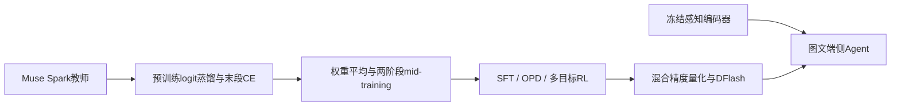
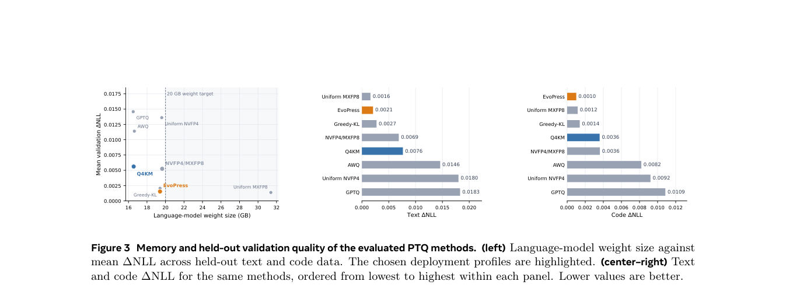

# Muse Glimmer 30B：Meta端侧多模态Agent模型

> Google/Meta优先资料。**成本过高，不复现（审查 DONE）**；“单卡可装下”不等于本项目低成本可完成训练和完整评测。

## 论文信息

| 字段 | 内容 |
| --- | --- |
| 论文链接 | [arXiv 2610.24628v1](https://arxiv.org/abs/2610.24628v1)；[Meta官方发布页](https://ai.meta.com/research/publications/muse-glimmer-30b-an-on-device-agentic-model/) |
| 公司 / 机构 | Muse Glimmer team，Meta Superintelligence Labs |
| 首次公开日期 | 2026-10-17 11:05:21 UTC（arXiv v1）；Meta目录日期10月19日，PDF封面日期10月20日，不能用后两者改写v1日期 |
| 原作者代码 / 权重 | [官方模型仓库](https://huggingface.co/meta-models/Muse-Glimmer-30B)，Apache-2.0，已核到权重、配置、tokenizer和chat template；未核到完整预训练、OPD训练源码及数据。权重发布与训练可复现性分开记录 |
| 本地 adapter / 稳定键 | `muse-glimmer-30b`（资料键）；`adapter: null` |
| 本地复现代码 | 无；仅本文与`src/auto_research/paper_specs/catalog/foundation-models/muse-glimmer-30b.json` |

## 原始论文总结

### 背景与主要改动

模型瞄准有32GB专用内存的端侧Agent：语言骨干用稠密Transformer而非MoE，在相同内存预算下用缩放实验选架构；约1.8B冻结视觉编码器支持图文交错输入。52层采用三层2048窗口局部注意力接一层全局注意力，32Q/2KV的GQA，局部层使用RoPE，全局层不再施加RoPE。

训练从Muse Spark logits蒸馏起步，预训练末段切CE处理top-k截断偏差，之后权重平均和两阶段mid-training，再SFT、学生前缀上的OPD与多目标RL。端侧推理比较混合精度分配，选Q4KM/EvoPress配置，并发布DFlash推测头。本文不复刻一层注意力就宣称实现完整Agent。

原文Figure3展示量化内存与验证质量权衡，不是架构图。

<!-- paper-figure:start -->
### 原论文关键图

> **原论文 Figure 3（关键图）**：Muse Glimmer各量化策略的权重体积与验证损失权衡；是作者的量化结果图，不是架构图或本地测量。图片来自[原论文](https://arxiv.org/abs/2610.24628v1)，版权归原作者所有；点击图片可查看来源。
<!-- paper-figure:end -->

### 核心公式与结构

原文约29.6B参数，语言层宽6656、52层、SwiGLU中间维19968、词表202048，输入和输出embedding不共享。视觉分支用2×2空间压缩，448×448图像从1024patch压成256视觉token。

$$
\text{attention pattern}=[Local,Local,Local,Global]^{13},\qquad Q:KV=32:2.
$$

这只是结构摘要，不是公开的完整训练目标或本地可执行模型。OPD使用学生实际访问前缀，训练数据、奖励与长轨迹环境不可由一个KL函数替代。

### 论文离线与线上效果

原文Table2报告high reasoning下SWE-bench Verified76.0、MCPAtlas75.5、MMMU-Pro74等作者分数，不是本地结果，也不是所有维度都优于两种对比模型。Table3的15任务平均，BF16为75.7%，EvoPress75.6%，Q4KM74.8%；量化配置的能力和内存是联合权衡。没有工业搜广推线上A/B要求，因为本条归基础模型，不借用该领域例外。

## 本地复现与成本判断

BF16权重约55.7GB，量化LM目标低于20GB仍需KV、视觉编码器和drafter空间；长Agent轨迹与多模型对照远非一次前向。完整过程依赖前沿教师、多阶段大规模蒸馏、128K上下文与多域Agent环境，**成本过高，不复现（审查 DONE）**。本轮只取论文与仓库元数据，不下载权重、不开长推理或训练，不提供本地能力分数、GPU回执或Evolve整合声明。
