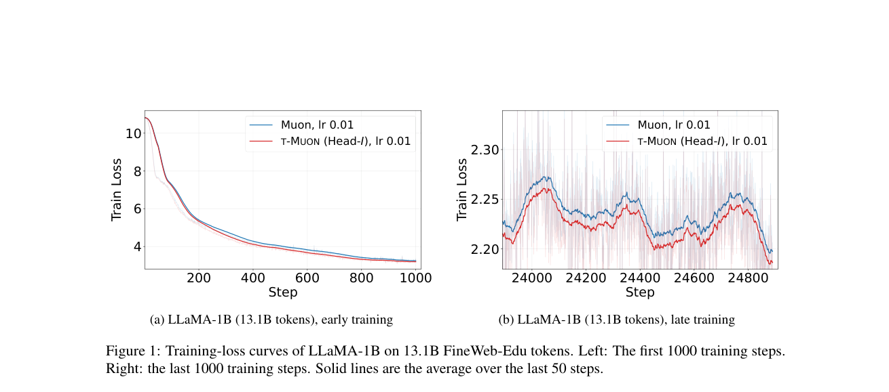

# T-MUON: Constructing Muon updates in a tensor transform domain

<!-- source-sha256: 35c5fe95a5d70dfb421f6500636c4bb507442ca61ffd6e844789b95ee96768e2 -->

[简体中文](README.md)

## Paper information

| Field | Details |
| --- | --- |
| Paper links | [arXiv 2610.24938](https://arxiv.org/abs/2610.24938); [pinned v1 full text](https://arxiv.org/html/2610.24938v1) |
| Original title | T-MUON: Tensorizing Muon via t-SVD for Large Language Model Pre-training |
| Company / institution | First author Dongyang Li, University of California, Santa Barbara. Not a Google or Meta paper. |
| First public release | 2026-10-18 01:20:16 UTC. Announced on arXiv October 20, not first released then. |
| Author code | No verifiable source repository found in the paper or author sources during this review. Code license unverified. |
| Local adapter / stable key | `t-muon`; `adapter: null`, component rather than an Evolve execution operator |
| Local implementation | `src/auto_research/foundation_models/t_muon.py`; `scripts/run_oct20_foundation_components.py` |
| Implementation status | `component_only`, L1 mechanism diagnostic, not the paper's pretraining result |
| Full experiment | Reviewed and not reproduced because of cost; `not_reproduced_high_cost` |

## Paper summary

### Background and main changes

Ordinary Muon computes the polar factor of each matrix independently. T-MUON packs structurally related matrices into a third-order tensor and computes a polar factor for each slice in the third-axis transform domain. This is not ordinary Muon on an arbitrarily flattened tensor. Grouping and transform are separate choices. The paper compares adjacent layers, QKV, heads of a single matrix, and a stack of QKV heads.

~~~mermaid
flowchart LR
  G[Real gradients of related matrices] --> N[Nesterov momentum]
  N --> T[Group by layer, QKV, or head]
  T --> M[Third-axis M-transform]
  M --> P[Polar factor for each transformed slice]
  P --> I[Inverse M-transform and restore matrices]
  I --> U[Update using original fan ratio and weight decay]
~~~

<!-- paper-figure:start -->
### Original paper figure

> **Paper Figure 1:** T-MUON and Muon training-loss curves for LLaMA-1B on FineWeb, with early and late zooms. These are paper results, not an optimizer architecture diagram. From the [original paper](https://arxiv.org/abs/2610.24938); copyright remains with the authors. Click the image to open its source.
<!-- paper-figure:end -->

### Core equations

For $X\in\mathbb R^{m\times n\times K}$ and an orthogonal or unitary matrix $M$:

$$
\widehat X_k=\sum_jM_{kj}X_j,\quad \widehat D_k=\operatorname{Polar}(\widehat X_k),\quad
D_j=\operatorname{Re}\sum_k\overline{M_{kj}}\widehat D_k.
$$

[Algorithm 1](https://arxiv.org/html/2610.24938v1#S3.SS1) uses unnormalized momentum $B_t=\mu B_{t-1}+G_t$ and sends $Y_t=G_t+\mu B_t$ into the polar step. After restoring the matrices:

$$
W_{t+1}=(1-\eta_t\lambda)W_t-\eta_t\sqrt{\frac{\operatorname{fan}_{out}(W)}{\operatorname{fan}_{in}(W)}}D_t.
$$

The ratio uses the original matrix shape, not the shape of a head slice. A numerically rank-zero slice gets a zero update. Arbitrary null-space basis vectors from a thin SVD must not produce a spurious nonzero update. The local implementation retains the rank-reduced polar definition and uses exact SVD; it does not reproduce the speed of a finite-step polar kernel.

### Offline and online results reported in the paper

In the largest FineWeb-Edu comparison in [Table 5](https://arxiv.org/html/2610.24938v1#S4.SS4), Muon's validation PPL is 9.45 and Head-I's is 9.34. The table reports single runs after learning-rate selection. Main comparisons usually favor identity, but another long-context setting favors DFT. It is not accurate to say all transforms beat identity. The paper does not report production user A/B or use downstream capability evaluations in place of PPL.

## Local reproduction

### Executable component and independent reference

`TensorMuon` groups real `nn.Parameter` objects, keeps momentum, and updates the parameters. It supports identity, orthogonal DCT-II and DST-II, and complex unitary DFT. `stack` takes explicitly associated matrices from the caller; `head` and `head-stack` actually split and restore row blocks. FP32 and FP64 are supported. Lower precision is explicitly rejected with no hidden numerical fallback. The optimizer does not discover how to group all parameters in an LLM.

The pinned synthetic recipe uses three $6\times4$ matrices, seven random inputs, and MSE to execute two Nesterov updates. Linear-regression derivatives independently verify gradients. Explicit sums and a block-diagonal Gram eigendecomposition verify the transform and polar calculation rather than merely rerunning the same SVD. Flattening the tensor before polar is a negative control and must produce a different direction. Tests also cover zero tensors, rank deficiency, original-matrix scaling, momentum restoration, and rejection of missing gradients.

~~~bash
PYTHONPATH=src python scripts/run_oct20_foundation_components.py \
  --methods t-muon --device cpu --seeds 42,43,44 \
  --output runs/oct20-foundation/t-muon-cpu.json
~~~

Change to `--device cuda` for CUDA. If CUDA is unavailable, the runner fails rather than falling back to CPU. Output files cannot be overwritten. The runner stores real scalar metrics and audit inputs by seed, along with four SHA256 digests covering the runner and three modules. The data ID is `synthetic:oct20-t-muon-v1`, with its revision tied to the runner SHA256. No real corpus or weights were downloaded.

### Local results and evidence limits

CPU and a real single A100 both completed FP64 numerical, gradient, and parameter-update diagnostics for seeds 42, 43, and 44. The A100 mean polar reference error was approximately 1.31e-14 and the parameter-update reference error approximately 1.34e-16. This establishes small-matrix implementation agreement, not PPL improvement, pretraining stability, or kernel speedup. See the [actual metrics](metrics/component-cuda-seeds42-44.json) and [GPU receipt](../../gpu-validations/t-muon-a100-20261020.json), tied to frozen source commit `324217ed26fe2e297e25879ad092281eb0960b87`.

### Cost decision

The paper covers 51M–1.3B models, FineWeb and FineWeb-Edu with up to 13.1B tokens, comparisons across groupings, transforms, and learning rates, plus longer token-budget and context experiments. That does not fit a low-cost verification on a single A100/A30 or a local Mac. **Full training was reviewed and not reproduced because of cost.**

No LLM was trained and no real validation PPL was compared. This component cannot automatically enter Evolve or serve as evidence for promoting a candidate. `diagnostic_only=true`, `promotion_eligible=false`, `evolve_integrated=false`.
