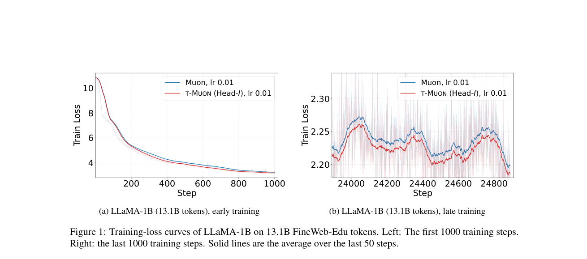

# T-MUON：在张量变换域构造 Muon 更新

## 论文信息

| 字段 | 内容 |
| --- | --- |
| 论文链接 | [arXiv 2610.24938](https://arxiv.org/abs/2610.24938)；[固定 v1 全文](https://arxiv.org/html/2610.24938v1) |
| 原文标题 | T-MUON: Tensorizing Muon via t-SVD for Large Language Model Pre-training |
| 公司 / 机构 | 一作 Dongyang Li，University of California, Santa Barbara；并非 Google / Meta 论文 |
| 首次公开日期 | 2026-10-18 01:20:16 UTC；2026-10-20 arXiv 新公告，不是 10 月 20 日首发 |
| 原作者代码 | 截至本轮未在论文及可核验的作者来源找到源码仓库；代码许可证未核到 |
| 本地 adapter / 稳定键 | `t-muon`；`adapter: null`，组件而非 Evolve 执行算子 |
| 本地复现代码目录 | `src/auto_research/foundation_models/t_muon.py`；`scripts/run_oct20_foundation_components.py` |
| 实现状态 | `component_only`；L1 机制诊断；不代表原论文预训练结果 |
| 完整实验 | 成本过高，不复现（审查 DONE）；`not_reproduced_high_cost` |

## 原始论文总结

### 背景与主要改动

普通 Muon 逐矩阵求 polar。本文先把结构相关矩阵放进三阶张量，再在第三轴变换域分别求 polar；这不是把张量任意展平后运行普通 Muon。分组方式与变换方式是两个独立选择：论文比较相邻层、QKV、单矩阵的 head、QKV 的 head-stack。


<!-- paper-figure:start -->
### 原论文关键图

[](https://arxiv.org/pdf/2610.24938#page=8)

> **原论文 Figure 1（关键图）**：t-Muon与Muon在LLaMA-1B FineWeb上的训练损失曲线，包括早期与末段放大；是原文结果，不是优化器架构图。图片来自[原论文](https://arxiv.org/abs/2610.24938)，版权归原作者所有；点击图片可查看来源。
<!-- paper-figure:end -->

### 核心公式

对 $X\in\mathbb R^{m\times n\times K}$ 和正交/酉矩阵 $M$，

$$
\widehat X_k=\sum_jM_{kj}X_j,\quad \widehat D_k=\operatorname{Polar}(\widehat X_k),\quad
D_j=\operatorname{Re}\sum_k\overline{M_{kj}}\widehat D_k.
$$

依据 [Algorithm 1](https://arxiv.org/html/2610.24938v1#S3.SS1)，使用未归一化动量 $B_t=\mu B_{t-1}+G_t$，送入 polar 的是 $Y_t=G_t+\mu B_t$。矩阵还原后：

$$
W_{t+1}=(1-\eta_t\lambda)W_t-\eta_t\sqrt{\frac{\operatorname{fan}_{out}(W)}{\operatorname{fan}_{in}(W)}}D_t.
$$

比例来自原始矩阵，不是拆出的 head 切片形状。数值秩为零的切片更新为零；不能使用薄 SVD 中任意零空间基产生虚假的非零更新。本地保留 rank-reduced polar 定义，使用精确 SVD，不宣称复现有限步 polar 内核的速度。

### 论文离线与线上效果

[Table 5](https://arxiv.org/html/2610.24938v1#S4.SS4) 的最大规模 FineWeb-Edu 比较中，Muon 的验证 PPL 为 9.45，Head-I 为 9.34；该表是选定学习率后的单次运行。主比较通常偏好 identity，但论文另有长上下文配置偏好 DFT，不能概括为所有变换都优于 identity。论文未报告生产用户线上 A/B，也未用下游能力评测替代 PPL。

## 本地复现

### 可执行组件与独立参考

`TensorMuon` 对真正的 `nn.Parameter` 分组、保存动量并更新参数。支持 identity、正交 DCT-II / DST-II、复数 unitary DFT；`stack` 接受调用方明确提供的关联矩阵，`head` / `head-stack` 真正拆分和还原行块。支持 FP32/FP64；低精度明确拒绝，无隐式数值回退。它不会自动发现整个 LLM 中哪些参数应该归组。

固定人工 recipe 使用三张 $6\times4$ 矩阵、7 条随机输入和 MSE，执行两次 Nesterov 更新。梯度由线性回归解析式独立核对；变换用显式求和与 block-diagonal Gram 特征分解核对，避免把同一 SVD 重跑当作独立参考。负对照把 tensor 展平再求 polar，应产生不同方向；零张量、秩亏矩阵、原矩阵缩放、动量恢复及缺失梯度拒绝均有测试。

```bash
PYTHONPATH=src python scripts/run_oct20_foundation_components.py \
  --methods t-muon --device cpu --seeds 42,43,44 \
  --output runs/oct20-foundation/t-muon-cpu.json
```

使用 CUDA 时改为 `--device cuda`；CUDA 不可用直接失败，不落回 CPU。输出不可覆盖，逐 seed 保存真实标量指标及审计输入，记录执行的 runner 与三个模块共四份 SHA256。数据 ID 为 `synthetic:oct20-t-muon-v1`，revision 绑定 runner SHA256；没有下载真实语料或权重。

### 本地结果与证据边界

CPU与真实单张A100均完成42/43/44三seed的FP64数值、梯度和参数更新诊断。A100的polar参考误差均值约1.31e-14、参数更新参考误差约1.34e-16；只证明小矩阵实现一致，不证明论文PPL改善、预训练稳定性或内核加速。见[实际指标](metrics/component-cuda-seeds42-44.json)和[GPU回执](../../gpu-validations/t-muon-a100-20261020.json)，执行源码绑定冻结提交`324217ed26fe2e297e25879ad092281eb0960b87`。

### 成本判断

原文覆盖 51M–1.3B 模型，FineWeb / FineWeb-Edu 最大 13.1B tokens，多个分组、变换与学习率对照；还包含较长 token 预算及上下文实验。与单张 A100/A30 或本地 Mac 的低成本验证目标不匹配，完整训练**成本过高，不复现（审查 DONE）**。

本组件没有训练 LLM、没有比较真实验证集 PPL，不能自动进入 Evolve、不能作为候选晋级证据。`diagnostic_only=true`、`promotion_eligible=false`、`evolve_integrated=false`。
