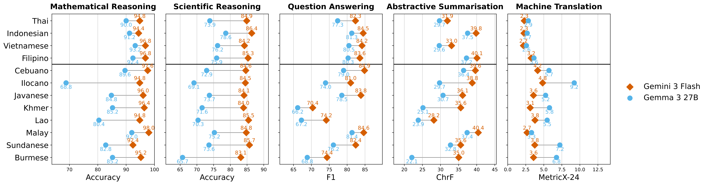

# DeepSEA: Scoring interfaces for Southeast Asian multilingual evaluation

<!-- source-sha256: bc6db634376d4d5ecae131fc5bf9760c2f2b37c4610123e2919529c498da8293 -->

[简体中文](README.md)

> **L1 external prediction scoring and data contracts; diagnostic only.** No language model training or full benchmark inference.

## Paper information

| Field | Details |
| --- | --- |
| Paper | [DeepSEA: A Multilingual Evaluation Benchmark for Southeast Asia](https://arxiv.org/abs/2610.26155v1) |
| Affiliations | First author Jiuzhou Han: Google Research; work during a Google internship. An email domain is not a separate formal affiliation. |
| First public release | 2026-10-19 10:43:30 UTC |
| Author code | [google-research/deep-sea](https://github.com/google-research/deep-sea) at `7c3abc06824c8cb634930ab6049176da30cfa0e7`; scoring code Apache-2.0, separate data terms including some non-commercial/share-alike restrictions. |
| Local key | `deepsea`; no adapter |
| Local code | `src/auto_research/foundation_models/deepsea.py` |
| Local evidence | [Local mechanism metrics](metrics/component-cpu-seeds42-44.json) |

## What the paper changes

Professional translation and review expand five public tasks to 12 Southeast Asian languages plus English. Compare by resource tier and analyze English pivoting, errors and tokenizer efficiency. This is a benchmark, not a parameter update.

### Original paper figure



Original result figure rasterized without modifying data or text. Translation uses MetricX-24 in this figure, not the local release-compatible chrF. See [figure provenance](assets/provenance.json).

### Core equations

$$
\mathrm{F1}=\frac{2PR}{P+R},\qquad
\mathrm{IndoMMLU}=\frac1{|S|}\sum_{s\in S}\mathrm{Accuracy}_s.
$$

$$
\mathrm{chrF2}=100\frac{5\bar P\bar R}{4\bar P+\bar R}.
$$

MGSM uses numeric exact match (last answer tag and release extraction); IndoMMLU macros accuracy over subjects; XQuAD token F1 uses first reference and fixed answer-tag/“answer is” extraction, not best reference; CrossSum uses corpus chrF2 and release summary extraction. Unclosed tags can produce empty outputs. chrF matches SacreBLEU 2.5.1: character orders 1–6, no word n-grams, beta two, no whitespace, preserve case and Unicode, aggregate corpus counts before effective-order means, not sentence averaging. Report 0–100 and complete-language group means, excluding English from Southeast Asian groups. WMT24++ paper MetricX-24 differs from release chrF; local `corpus_chrf2_not_metricx24` explicitly rejects MetricX.

### Results reported by the authors

The paper reports resource-tier differences, English pivot benefits on some low-resource tasks and extraction/tokenization challenges for non-space scripts. Figure 2 is author model evidence. No production A/B or local LLM performance.

## Local reproduction and limits

`DeepSEATask` copies private references; exact immutable public projections whitelist question/options/context/source and exclude answers, CoT, extra metadata and demonstrations. Validate language/subject/order/count/string predictions rather than truncating. Application boundary, not a sandbox: untrusted predictors must not access files, evaluator, Gold or shell. `load_official_json` is offline; fixed MGSM SHA `9527f9693fbc2ba4e5b6ec4546f947888093c693f9231641016d6b8a52cdfb7d`; `inspect_fixed_mgsm_archive` checks archive hashes, JSON size and 250 test examples ×13 languages without releasing contents or predicting. [chrF parity](assets/chrf-reference-parity.json) across 12 cases (including empty/Unicode/non-space/corpus differences) and [schema receipt](assets/official-schema-receipt.json) are contract evidence. Standard library only, three CPU seeds, no model calls, gold-guided actor, GPU or Evolve tuning.

```bash
PYTHONPATH=src python -c 'from auto_research.foundation_models.deepsea import diagnostic; print(diagnostic(42))'
PYTHONPATH=src python -m pytest tests/test_deepsea.py
```

### Full experiment: not reproduced

13 languages, five tasks, multiple public and paid models plus analyses require long generation or paid calls. No full inference, weight downloads, expensive trial or automatic retry; the low-cost scorer is not complete benchmark qualification.

### Additional references

[Full paper](https://arxiv.org/html/2610.26155v1) · [Paper Figure 2](https://arxiv.org/html/2610.26155v1#S4.F2)
