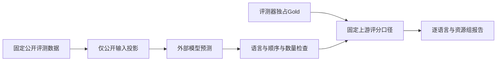
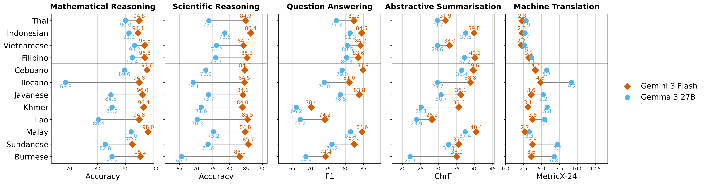

# DeepSEA：东南亚语言评测接口

## 论文信息

| 字段 | 内容 |
| --- | --- |
| 论文链接 | [arXiv 2610.26155 v1](https://arxiv.org/abs/2610.26155v1)；[固定原文](https://arxiv.org/html/2610.26155v1) |
| 原文标题 | DeepSEA: A Multilingual Evaluation Benchmark for Southeast Asia |
| 公司 / 机构 / 学校 | 一作 Jiuzhou Han；论文作者栏列 Google Research，注明工作在 Google 实习期间完成。Google 优先候选；不把邮箱域名直接推断成另一正式署名机构 |
| 首次公开日期 | 2026-10-19 10:43:30 UTC（arXiv v1）；本轮是近期补发现，不是两小时内新首发 |
| 原作者代码 | [Google Research 官方仓库](https://github.com/google-research/deep-sea)，固定 revision `7c3abc06824c8cb634930ab6049176da30cfa0e7`；评分代码 Apache-2.0，数据各自遵循上游许可，部分含非商业/相同方式共享限制 |
| 本地 adapter / 稳定键 | `deepsea`；`adapter: null`、`component_only`，是外部预测评分/数据接口，不是新训练模型 |
| 本地复现代码目录 | `src/auto_research/foundation_models/deepsea.py`；`tests/test_deepsea.py` |
| 完整实验 | 成本过高，不复现（审查 DONE）；不运行原论文完整模型矩阵，不调用付费 API |

## 原始论文总结

### 背景与主要改动

现有多语言评测对东南亚低资源语言覆盖不足。DeepSEA 通过专业翻译与质量审核扩展五类公开任务，支持按语言资源层级比较推理、问答和生成表现；研究同时分析英语中转、错误类型及 tokenizer 效率。它是 benchmark，而非改变语言模型参数的训练算法。



<!-- paper-figure:start -->
### 原论文关键图

[](https://arxiv.org/html/2610.26155v1#S4.F2)

**Figure 2** 展示原论文的跨语言结果，图片来自[原论文](https://arxiv.org/html/2610.26155v1#S4.F2)，版权归原作者所有。本地将原始 SVG 原样栅格化；没有改动数据或文字，[来源及哈希](assets/provenance.json)。图中翻译任务使用 **MetricX-24**，本地不实现这一模型指标，不能把下方官方 release 的 chrF 输出当作图中结果。
<!-- paper-figure:end -->

### 核心公式与评分口径

固定上游 release 覆盖 12 种东南亚语言，加英语参考共 13 种。数学任务使用数值答案精确匹配；科学任务先在每个学科计算选项正确率，再按学科等权平均，而非把所有题混在一起计算；问答对第一条参考答案计算 token F1；摘要使用 corpus chrF。

$$
\mathrm{F1}=\frac{2PR}{P+R},\qquad
\mathrm{IndoMMLU}=\frac1{|S|}\sum_{s\in S}\mathrm{Accuracy}_s.
$$

本地 chrF2 使用 SacreBLEU 2.5.1 默认口径：字符 1 至 6 阶、无词 n-gram、$\beta=2$、去除空白、保留大小写及 Unicode 原表示。先在语料级累加各阶充分统计，再对有效阶数的 precision/recall 求平均：

$$
\mathrm{chrF2}=100\frac{5\bar P\bar R}{4\bar P+\bar R}.
$$

这不是句子 chrF 的宏平均，也不会默认做 Unicode 规范化或换成字符级 QA F1。高/低资源组在成员语言齐备时才生成等权平均，东南亚组不包含英语；每种指标保留官方的 0 至 100 尺度。

### 论文离线与线上效果

原论文报告不同语言资源层级下的表现差异，发现英语中转可帮助部分低资源任务，亦分析非空格书写系统的抽取与分词问题。Figure 2 是原论文模型结果；本地只核验评分/隔离协议，不复制该模型对比。未报告生产线上 A/B。

### 原文与公开代码的差别

| 任务 | 论文 / 公开 release | 本地实现 |
| --- | --- | --- |
| MGSM | 数值 EM | 保留最后一个 `<answer>`、逗号处理与数值提取顺序 |
| IndoMMLU | 选项正确率，release 按学科宏平均 | 保留大小写优先提取与学科宏平均 |
| XQuAD | token F1 | 按固定脚本只选第一参考；保留其 answer tag / `answer is` 提取规则，不做最佳参考 oracle |
| CrossSum | corpus chrF | 保留摘要提取规则及 corpus chrF2 默认统计 |
| WMT24++ | **论文主指标 MetricX-24；公开 evaluate.py 实际仅 chrF** | 只提供明确命名的 `corpus_chrf2_not_metricx24`，请求 MetricX 时抛出 `NotImplementedError` |

固定上游的无闭合摘要 tag 会提取为空，QA 无 tag / 指定引导词时也不会自动接受整段文本。本地保留这些可定位的语义，而非一边修改评分器一边声称与原 release 相同。公开评分器的局限不等于原论文结论错误，但输出必须注明采用哪个版本和指标。

## 本地复现

### 公共输入与 Gold 隔离

`DeepSEATask` 深复制 evaluator 私有参考；预测回调仅接收不可变 `PublicExample`。各任务用字段白名单重建公开输入：问题、选项、上下文或源文本；`answer`、`answer_with_cot`、附加 metadata 和 few-shot 示例不会自动流入预测。预测按固定的语言/学科/行号绑定；缺语言、缺学科、数量不齐或非字符串预测直接报错，不以 `zip` 截断掩盖覆盖缺失。

这是应用层数据流合同，不是操作系统安全沙箱。评测进程有权读取参考，但未受信任的模型/Agent 不应获得 benchmark 文件路径、evaluator 对象、Gold 或 shell 权限。**该 benchmark 不用于训练、Evolve 候选选择或调参**；本次没有运行任何这样的流程。

```python
from pathlib import Path
from auto_research.foundation_models.deepsea import load_official_json

task = load_official_json(
    Path("/local/heldout/mgsm.json"), "mgsm",
    expected_sha256="9527f9693fbc2ba4e5b6ec4546f947888093c693f9231641016d6b8a52cdfb7d",
)
public_inputs = task.public_examples()  # 只有问题等公开字段
# 外部预测返回固定顺序的语言->字符串列表，再由 evaluator 调用 task.score(predictions)。
```

加载器不联网、不解包任意路径、不执行上游 shell/Python 脚本。固定官方 MGSM 小压缩包另有 `inspect_fixed_mgsm_archive`：仅检查完整文件哈希、JSON 大小、13 语言各 250 条 test、公开输入顺序及前缀哈希；不生成预测或输出 benchmark 原文、答案与 CoT。

### 验证与结果

```bash
PYTHONPATH=src python -c 'from auto_research.foundation_models.deepsea import diagnostic; print(diagnostic(42))'
PYTHONPATH=src python -m pytest tests/test_deepsea.py
```

人工编写的合成用例覆盖五任务评分、错误覆盖拒绝、Gold 隔离和 MetricX 拒绝。chrF 另对官方 SacreBLEU 2.5.1 比较 12 类边界（空串、单边为空、短文本、非空格语言、Unicode 组合字符、语料/句子平均差异等），绝对差在浮点舍入误差内；本地实现只依赖标准库，导入时不加载模型、SacreBLEU 或训练框架。

- [chrF 独立参照核验](assets/chrf-reference-parity.json)
- [官方数据 schema / 哈希验证](assets/official-schema-receipt.json)
- [统一三 seed 评分合同产物](metrics/component-cpu-seeds42-44.json)

诊断只报告 `scorer_contract_cases`、`reference_score_error`、`coverage_rejection_count` 和 `model_calls=0`。给定预测的参考评分不能被展示成某个 LLM 的 accuracy。固定 `L1`、`diagnostic_only=true`、`promotion_eligible=false`、`evolve_integrated=false`；三 seed 只是重复检查合同，不是模型能力试验。

### 成本与未复现范围

完整论文矩阵涵盖 13 语言、多任务、多规模公开权重和商业模型及额外分析。按原配置估计，单卡 A100/A30 或 Mac 批量生成需要长时间推理，商业端还涉及付费调用；因此完整模型实验**成本过高，不复现（审查 DONE）**，不下载大权重、不试跑全量矩阵、不自动重试。该成本结论基于论文规模，而非本地测得的完整耗时。低成本评分和数据 schema 接口不要求 GPU，也不冒充完整 benchmark 验证。
