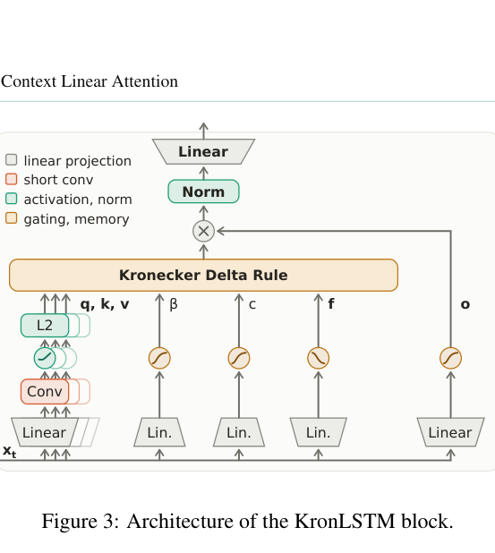

# KronLSTM: Updating recurrent memory by scalar key–value association

<!-- source-sha256: 387884f18f41ffa0328b284f09335984f0db88d73644c6299b1313bcdaf55022 -->

[简体中文](README.md)

> **L1 trainable mixer and memory operator; diagnostic only.** No large-scale pretraining or optimized kernel.

## Paper information

| Field | Details |
| --- | --- |
| Paper | [Kronecker Delta Rule for Long Context Linear Attention](https://arxiv.org/abs/2610.26834) |
| Affiliations | Co-first authors Anamaria-Roberta Hartl: Johannes Kepler University Linz; Levente Zólyomi: JKU and NXAI. Collaboration with NXAI GmbH. |
| First public release | 2026-10-19 17:56:52 UTC |
| Author code | The abstract announces code/models, but no verifiable repository, release location or license was found in the reviewed abstract/HTML/PDF. lm-engine/FLA are not the method source. |
| Local key | `kronlstm`; no adapter |
| Local code | `src/auto_research/foundation_models/kronlstm.py` |
| Local evidence | [Local mechanism metrics](metrics/component-cuda-seeds42-44.json); [A100 validation receipt](../../gpu-validations/kronlstm-a100-20261020.json) |

## What the paper changes

DeltaNet updates a vector error and can disturb overlapping keys. The Kronecker rule instead corrects scalar association $v^TSk$ along one outer-product direction $vk^T$. In vector form $a=v\otimes k$, the step is $s'=(I-\beta aa^T)s+\beta ca$. Overlap depends on both key and value inner products; orthogonality of either preserves that association for the current update, not arbitrary long-sequence retention.

### Original paper figure



Original figure from the reviewed paper, reused without redrawing.

### Core equations

$$
S'=S-\beta(v^TSk-c)vk^T.
$$

$$
S_d=SF,\qquad S'=S_d-\beta(v^TS_dk)vk^T+c\,vk^T,
$$

$$
\beta=\sigma(W_\beta x+b_\beta),\quad c=\sigma(W_cx+b_c),\quad
f=\sigma(-W_fx-b_f)^{\exp(a_{log})},\quad F=\operatorname{diag}(f).
$$

KronLSTM applies channelwise forgetting on the right/key axis, then independent erase and write gates. Write is $c$, not $\beta c$. Q/K/V use causal short depthwise convolution, SiLU and L2 normalization. Query reads the new memory, then output gate, per-head RMSNorm and projection. An explicit vectorized matrix with repeated per-key decay independently checks the contraction.

### Results reported by the authors

Table 1 1.5B/100B-token linear model: Avg-6 59.72% versus GDN-2 57.94%; LAMBADA PPL 11.72 versus 12.54. Also studies RULER, retrieval, state tracking and sliding-window hybrids. Not all tasks lead. No production A/B or local LLM results.

## Local reproduction and limits

`kronecker_update` and `TinyKronLSTM` implement recurrence, projections, short convolution and four input-dependent gates. Fixture batch two, seven tokens, width 12, two heads, key/value widths three/four; FP64 only, no AMP qualification. CPU and A100 seeds 42/43/44 check explicit-vector state/readout, six projection/gate gradients, causal prefixes, segment memory, scalar association, key forgetting and actual SGD; ordinary DeltaNet is a negative control. A100 errors ~1e-16 state/readout and 1.16e-17 gradients, frozen source `324217ed26fe2e297e25879ad092281eb0960b87`. No fallback, output overwrite, export, throughput or Evolve.

```bash
PYTHONPATH=src python scripts/run_oct20_foundation_components.py \
  --methods kronlstm --device cpu --seeds 42,43,44 \
  --output runs/oct20-foundation/kronlstm-cpu.json
```

### Full experiment: not reproduced

Appendix A7 describes 1.5B on 100B FineWeb-Edu tokens, 8,192 context and 16 nodes × four GH200s, plus 400M/40B, long-context continued training and mixer comparisons. No full run, fused chunkwise kernel or automatic retry.

### Additional references

[Full paper](https://arxiv.org/html/2610.26834v1) · [Paper section](https://arxiv.org/html/2610.26834v1#A7) · [Paper Section 2.1](https://arxiv.org/html/2610.26834v1#S2.SS1) · [Paper Section 2.2](https://arxiv.org/html/2610.26834v1#S2.SS2) · [Paper Section 3.1](https://arxiv.org/html/2610.26834v1#S3.SS1) · [Paper PDF, p. 6](https://arxiv.org/pdf/2610.26834#page=6)
