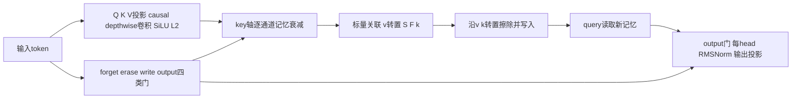
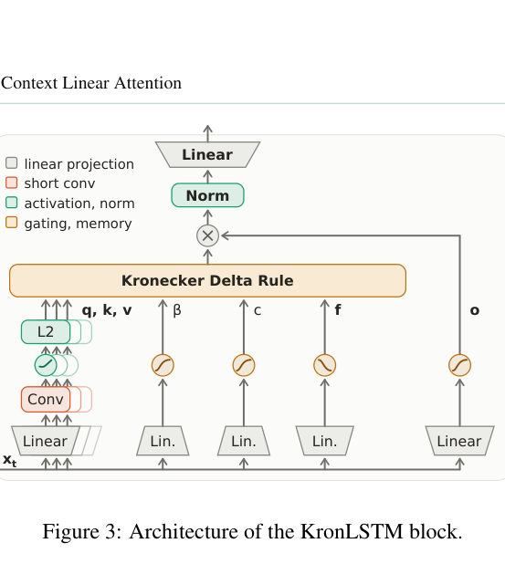

# KronLSTM：按 key-value 标量关联修订递归记忆

## 论文信息

| 字段 | 内容 |
| --- | --- |
| 论文链接 | [arXiv 2610.26834](https://arxiv.org/abs/2610.26834)；[固定 v1 全文](https://arxiv.org/html/2610.26834v1) |
| 原文标题 | Kronecker Delta Rule for Long Context Linear Attention |
| 公司 / 机构 | 首列共同一作 Anamaria-Roberta Hartl：Johannes Kepler University Linz；另一共同一作 Levente Zólyomi：JKU / NXAI；合作 NXAI GmbH |
| 首次公开日期 | 2026-10-19 17:56:52 UTC；2026-10-20 arXiv 新公告 |
| 原作者代码 | 摘要声明代码及模型开源，但本轮未在摘要/HTML/PDF 定位到可核验的作者仓库链接；发布位置和许可证待核，不把通用 lm-engine/FLA 依赖当成本文源码 |
| 本地 adapter / 稳定键 | `kronlstm`；`adapter: null`，不是 Evolve 可晋级算子 |
| 本地复现代码目录 | `src/auto_research/foundation_models/kronlstm.py`；`scripts/run_oct20_foundation_components.py` |
| 实现状态 | `component_only`；真实小型 mixer 与记忆算子，L1 机制诊断 |
| 完整实验 | 成本过高，不复现（审查 DONE）；`not_reproduced_high_cost` |

## 原始论文总结

### 背景与主要改动

标准 DeltaNet 用向量误差 $Sk-v$ 更新矩阵记忆，会干扰与当前 key 重叠的其他关联。Kronecker Delta Rule 修正的是**一个 key-value 对的标量关联** $v^TSk$；记忆修订沿 $v k^T$ 的单一矩阵方向进行。KronLSTM 再加入 key 轴逐通道遗忘和分离 erase/write 门。



<!-- paper-figure:start -->
### 原论文关键图

[](https://arxiv.org/pdf/2610.26834#page=6)

> **原论文 Figure 3（关键图）**：KronLSTM块的投影、短卷积、L2归一化、Kronecker Delta记忆、独立门及RMSNorm；本地是小型循环实现，不是融合chunk内核。图片来自[原论文](https://arxiv.org/abs/2610.26834)，版权归原作者所有；点击图片可查看来源。
<!-- paper-figure:end -->

### 核心公式

[Eq.3](https://arxiv.org/html/2610.26834v1#S2.SS1) 是标量平方误差的梯度步：

$$
S'=S-\beta(v^TSk-c)vk^T.
$$

若向量化 $a=v\otimes k$，则 $s'=(I-\beta aa^T)s+\beta c a$。其他关联受到的扰动同时取决于 key 和 value 的内积；任一正交都不受当前擦写影响，但不能据此宣称任意长序列下完全没有遗忘。

本地实际 mixer 对应 [Eq.10–12](https://arxiv.org/html/2610.26834v1#S2.SS2) 的解耦写入：

$$
S_d=SF,\qquad S'=S_d-\beta(v^TS_dk)vk^T+c\,vk^T,
$$

$$
\beta=\sigma(W_\beta x+b_\beta),\quad c=\sigma(W_cx+b_c),\quad
f=\sigma(-W_fx-b_f)^{\exp(a_{log})},\quad F=\operatorname{diag}(f).
$$

注意式中 write 是 $c$ 而非 $\beta c$，forget 乘记忆的**右侧 key 轴**。Q/K/V 经因果短卷积、SiLU 与 L2 归一化，query 读取更新后的记忆，输出门之后做每 head RMSNorm，再投影。数值参考使用 $s'=(I-\beta aa^T)\operatorname{diag}(f\ \text{重复}\ d_v\ \text{次})s+ca$ 的显式矩阵，独立于实现中的张量收缩。

### 论文离线与线上效果

[Table 1](https://arxiv.org/html/2610.26834v1#S3.SS1) 的 1.5B / 100B-token 纯线性模型中，KronLSTM Avg-6 为 59.72%，GDN-2 为 57.94%；LAMBADA PPL 为 11.72 对 12.54。原文还做 RULER、真实语料检索、状态跟踪与 SWA hybrid 比较。不是所有单项都领先，且完整能力依赖大规模训练；未报告生产线上 A/B。本地不复述为自己得到的收益。

## 本地复现

### 实现与运行

`kronecker_update` 保存标量关联擦除与 key 轴忘记；`TinyKronLSTM` 包含真实投影、短卷积、归一化、四类输入相关门、循环记忆和输出投影。它不是把普通 DeltaNet 换个名字，也不是仅记录配置。当前是 PyTorch 循环版，未实现论文 Appendix A8 的融合 chunkwise 前后向内核，不宣称相同吞吐量。

```bash
PYTHONPATH=src python scripts/run_oct20_foundation_components.py \
  --methods kronlstm --device cpu --seeds 42,43,44 \
  --output runs/oct20-foundation/kronlstm-cpu.json
```

固定人工输入为 batch 2、7 token、12 维、2 head、key 3 维/value 4 维，验收使用 FP64，不宣称 FP16/BF16 或 AMP 已验证。不是语言、视频或检索 benchmark；数据 ID 为 `synthetic:oct20-kronlstm-v1`，revision 是 runner SHA256，未下载权重。CUDA 必须显式选择，无 CPU 回退；输出不可覆盖。

### 本地结果与负对照

CPU与真实单张A100的42/43/44三seed均执行前向、显式vec参考、六组投影/门的梯度参考和真实SGD更新。A100读出/状态参考误差约1e-16，梯度参考约1.16e-17。另验证前缀因果、跨段记忆、标量关联修改与key轴遗忘，普通DeltaNet是负对照。见[实际指标](metrics/component-cuda-seeds42-44.json)和[GPU回执](../../gpu-validations/kronlstm-a100-20261020.json)，绑定冻结提交`324217ed26fe2e297e25879ad092281eb0960b87`；只验FP64随机初始化小mixer，不宣称语言能力或融合内核速度。

### 成本判断与边界

[Appendix A7](https://arxiv.org/html/2610.26834v1#A7) 报告 1.5B 模型在 100B FineWeb-Edu tokens 上预训练、8192 context、16 节点×4 张 GH200，另有 400M/40B、长上下文继续训练、多个 mixer 对照。完整实验显著超出单张 A100/A30 或本地 Mac 的日常预算，**成本过高，不复现（审查 DONE）**。

本地没有语言预训练、真实长上下文任务、性能内核或模型导出。未建立完整 Evolve 控制器映射；L1 数值与梯度通过不等于长上下文能力提升，不能用于自动晋级。
