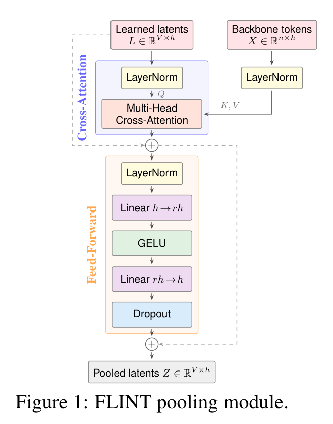

# FLINT: Fixed-budget Late Interaction

<!-- source-sha256: 6370e1edd786aae2d1f9c30fb01768a06efe4dbbe9fc42eda5ddfc524d9d3a6c -->

[简体中文](README.md)

> **L1 differentiable fixed-budget pooling, projection and MaxSim; diagnostic only.** No full text retrieval system.

## Paper information

| Field | Details |
| --- | --- |
| Paper | [FLINT: Fixed-budget Late Interaction](https://arxiv.org/abs/2610.27273v1) |
| Affiliations | First author Himank Handa: UIUC; Negar Arabzadeh and Matei Zaharia: UC Berkeley. |
| First public release | 2026-10-19 20:46:01 UTC |
| Author code | [hmk55555/FLINT](https://github.com/hmk55555/FLINT), MIT, `3b3f3e37d34e32ca5c92cc5b66e3f778ae4210ec`; [checkpoint collection](https://huggingface.co/collections/himankhanda/flint), not downloaded. |
| Local key | `flint`; no adapter |
| Local code | `src/auto_research/foundation_models/flint.py` |
| Local evidence | [Local mechanism metrics](metrics/component-cuda-seeds42-44.json); [A100 validation receipt](../../gpu-validations/flint-a100-20261021-late.json) |

## What the paper changes

ColBERT scales with document and query token counts; ConstBERT fixes only the document side. FLINT uses separate learned query/document latent sets after a shared backbone, with shared cross-attention and FFN to emit fixed $V$ vectors per side. This is neither first-token truncation nor averaging.

### Original paper figure



Original figure from the reviewed paper, reused without redrawing. See [figure provenance](assets/provenance.json).

### Core equations

$$
A_s=\operatorname{Concat}_{a=1}^H\left[
\operatorname{softmax}\!\left(
\frac{[\operatorname{LN}_L(L_s)W_Q^a]
[\operatorname{LN}_X(X)W_K^a]^\top}{\sqrt{h_a}}+M
\right)\operatorname{LN}_X(X)W_V^a\right]W_O.
$$

$$
U_s=L_s+\operatorname{Dropout}(A_s),\qquad
Z_s=U_s+\operatorname{Dropout}\!\left(
W_2\operatorname{GELU}(W_1\operatorname{LN}_{FF}(U_s)+b_1)+b_2
\right).
$$

$$
\widetilde z_i^s=\operatorname{normalize}(P_s z_i^s),\qquad
S(q,d)=\sum_{i=1}^{V}\max_{1\le j\le V}
\langle\widetilde z_i^q,\widetilde z_j^d\rangle.
$$

Mask padded keys with negative infinity. Retain both pre-LN residuals, projection bias and one cross-attention plus one pointwise FFN, no latent self-attention or post-norm. L2-normalize projected vectors and sum over query vectors after max over document vectors; score need not be symmetric. Appendix B/source: BERT uses separate bias-free projections, ModernBERT shared; `shared_projection` supports both. Typical V=32, heads eight, projection 128; expansion four for BERT and two for ModernBERT.

### Results reported by the authors

Table 1 BERT BEIR NDCG@10 0.452 versus ConstBERT 0.469 and ColBERTv2 0.502. ModernBERT V=32 BEIR/CRUMB 0.530/0.205 versus 0.518/0.180. TREC-ToT BERT response 74.3 ms to 26.1 ms against ConstBERT. No production A/B or local score/speed.

## Local reproduction and limits

`FlintLatentPool` and `FlintFixedBudgetRetrieval` take encoded tokens, apply pooling, projection and aligned-batch MaxSim. Three synthetic query/document pairs of 7/11 width-16 tokens compress to four width-eight vectors; gradients reach inputs, both latent sets and shared modules. True mask means valid; all-masked fails. Tests independent attention, residuals/no postnorm, masks/zero gradient, latent independence, projection variants, norms, MaxSim axes/gradient and gradcheck. Pool invariance does not remove backbone word order. No tokenizer, backbone, distillation, data, PLAID, gold, CUDA fallback or Evolve.

```bash
PYTHONPATH=src python -c 'from auto_research.foundation_models.flint import run_flint_diagnostic; print(run_flint_diagnostic(seed=42, device="cpu"))'
```

### Full experiment: not reproduced

MS MARCO BERT 64 candidates/query, global batch 48, 267K steps; ModernBERT-large 32 candidates/query for one epoch, default four GPUs; evaluation to 6.4M documents with PLAID indexes. No downloads, full run or retry. Fixed budget constrains post-encoder representation/matching, not backbone cost.

### Additional references

[Paper PDF](https://arxiv.org/pdf/2610.27273v1) · [Paper PDF, p. 3](https://arxiv.org/pdf/2610.27273v1#page=3)
