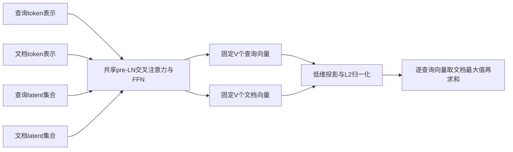
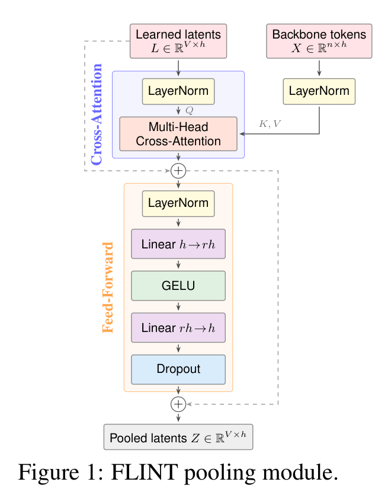

# FLINT：查询与文档的固定预算多向量检索

## 论文信息

| 字段 | 内容 |
| --- | --- |
| 论文链接 | [arXiv 2610.27273 v1](https://arxiv.org/abs/2610.27273v1)；[固定原文 PDF](https://arxiv.org/pdf/2610.27273v1) |
| 原文标题 | FLINT: Fixed-budget Late Interaction |
| 公司 / 机构 / 学校 | 一作 Himank Handa：University of Illinois Urbana-Champaign；合作者 Negar Arabzadeh、Matei Zaharia：University of California, Berkeley；不是 Google/Meta 机构稿 |
| 首次公开日期 | 2026-10-19 20:46:01 UTC（arXiv v1；目录公告日期不替代首发日期） |
| 原作者代码 | [官方 MIT 仓库](https://github.com/hmk55555/FLINT)，核对固定 commit `3b3f3e37d34e32ca5c92cc5b66e3f778ae4210ec`；[官方 checkpoint 集合](https://huggingface.co/collections/himankhanda/flint)，本轮未下载权重 |
| 本地 adapter / 稳定键 | `flint`；`adapter: null`，`component_only` |
| 本地复现代码目录 | `src/auto_research/foundation_models/flint.py`；测试 `tests/test_flint.py` |
| 完整实验 | 成本过高，不复现（审查 DONE）；只实现固定预算池化、投影与 MaxSim 的 L1 可微组件 |

## 原始论文总结

### 背景与主要改动

ColBERT 对每个 token 保留向量，文档越长索引越大，长查询也需要更多次向量检索。ConstBERT 固定了文档侧预算，但查询仍逐 token。FLINT 则在共享 backbone 后，用两套不同的可学习 latent 分别读取查询和文档 token；交叉注意力、FFN 参数共享，双方输出都固定为 $V$ 个向量。它不是截取前 $V$ 个 token，也不是简单平均池化。



<!-- paper-figure:start -->
### 原论文关键图

[](https://arxiv.org/pdf/2610.27273v1#page=3)

**Figure 1，第3页**：共享 token 上下文、可学习 latent，以及两段带 pre-LayerNorm 的残差。图片来自[原论文](https://arxiv.org/pdf/2610.27273v1#page=3)，版权归原作者所有，原文许可 CC BY 4.0；本地只裁切渲染，未重绘内容。[裁切与文件校验信息](assets/provenance.json)。
<!-- paper-figure:end -->

### 核心公式

令 $X\in\mathbb R^{n\times h}$ 为已编码的 token 表示，$L_s\in\mathbb R^{V\times h}$ 为侧别 $s\in\{q,d\}$ 的 latent，$h_a=h/H$。对每个 head，正文式1的缩放交叉注意力写为：

$$
A_s=\operatorname{Concat}_{a=1}^H\left[
\operatorname{softmax}\!\left(
\frac{[\operatorname{LN}_L(L_s)W_Q^a]
[\operatorname{LN}_X(X)W_K^a]^\top}{\sqrt{h_a}}+M
\right)\operatorname{LN}_X(X)W_V^a\right]W_O.
$$

$M$ 对 padding 位置为 $-\infty$。Figure 1 和官方 `SharedPerceiverBottleneck` 明确保留两段残差，不把正文简写误实现为裸 attention：

$$
U_s=L_s+\operatorname{Dropout}(A_s),\qquad
Z_s=U_s+\operatorname{Dropout}\!\left(
W_2\operatorname{GELU}(W_1\operatorname{LN}_{FF}(U_s)+b_1)+b_2
\right).
$$

注意力投影保留官方 bias。这里只使用一次 cross-attention 和一次 position-wise FFN，不添加 latent self-attention 或 post-residual norm。投影后按向量做 L2 归一化，再按式2计算：

$$
\widetilde z_i^s=\operatorname{normalize}(P_s z_i^s),\qquad
S(q,d)=\sum_{i=1}^{V}\max_{1\le j\le V}
\langle\widetilde z_i^q,\widetilde z_j^d\rangle.
$$

求和轴是查询，取最大轴是文档；不是对所有元素平均，也不要求分数对称。正文 §2.2 对共享投影做了简写，附录 B 与官方 `hf_colbert.py` 更具体：BERT 使用两套无 bias 投影，ModernBERT 共享一套。本地 `shared_projection=False/True` 分别支持这两条路径。论文预算通常为 $V=32$、$H=8$、投影维128；BERT 的 FFN 扩张比4，ModernBERT 为2。

### 论文离线与线上效果

原文表1中，BERT FLINT 的 BEIR 平均 NDCG@10 为0.452，低于 ConstBERT 的0.469和 ColBERTv2 的0.502，不能写成全面领先。ModernBERT、$V=32$ 时 BEIR 为0.530、CRUMB 为0.205，分别对比 ConstBERT 的0.518、0.180；长查询收益更明显。原文表2报告 TREC-ToT 的 BERT 总响应时间由 ConstBERT 的74.3ms降至26.1ms。以上都是论文结果，不是本地测量；未报告生产线上 A/B。

## 本地复现

`FlintLatentPool` 实现共享多头 cross-attention、两套 latent、pre-LN、残差及 GELU FFN；`FlintFixedBudgetRetrieval` 接收已经编码的 token 张量，执行投影、归一化和 aligned-batch MaxSim。它不包含 tokenizer、BERT/ModernBERT backbone、教师蒸馏、训练数据或 PLAID 索引，因此不是可直接用于文本检索的完整模型。

```bash
PYTHONPATH=src python -c 'from auto_research.foundation_models.flint import run_flint_diagnostic; print(run_flint_diagnostic(seed=42, device="cpu"))'
```

`run_flint_diagnostic` 用3组随机生成的查询/文档 token 表示（7/11个token、16维），压到双方各4个8维向量，真实反向传播至输入、两套 latent、attention/FFN 和共享投影。mask 中 `True` 表示有效 token；整行全部 masked 时显式报错。指定 CUDA 不可用会失败，不静默回退 CPU；真实设备执行证据由本轮统一运行入口记录，本页不把 CPU 单测当成 GPU 验证。

### 数据协议、验证与结果边界

不下载 checkpoint 或检索语料，不访问任何金标答案。单元测试覆盖独立多头缩放 attention 手算、两段残差与无 post-norm 负控、固定 $V$ 预算、padding 内容隔离、masked token 零梯度、查询/文档 latent 独立性、BERT/ModernBERT 投影共享、L2归一化、MaxSim 求和轴与梯度、有限差分 gradcheck 和无 CUDA 回退；`diagnostic(seed, device)` 提供统一运行器的有限标量与布尔检查接口。pool 本身对 token 重排等变后的集合读取不变，但完整 backbone 仍可编码词序，不能由此声称模型忽略语序。

本地仅为 `l1_mechanism`、`diagnostic_only: true`。不提供 BEIR NDCG、生产吞吐或优于基线结论；多 seed 不提升证据层级，`promotion_eligible: false`、`evolve_integrated: false`。

### 成本与未复现范围

附录 B 的 BERT 配方为 MS MARCO 每查询64候选、global batch48、267K steps；ModernBERT-large 为每查询32候选的一整个 epoch，官方脚本默认4张 GPU。正式评测还需最高640万文档语料及多套 PLAID 索引。这些完整训练/索引/多基准实验明显超过单 A100/A30 的本轮短预算，标注**成本过高，不复现（审查 DONE）**，不下载、不试跑、不进入自动重试队列。固定预算只限制 encoder 之后的表示与匹配规模，不使 backbone 编码成本与文本长度无关。
