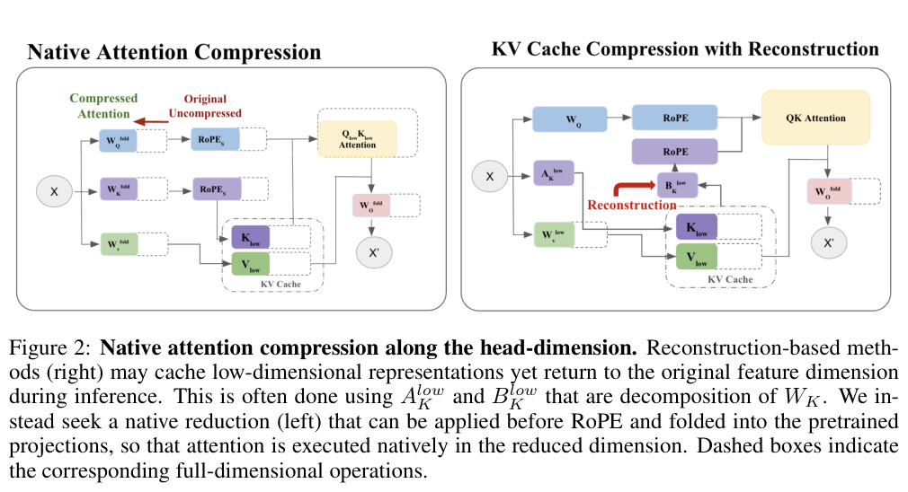

# RACE: Native attention compression that preserves RoPE pairs

<!-- source-sha256: 19e81f859ccb720420d179ce22b1cec07c3ea4ed1070b3ff903e6dbca25f0f45 -->

[简体中文](README.md)

> **L1 single-head calibration, projection folding and attention; diagnostic only.** No full converted model.

## Paper information

| Field | Details |
| --- | --- |
| Paper | [RACE: RoPE-Aligned Attention Compression Based on Query-Key Activation Energies](https://arxiv.org/abs/2610.28385v1) |
| Affiliations | First author Irene Tenison: MIT CSAIL; collaboration with MIT-IBM Computing Research Lab. |
| First public release | 2026-10-20 15:34:02 UTC |
| Author code | No verifiable author repository or revision in the paper or abstract. Related-work repositories are not method source. |
| Local key | `race-rope-compression`; no adapter |
| Local code | `src/auto_research/foundation_models/oct21_followup_attention.py` |
| Local evidence | [Local mechanism metrics](metrics/component-cuda-seeds42-44.json); [A100 validation receipt](../../gpu-validations/race-rope-compression-a100-20261021-followup.json) |

## What the paper changes

KV reconstruction can save storage while adding compute. RACE shrinks the head directly: select shared complete Q/K rotation pairs by joint activation energy and obtain a V subspace from right singular vectors. Fold both into Q/K/V/O. Preserve the original frequencies rather than renumbering pairs.

### Original paper figure



Original figure from the reviewed paper, reused without redrawing. See [figure provenance](assets/provenance.json).

### Core equations

$$
W_Q'=W_QP_{QK},\quad W_K'=W_KP_{QK},\quad
W_V'=W_VP_V,\quad W_O'=P_V^\top W_O.
$$

$$
Y'=\mathrm{softmax}\left(\frac{\mathrm{RoPE}_{S}(XW_Q')\,
\mathrm{RoPE}_{S}(XW_K')^\top}{\sqrt{d_k}}+M_{causal}\right)
(XW_V')W_O'.
$$

Rank each rotation pair by $\|Q_m\|_F^2+\|K_m\|_F^2$ and retain top-$r_k/2$; V uses top-$r_v$ right vectors. Use the **original** head width in the attention denominator, not compressed width. Energy selection optimizes a separable calibration bound, not exact task loss. Calibration/SVD are detached; folded forward differentiates through inputs/weights.

### Results reported by the authors

Paper experiments use Llama-3.2-3B, Qwen2.5-7B and Granite-4.1-3B, with about 1M-token KL recovery in all main results. At 256K and 50% retention the system reports ~1.79× throughput. No local recovery/benchmark/speed and no production A/B.

## Local reproduction and limits

`race_pair_selection` supports split-half/interleaved; `calibrate_race`, `fold_race_weights` and `native_race_attention` run a genuinely lower-dimensional causal head without restoring full Q/K/V. Fixture uses 24 width-eight vectors, keeps four Q/K and V coordinates. Checks original noncontiguous frequencies, wrong renumbering, scale, folded vs explicit projections, full rank, orthogonality, detached calibration and nonzero gradients. No GQA, partial-RoPE serving, HF conversion or Evolve.

```bash
PYTHONPATH=src python scripts/run_oct21_followup_attention.py \
  --device cpu --seeds 42,43,44 \
  --output runs/oct21-followup-attention-cpu.json
```

### Full experiment: not reproduced

Full setup uses 3B/7B models, 32,768 calibration tokens/model, ~1M-token distillation recovery and multiple benchmarks/64K–256K system runs. No model downloads, trial or automatic retry.

### Additional references

[Paper PDF](https://arxiv.org/pdf/2610.28385v1) · [Paper PDF, p. 3](https://arxiv.org/pdf/2610.28385v1#page=3)
