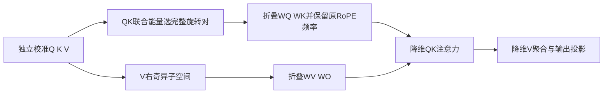
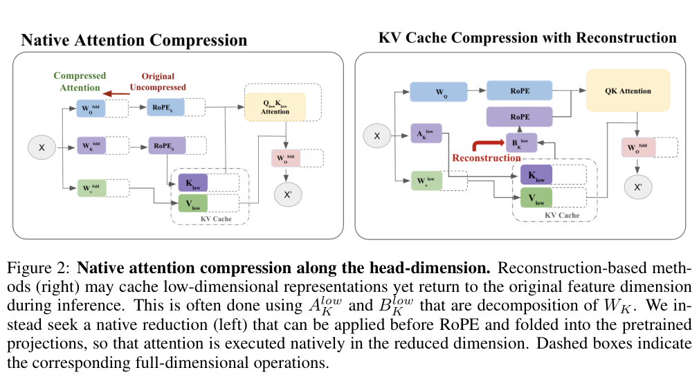

# RACE：保留旋转对的原生注意力维度压缩

## 论文信息

| 字段 | 内容 |
| --- | --- |
| 论文链接 | [arXiv 2610.28385 v1](https://arxiv.org/abs/2610.28385v1)；[固定原文 PDF](https://arxiv.org/pdf/2610.28385v1) |
| 原文标题 | RACE: RoPE-Aligned Attention Compression Based on Query-Key Activation Energies |
| 公司 / 机构 / 学校 | 一作 Irene Tenison：MIT CSAIL；合作机构 MIT-IBM Computing Research Lab。不是Google/Meta稿 |
| 首次公开日期 | 2026-10-20 15:34:02 UTC（arXiv v1；10月21日公告） |
| 原作者代码 | 原文与摘要未提供可核验仓库；未找到/未确认公开代码和revision，不以相关工作代码代替 |
| 本地 adapter / 稳定键 | `race-rope-compression`；`adapter: null`，`component_only` |
| 本地复现代码目录 | `src/auto_research/foundation_models/oct21_followup_attention.py`；`scripts/run_oct21_followup_attention.py` |
| 完整实验 | 成本过高，不复现（审查 DONE）；本地仅交付单头校准、投影折叠与降维执行算子 |

## 原始论文总结

### 背景与主要改动

把KV写成低秩形式却在注意力前还原，可能节省缓存但增加运算。RACE直接改变注意力head的宽度：Q和K共享选择，只保留完整RoPE旋转对；V通过校准激活的右奇异子空间投影；再将两种变换折叠到Q/K/V/O权重。保留原模型频率及原head维度缩放，避免把缩小维度当作新模型重新编码。



<!-- paper-figure:start -->
### 原论文关键图

[](https://arxiv.org/pdf/2610.28385v1#page=3)

**Figure 2，第3页**：左侧原生压缩与右侧需要重建的缓存压缩对照。图片来自[原论文](https://arxiv.org/pdf/2610.28385v1#page=3)，版权归原作者所有；[裁切与校验信息](assets/provenance.json)。
<!-- paper-figure:end -->

### 核心公式

对原旋转对 $m=(i_m,j_m)$，按校准统计 $E_m=\|Q_m\|_F^2+\|K_m\|_F^2$ 选择top-$r_k/2$对，得到共同选择矩阵 $P_{QK}$。V校准矩阵的top-$r_v$右奇异向量组成 $P_V$。采用行向量权重约定：

$$
W_Q'=W_QP_{QK},\quad W_K'=W_KP_{QK},\quad
W_V'=W_VP_V,\quad W_O'=P_V^\top W_O.
$$

$$
Y'=\mathrm{softmax}\left(\frac{\mathrm{RoPE}_{S}(XW_Q')\,
\mathrm{RoPE}_{S}(XW_K')^\top}{\sqrt{d_k}}+M_{causal}\right)
(XW_V')W_O'.
$$

分母仍是**原始** $d_k$，不是保留宽度 $r_k$；`RoPE_S`限制原频率而不重编号。联合能量最小化论文的可分离校准上界，不保证全局最小化精确误差或语言模型损失。校准/SVD不参与反向传播；折叠后的前向对输入和权重保留梯度。

### 论文离线与线上效果

原文在Llama-3.2-3B、Qwen2.5-7B、Granite-4.1-3B等评估；全部主要结果都包含约1M-token KL恢复。256K、50%缓存保留的系统实验报告约1.79倍总吞吐。未报告生产线上 A/B。本地没有重跑这些benchmark、恢复或系统速度，不能把折叠数值一致称为复现该提升。

## 本地复现

`race_pair_selection`支持split-half和interleaved两种物理旋转布局；`calibrate_race`得到detached QK选择与V子空间；`fold_race_weights`真实生成缩小后的四个投影；`native_race_attention`仅在保留维度执行因果注意力，不还原完整Q/K/V。当前是单头、全RoPE参考算子，不是HuggingFace整模型转换器，也未实现GQA/partial-RoPE部署。

```bash
PYTHONPATH=src python scripts/run_oct21_followup_attention.py \
  --device cpu --seeds 42,43,44 \
  --output runs/oct21-followup-attention-cpu.json
```

runner使用24个8维生成向量，将QK/V各保留4维；比较折叠执行和显式子空间参考，记录原频率交换误差、折叠误差、V正交性和输入梯度。源码hash、Git commit、生成数据hash和设备随结果保存。GPU结果仅在实际执行后收录。

### 验证与边界

测试覆盖两种布局的完整对选择、非连续原频率保留、错用重新编号频率的负对照、原始缩放、显式投影与原生折叠一致、全rank恢复、detached校准及有限非零梯度。校准与该小向量诊断不是validation/test能力评测；结果不晋级、不接入Evolve。

### 成本与未复现范围

完整论文包含3B/7B模型、每模型32768-token校准、约1M-token蒸馏恢复、多个基准和64K–256K系统实验。整套矩阵超出本轮单A100/A30短时预算，**成本过高，不复现（审查 DONE）**，不下载、不试跑、不进入重试队列。本轮仅低成本组件和设备执行验证。
