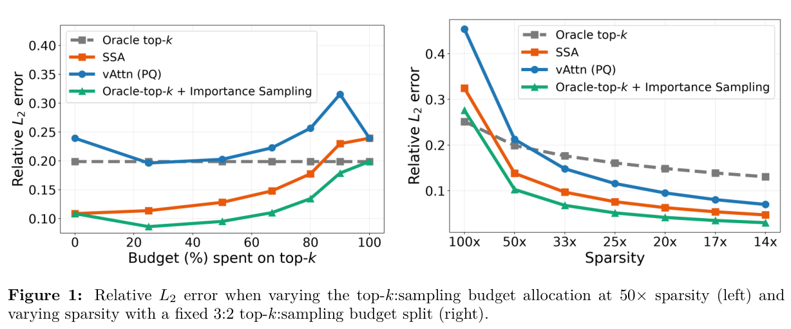

# SSA: Correcting stratified sparse attention by inclusion probability

<!-- source-sha256: ae6903ea6f5a54b08cff6e6083304f714c5fb80df98fba792af9286be35885b5 -->

[简体中文](README.md)

> **L1 single-head Algorithm 1 reference; diagnostic only.** No optimized kernel or full benchmark reproduction.

## Paper information

| Field | Details |
| --- | --- |
| Paper | [Stratified Sparse Attention: Reducing the Sparse-to-Dense Gap at Extreme Sparsity](https://arxiv.org/abs/2610.28441v1) |
| Affiliations | First author Sahil Joshi: Rice University; collaborators include UC Berkeley, Stanford and IIT Bombay. |
| First public release | 2026-10-20 16:02:12 UTC |
| Author code | The claimed [SSA-Paper-Code](https://github.com/skylight-org/SSA-Paper-Code) returned 404 on 2026-10-21. No verified code or revision. |
| Local key | `stratified-sparse-attention`; no adapter |
| Local code | `src/auto_research/foundation_models/oct21_followup_attention.py` |
| Local evidence | [Local mechanism metrics](metrics/component-cuda-seeds42-44.json); [A100 validation receipt](../../gpu-validations/stratified-sparse-attention-a100-20261021-followup.json) |

## What the paper changes

Top-k loses tail mass, while uniform sampling wastes budget. Water-fill proxy probabilities to solve $\sum_i\min(1,\lambda q_i)=k$. Keep $\lambda q_i\ge1$ exactly; renormalize residual proxy probabilities, draw the remaining budget with replacement and deduplicate. The paper's optimized fixed-heavy-fraction kernel differs from adaptive Algorithm 1.

### Original paper figure



Original figure from the reviewed paper, reused without redrawing. See [figure provenance](assets/provenance.json).

### Core equations

$$
\pi_i=\begin{cases}1&i\in H\\1-(1-p_i)^m&i\in S\end{cases},\quad
\hat o=\frac{\sum_{i\in H\cup S}\exp(q^\top k_i/\sqrt d)v_i/\pi_i}
{\sum_{i\in H\cup S}\exp(q^\top k_i/\sqrt d)/\pi_i}.
$$

Use the probability of appearing **at least once**, not reciprocal per-draw probability, after deduplication. Compute it stably via `-expm1(m*log1p(-p))` and normalize corrected logits in log space. The ratio estimator is self-normalized, not strictly unbiased. Full budget returns dense attention; invalid/non-finite or underflowing inputs fail without floors.

### Results reported by the authors

Table 1 128K RULER-HARD at 50× sparsity: Ministral-3-8B vAttention 63.78 versus SSA 69.25. Kernel timings use H200 at 1M context. No production A/B or local model/speed result.

## Local reproduction and limits

`stratified_sparse_attention` takes one query, keys, values and external proxy scores. Only exact selected Q/K/V paths differentiate; allocation is detached. Fixture: 64 keys, Q/K width eight, V width six, budget 16. Tests force repeated draws, check inclusion formula, heavy probability one, dense endpoint, Q/K/V gradients, no proxy gradient and invalid input. CPU sync and full-length probability processing preclude the kernel speed claim. No PQCache, layer sampler, paged KV or Evolve.

```bash
PYTHONPATH=src python scripts/run_oct21_followup_attention.py \
  --device cpu --seeds 42,43,44 \
  --output runs/oct21-followup-attention-cpu.json
```

### Full experiment: not reproduced

3B–27B models, 32K–128K benchmarks, 32K generation and H200 1M-context kernel testing. No downloads, long run or retry.

### Additional references

[Paper PDF](https://arxiv.org/pdf/2610.28441v1) · [Paper PDF, p. 2](https://arxiv.org/pdf/2610.28441v1#page=2)
