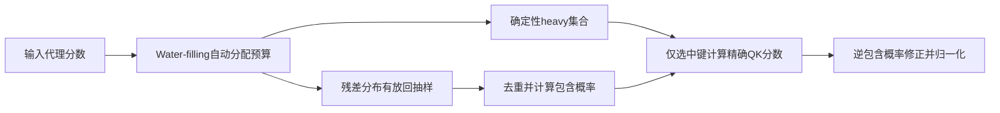
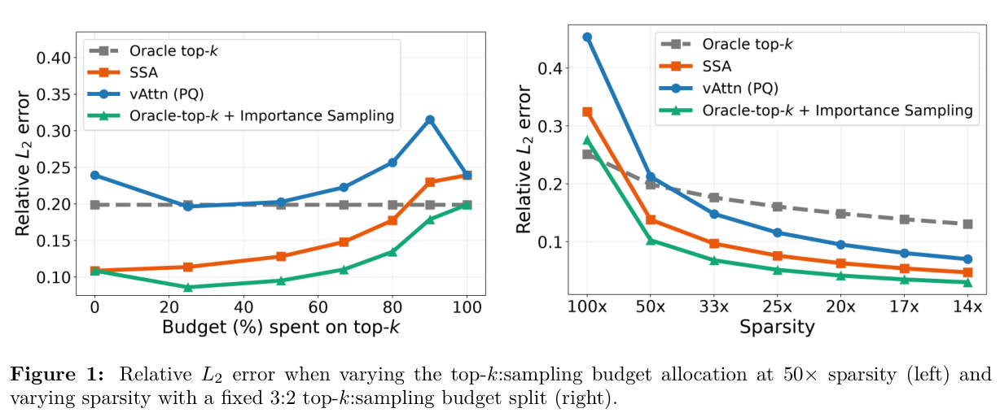

# SSA：按包含概率修正的分层稀疏注意力

## 论文信息

| 字段 | 内容 |
| --- | --- |
| 论文链接 | [arXiv 2610.28441 v1](https://arxiv.org/abs/2610.28441v1)；[固定原文 PDF](https://arxiv.org/pdf/2610.28441v1) |
| 原文标题 | Stratified Sparse Attention: Reducing the Sparse-to-Dense Gap at Extreme Sparsity |
| 公司 / 机构 / 学校 | 一作 Sahil Joshi：Rice University；合作机构含 UC Berkeley、Stanford 和 IIT Bombay。不是 Google/Meta 稿 |
| 首次公开日期 | 2026-10-20 16:02:12 UTC（arXiv v1；10月21日公告） |
| 原作者代码 | 论文声明 [SSA-Paper-Code](https://github.com/skylight-org/SSA-Paper-Code) 开源；2026-10-21访问返回404，未获得可核验代码或 revision，不将声明写成已验证代码 |
| 本地 adapter / 稳定键 | `stratified-sparse-attention`；`adapter: null`，`component_only` |
| 本地复现代码目录 | `src/auto_research/foundation_models/oct21_followup_attention.py`；`scripts/run_oct21_followup_attention.py` |
| 完整实验 | 成本过高，不复现（审查 DONE）；本地仅交付 Algorithm 1 单头公式与梯度诊断 |

## 原始论文总结

### 背景与主要改动

只保留 top-k 会丢掉尾部质量；均匀抽样又浪费预算。SSA先确定保留高概率项，再按残差代理分布抽样。关键不是“top-k加采样”的外形，而是**有放回抽样后去重，按每个token至少出现一次的包含概率修正**。论文的自适应 Algorithm 1 与实际优化内核的固定 heavy fraction 版本不同；本地实现前者，不冒充后者的速度。



<!-- paper-figure:start -->
### 原论文关键图

[](https://arxiv.org/pdf/2610.28441v1#page=2)

**Figure 1，第2页**：比较确定性预算与采样预算的分配以及稀疏程度对误差的影响；曲线为原论文结果，不是本地测量。图片来自[原论文](https://arxiv.org/pdf/2610.28441v1#page=2)，版权归原作者所有；[裁切与校验信息](assets/provenance.json)。
<!-- paper-figure:end -->

### 核心公式

令代理概率 $q_i=\mathrm{softmax}(\tilde s)_i$，解 $\sum_i\min(1,\lambda q_i)=k$。令 $H=\{i:\lambda q_i\ge1\}$、$m=k-|H|$，在残差集合上归一化为 $p$，有放回抽取 $m$ 次后去重得到 $S$。

$$
\pi_i=\begin{cases}1&i\in H\\1-(1-p_i)^m&i\in S\end{cases},\quad
\hat o=\frac{\sum_{i\in H\cup S}\exp(q^\top k_i/\sqrt d)v_i/\pi_i}
{\sum_{i\in H\cup S}\exp(q^\top k_i/\sqrt d)/\pi_i}.
$$

本地使用 `-expm1(m*log1p(-p))` 稳定计算包含概率，并在log空间softmax。由于取比值，这是self-normalized估计，不宣称严格无偏。`k=N`显式返回稠密注意力；非有限输入、非法预算或极端代理softmax下溢明确报错，不偷偷加概率下限改变算法。

### 论文离线与线上效果

原文表1：Ministral-3-8B在128K RULER-HARD、50倍稀疏时，vAttention为63.78、SSA为69.25；优化内核在单H200、1M context测量解码速度。未报告生产线上 A/B。本地不运行这些大模型/长上下文实验，不以小张量误差代替该benchmark。

## 本地复现

`stratified_sparse_attention` 接受单query、keys、values和外部代理分数，真实执行water-filling、离散采样和精确选中项打分。梯度只通过实际选中Q/K/V；代理分配是detached离散步骤。没有声称实现PQCache代理、层级采样或paged KV runtime。

```bash
PYTHONPATH=src python scripts/run_oct21_followup_attention.py \
  --device cpu --seeds 42,43,44 \
  --output runs/oct21-followup-attention-cpu.json
```

runner固定64个key、8维Q/K、6维V、预算16；输入是显式生成向量和带噪代理分数，不是公开模型注意力。记录逐seed误差、选中数量、梯度范数、源码SHA与Git commit。CUDA需显式 `--device cuda`，不可用时报错；GPU证据由实际A100/A30执行后收录，不从CPU推断。

### 验证与边界

测试固定重复抽样，直接验证去重后必须使用包含概率而非 `1/p`；同时覆盖full-budget稠密一致、heavy项概率1、精确公式、Q/K/V梯度、代理无梯度和非法输入。普通PyTorch参考实现含全长概率处理和CPU同步，**不具备原论文kernel加速主张**。

### 成本与未复现范围

论文3B–27B模型矩阵、32K–128K benchmark、32K生成和H200上1M context内核测量超出本轮单卡短时预算。完整实验标注**成本过高，不复现（审查 DONE）**，不下载、不试跑、不自动重试。L1诊断不是正式能力比较，不参与Evolve晋级。
