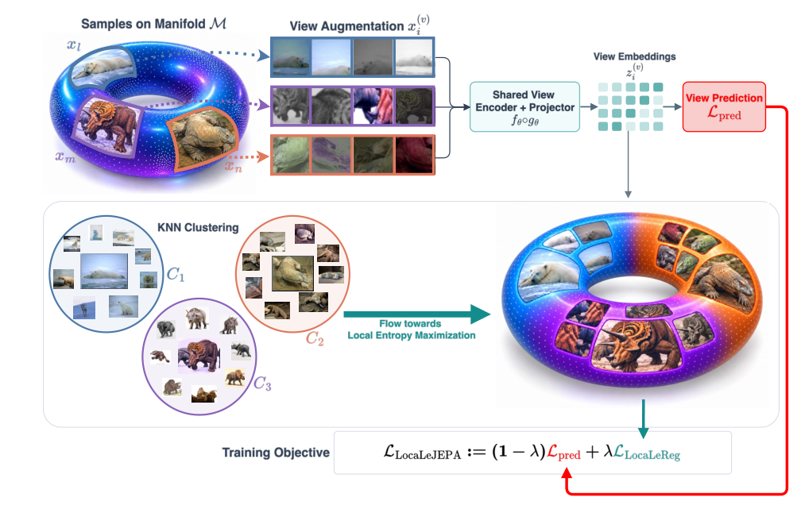

# LocaLeJEPA: Matching a uniform-ball prior within representation clusters

<!-- source-sha256: 21a4dec2a77ba8a17e4c6ce5868741b85c87ecccb5a9f0038d78fe77ccaa1afa -->

[简体中文](README.md)

> **L1 regularizer and gradient mechanism; diagnostic only.** Full visual representation training not reproduced.

## Paper information

| Field | Details |
| --- | --- |
| Paper | [LocaLeJEPA: Maximum Entropy Representations under Geometric Priors](https://arxiv.org/abs/2610.28458v1) |
| Affiliations | Co-first authors Kartik Tandon: University of Pennsylvania; Alessio Borgi: Sapienza University of Rome and University of Cambridge. |
| First public release | 2026-10-20 16:15:06 UTC |
| Author code | [alessioborgi/LocaLeJEPA](https://github.com/alessioborgi/LocaLeJEPA), MIT, formula review at `771361c18d37e65df3dc188761ffb26751ce4e37`. |
| Local key | `locale-jepa`; no adapter |
| Local code | `src/auto_research/foundation_models/locale_jepa.py` |
| Local evidence | [Local mechanism metrics](metrics/component-cuda-seeds42-44.json); [A100 validation receipt](../../gpu-validations/locale-jepa-a100-20261021.json) |

## What the paper changes

A global isotropic Gaussian can be unsuitable for manifold, hyperbolic or equivariant geometry. Cluster detached multiview means with cosine-like k-means, share labels across views and recenter each view within a cluster. Retain clusters of size at least four; if none qualify, use the whole batch and record fallback. Cluster centers need not approach one common origin.

### Original paper figure



The figure labels clustering “KNN,” but the text and source use k-means. See [figure provenance](assets/provenance.json).

### Core equations

$$
r_i^{(v)}=z_i^{(v)}-\mu_q^{(v)},\qquad
\mu_q^{(v)}=|C_q|^{-1}\sum_{j\in C_q}z_j^{(v)}.
$$

$$
D_{q,v}=|C_q|\,\mathbb E_u\int_{\mathbb R}
|\widehat\phi_{q,v,u}(t)-\phi_Y(t)|^2e^{-t^2/2}\,dt,
\qquad \mathcal L_{\mathrm{LocaLeReg}}=
\frac{1}{|Q|V}\sum_{q\in Q}\sum_v D_{q,v}.
$$

$$
\mathcal L=(1-\lambda)\frac{1}{NVd}\sum_{i,v}\|z_i^{(v)}-\bar z_i\|^2
+\lambda\mathcal L_{\mathrm{LocaLeReg}}.
$$

The target is uniform on a ball of radius $\sqrt{d+2}$, giving identity covariance. Compute projected characteristic functions from the ball cross-section; the Gaussian factor is only the integration window. Defaults: 256 directions, 17 nodes, trapezoids on [0,3] doubled by symmetry. Multiply each cluster's statistic by its own size then average clusters/views equally; changing K also changes effective strength.

### Results reported by the authors

Fixed v1 Table 2 Euclidean ViT-S/8 ImageNet-1K linear top-1: LeJEPA 44.6±0.23%, matched optimization 51.6±0.28%, LocaLeJEPA 62.1±0.27% ($\lambda=0.1,K=4$). Upstream README values differ; these are paper results, not local or production A/B.

## Local reproduction and limits

`uniform_ball_cf`, `ballreg_loss`, `torch_kmeans_labels`, `local_ballreg_loss` and `locale_jepa_loss` use pure Torch clustering. Only assignments are detached, not prediction means or residuals. Runner uses 64 width-eight vectors, two views and a small linear projector. Independent sinc, quadrature, translation-after-clustering, detachment, equal cluster reduction and fallback checks; clustering itself is not translation invariant or globally optimal. Record seed/gradient/cluster/source/data/device; no fallback from CUDA or benchmark/Evolve claim.

```bash
PYTHONPATH=src python scripts/run_oct21_locale_jepa.py \
  --device cpu --seeds 42,43,44 --steps 8 \
  --output runs/locale-jepa-cpu.json
```

### Full experiment: not reproduced

ImageNet-1K 100 epochs, Imagenette 800-epoch topology study, eight-GPU ViT-L/14, seven transfer datasets and a probe grid. No weights/data, full run or retry.

### Additional references

[Paper PDF](https://arxiv.org/pdf/2610.28458v1) · [Paper PDF, p. 3](https://arxiv.org/pdf/2610.28458v1#page=3)
