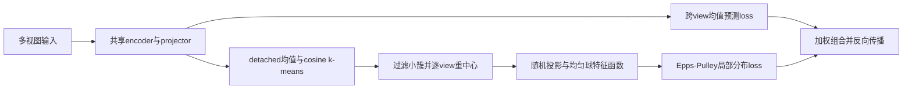
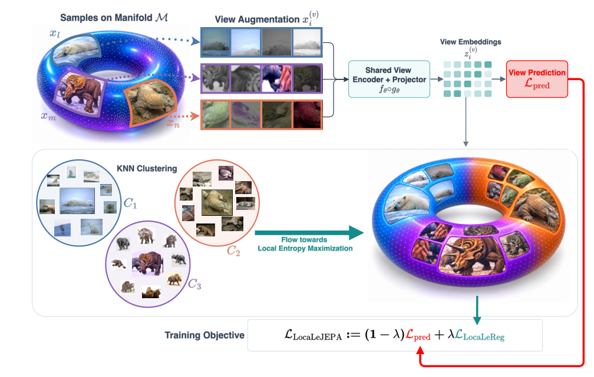

# LocaLeJEPA：局部均匀球分布匹配

## 论文信息

| 字段 | 内容 |
| --- | --- |
| 论文链接 | [arXiv 2610.28458 v1](https://arxiv.org/abs/2610.28458v1)；[固定原文 PDF](https://arxiv.org/pdf/2610.28458v1) |
| 原文标题 | LocaLeJEPA: Maximum Entropy Representations under Geometric Priors |
| 公司 / 机构 / 学校 | 一作 Kartik Tandon：University of Pennsylvania；共同一作 Alessio Borgi：Sapienza University of Rome / University of Cambridge。不是 Meta 机构稿 |
| 首次公开日期 | 2026-10-20 16:15:06 UTC（arXiv v1） |
| 原作者代码 | [官方 MIT 仓库](https://github.com/alessioborgi/LocaLeJEPA)；本地公式核对固定 commit `771361c18d37e65df3dc188761ffb26751ce4e37` |
| 本地 adapter / 稳定键 | `locale-jepa`；`adapter: null`，`component_only` |
| 本地复现代码目录 | `src/auto_research/foundation_models/locale_jepa.py`；`scripts/run_oct21_locale_jepa.py` |
| 完整实验 | 成本过高，不复现（审查 DONE）；本地仅实现核心正则与梯度诊断 |

## 原始论文总结

### 背景与主要改动

LeJEPA 将整体表示推向各向同性高斯；当表示本身具有局部流形、双曲或等变几何时，单一全局分布不一定合适。LocaLeJEPA 不改写为另一种高斯损失，而是将每个 batch 的多视图平均表示分簇，在各簇内分别匹配**均匀球分布**。各簇位置不被拉向共同原点，局部形状通过重中心后的残差约束。



<!-- paper-figure:start -->
### 原论文关键图

[](https://arxiv.org/pdf/2610.28458v1#page=3)

**Figure 2，第3页**：共享编码、多视图预测和局部分布匹配。图中局部分簇标为“KNN Clustering”，正文 §4 与作者代码明确使用 k-means；本地遵循正文算法，不把示意文字当成近邻算法。图片来自[原论文](https://arxiv.org/pdf/2610.28458v1#page=3)，版权归原作者所有；[裁切及校验信息](assets/provenance.json)。
<!-- paper-figure:end -->

### 核心公式

对 $V$ 个视图的投影 $z_i^{(v)}$，令 $\bar z_i=V^{-1}\sum_v z_i^{(v)}$；在 detached $\bar z_i$ 上进行 cosine-like k-means，各视图共享同一分组。只保留样本数至少4的簇；没有有效簇时回退到全 batch，并显式记录 `fallback`。

$$
r_i^{(v)}=z_i^{(v)}-\mu_q^{(v)},\qquad
\mu_q^{(v)}=|C_q|^{-1}\sum_{j\in C_q}z_j^{(v)}.
$$

目标 $Y\sim\mathrm{Unif}(B_R^d)$，$R=\sqrt{d+2}$ 使协方差为 $I$。其一维投影特征函数按球截面密度数值积分计算，不是 $e^{-t^2/2}$；后者仅为 Epps-Pulley 的积分窗口。

$$
D_{q,v}=|C_q|\,\mathbb E_u\int_{\mathbb R}
|\widehat\phi_{q,v,u}(t)-\phi_Y(t)|^2e^{-t^2/2}\,dt,
\qquad \mathcal L_{\mathrm{LocaLeReg}}=
\frac{1}{|Q|V}\sum_{q\in Q}\sum_v D_{q,v}.
$$

$$
\mathcal L=(1-\lambda)\frac{1}{NVd}\sum_{i,v}\|z_i^{(v)}-\bar z_i\|^2
+\lambda\mathcal L_{\mathrm{LocaLeReg}}.
$$

默认保留作者的256个随机方向、17个积分节点、$[0,3]$ 梯形积分及对称区间倍乘。各簇先乘自身样本数再等权平均；改变 $K$ 同时改变有效正则强度，不能误认为只是在改变聚类粒度。

### 论文离线与线上效果

固定 v1 表2：Euclidean ViT-S/8 的 ImageNet-1K linear top-1，LeJEPA 为 $44.6\pm0.23\%$、使用相同优化设置的 LeJEPA 为 $51.6\pm0.28\%$，LocaLeJEPA（$\lambda=0.1,K=4$）为 $62.1\pm0.27\%$。这是原论文报告，不是本地结果；比较须区分优化配方。原仓库 README 的叙述含不同数值，本页采用固定 PDF 的表格，不混合版本。未报告生产线上 A/B。

## 本地复现

已实现 `uniform_ball_cf`、`ballreg_loss`、`torch_kmeans_labels`、`local_ballreg_loss` 和 `locale_jepa_loss`。前向真实计算局部均匀球统计并反向传播至投影；仅分簇赋值 detached，预测均值和重中心残差没有 stop-gradient。采用作者官方 pure-torch k-means 路径，不额外引入聚类依赖。

```bash
PYTHONPATH=src python scripts/run_oct21_locale_jepa.py \
  --device cpu --seeds 42,43,44 --steps 8 \
  --output runs/locale-jepa-cpu.json
```

runner 使用64个8维、2视图的生成向量与小线性 projector，不下载图像或预训练权重。数据摘要、源文件 hash、源 commit、逐 seed 损失/梯度和实际簇数随运行保存；CUDA 不可用时明确失败，不回退 CPU。它验证核心算子可执行，**不是图像表示 benchmark、不是论文效果复现**。3 seed 不改变 L1 诊断资格，无正式 capability comparison、无 Evolve 晋级。

### 验证与边界

独立测试核对一维均匀分布解析 sinc 特征函数、梯形积分、逐view平移下的重中心统计、分簇梯度隔离、equal-cluster 平均、空簇过滤回退及组合 loss。cosine k-means 的分组本身不具有任意平移不变性，且随机初始化不保证得到全局最优聚类，不扩张原论文保证。

### 成本与未复现范围

原文多种 encoder 的 ImageNet-1K 100 epoch 训练、Imagenette 800 epoch 拓扑实验与8卡 ViT-L/14、七数据集迁移及 probe 网格超出本轮单卡短时成本门槛。完整实验标注**成本过高，不复现（审查 DONE）**，不下载、不试跑、不进入自动训练队列。这里只交付可复用正则组件及其真实设备执行证据。
