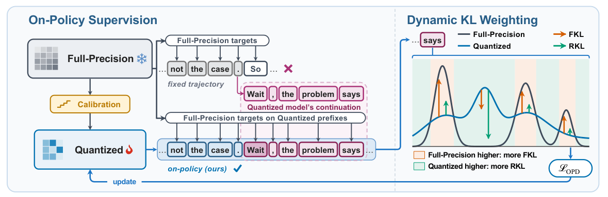

# Right On Q: Recovering Reasoning under Quantization via Self-Generated Trajectories

<!-- source-sha256: 4700e8a3036c7cc85b4b6e1c6abc5a6481d0d0b0a621a5988ffda60adecd6c4e -->

[简体中文](README.md)

> **Reference entry only.** No quantization runtime, distillation, benchmark, metrics or GPU evidence.

## Paper information

| Field | Details |
| --- | --- |
| Paper | [Right On Q: Recovering Reasoning under Quantization via Self-Generated Trajectories](https://arxiv.org/abs/2610.29378v1) |
| Affiliations | First author Boyuan Zheng: University of Michigan, Ann Arbor; Jing Xiong and Zhen Zhang: UC Santa Barbara; Zechun Liu: Meta AI. |
| First public release | 2026-10-21 08:03:24 UTC (announced 2026-10-22) |
| Author code | No verifiable author repository in v1 or arXiv. EvalScope is not this implementation. No software license verified; arXiv distribution terms are separate. |
| Local key | `right-on-q`; no adapter |
| Local code | No executable local implementation. |
| Local evidence | No local experiment, metrics or GPU receipt. |

## What the paper changes

Low-bit quantization changes visited prefixes. Calibrate each quantized block against the full-precision output, then have the quantized student generate and let the frozen BF16 teacher score those same prefixes. A token-specific probability ratio adjusts the balance of forward and reverse KL rather than using one coefficient for a whole response.

### Original paper figure

Original figure from the reviewed paper, reused without redrawing. See [figure provenance](assets/provenance.json).

### Core equations

$$
w_{\rm int}=\operatorname{clamp}(\operatorname{round}(w/s)+z,0,2^N-1),
\qquad \hat w=s(w_{\rm int}-z).
$$

$$
\alpha_v=\operatorname{sg}\left[\frac{p_v}{p_v+q_v}\right],\qquad
D_{\rm dyn}(h)=\sum_v\left[
\alpha_v p_v\log\frac{p_v}{q_v}
+(1-\alpha_v)q_v\log\frac{q_v}{p_v}\right].
$$

Use asymmetric uniform group quantization with latent weights, scales and zero points. Freeze rollouts, teacher targets, mixture weights and zero points during OPD; update latent weights/scales. Appendix A.3 uses the union of teacher/student top-20 with an extra residual-mass bucket, preserving student tail gradients and smoothing teacher categories at $10^{-8}$; this is not truncated renormalization.

### Results reported by the authors

Nine math/code/knowledge/instruction task groups for 2/3-bit Qwen3-1.7B/4B/8B; paper reports 10.26 percentage points over the strongest comparator for 2-bit Qwen3-8B and analyzes truncation/repetition. No production A/B or local measurement.

## Local reproduction and limits

No QAT/OPD, model loading, toy KL substitute or Evolve. A future faithful run would need calibrated initialization, real quantized rollout, frozen same-prefix teacher, detached candidate weights and residual mass.

### Full experiment: not reproduced

Calibration: 4,096 × 2,048-token windows, two epochs/block. OPD: 25,600 prompts; 400 steps for 1.7B, 300 for 4B/8B; 128 one-answer prompts per step at temperature 1. Caps 4,096 for steps 1–50, 8,192 for 51–100 and 16,384 after. H100/H200, verl, vLLM teacher, evaluation up to 32,768 tokens and three main seeds. No total time reported. Full study not reproduced, with no downloads, trials or retries.

### Additional references

[Paper PDF](https://arxiv.org/pdf/2610.29378v1)
